# 第 2 章 现代商用硬件

了解商用硬件非常重要，因为专用硬件正在式微。
如今，水平发展比垂直发展更常见，这意味着使用许多小型且相互连接的商用计算机成本效益更高，而非少数几个巨大且极快 (也非常昂贵) 的系统。
这是因为快速且便宜的网络硬件已经普及，虽然大型专用系统仍在某些情况下占有一席之地，且仍具有商机，但整体市场已被商用硬件市场所主导。
Red Hat 在 2007 年预测，未来大多数数据中心的“标准建构组件”(building block) 将是一台具有最多 4 个插槽 (socket) 的计算机，
每个插槽具备一颗 4 核的处理器，这些处理器 (例如 Intel 公司生产的 CPU) 将使用超线程 ([hyper-threading](https://en.wikipedia.org/wiki/Hyper-threading)，简称 HT) 技术[^1]。
这意味着标准数据中心系统将具有最多 64 个虚拟处理器[^2]。
当然，也可支持更大的机器，但 2007 年原文编写之际，4 个插槽、4 核的处理器会是最适合的配置，且大多数优化都针对这种硬件配置进行。

商用组件所构建的计算机在结构上存在着重大的差异，尽管如此，我们将专注于最重要的差异，以涵盖超过 90％ 的这类硬件。
需要注意的是，这些技术细节日新月异，因此建议读者留意原文编写日期。

过去的数年中，个人计算机和小型服务器已标准化为一个芯片组 (chipset)，并由两个主要组件组成：北桥 (Northbridge) 和南桥 (Southbridge)。
图 2.1 展现这种结构。

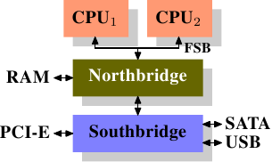

*图 2.1：包含北桥与南桥的结构*

所有 CPU (前例中有两颗，但可有更多) 都通过一条共用的总线，即前端总线 (Front Side Bus，简称 FSB)，连接到北桥。
北桥包含内存控制器 (memory controller)，其实现决定在计算机中使用的 RAM 芯片类型。
不同类型的 RAM，诸如 DRAM、Rambus 和 SDRAM，需要不同的内存控制器。
为与其他系统设备连接，北桥必须与南桥进行通信，其中南桥通常称为 I/O 桥接，借助各种不同的总线与各个设备进行通信。
现今南桥支持 PCI、PCI Express、SATA 和 USB 等最重要的总线，及 PATA、IEEE 1394、序列埠 (serial port) 和并行埠 (parallel port)。
在较老的系统中，北桥附带有 AGP 槽，这是由于南北桥之间的连接速度不够快的性能因素，然而，现代的 PCI-E 槽都连接到南桥上。

这种系统结构具有一些值得注意的结果：

* 从一颗 CPU 到另一颗 CPU 的所有数据通信，都必须经由与北桥通信的同一条总线。
* 所有与 RAM 的通信都必须经由北桥进行。
* RAM 只有单个埠口[^3]。
* 一颗 CPU 与一个依附于南桥的设备之间的通信会经由北桥。

几个瓶颈立刻在这种设计中显现出来，其一涉及设备对 RAM 的访问。
在早期的个人计算机中，所有设备 (无论在南桥还是北桥上) 与 RAM 的通信都必须经过 CPU，这对整体系统性能产生负面影响。
为解决这个问题，一些设备开始支持直接内存访问 (Direct Memory Access，简称 DMA)。DMA 允许设备借助北桥的帮助，
在不需要 CPU 介入 (及相应的性能成本) 的情况下，直接存储和接收 RAM 中的数据。
现今所有连接到总线上的高性能设备都可使用 DMA，尽管这大幅减轻 CPU 的工作负担，但这也引起北桥带宽的竞争，
因为 DMA 请求与 CPU 对 RAM 访问的竞争。因此，这个问题必须纳入考虑。

第二个瓶颈涉及从北桥到 RAM 的总线，其具体细节取决于所使用的内存类型。
在较旧的系统中，只有一条总线连接所有的 RAM 芯片，因此并行访问是不可能的。
近期的内存类型需要两条独立的总线 (或称通道〔channel〕，例如 DDR2 所称之，见图 2.8)，以增加可用的带宽。
北桥交错使用这些通道进行内存访问，更现代的内存技术 (如 FB-DRAM) 则引入更多通道。

由于带宽有限，以最小化延迟的方式安排内存访问对性能至关重要。
如同我们将在后面所见，处理器比内存快得多，且必须等待访问内存，即便使用 CPU 缓存仍是。
如果多个超线程 (HT) 或多个处理器核心同时访问内存，那么内存访问的延迟可能会更长，对于 DMA 操作也是如此。

然而，除了并行性 (concurrency) 之外，访问内存还存在许多问题。访问模式 (access pattern) 本身也会对内存子系统的性能产生显著影响，
尤其是在具有多个内存通道的情况下，在第 2.2 节中，我们将深究 RAM 访问模式的更多细节。

在一些高价的系统中，北桥不含内存控制器，相反地，北桥可连接到多个外部内存控制器 (下例中，共有 4 个控制器)。

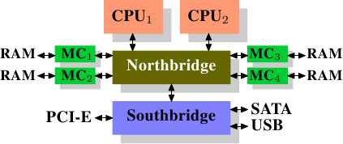

*图 2.2：包含外部控制器的北桥*

该架构的好处是拥有多个内存总线，从而增加整体可用带宽，此设计还支持多个内存模块。
并行内存访问模式借助同时访问不同的记忆库 (memory bank) 来降低延迟，尤其是在多个处理器直接连接到北桥的情况下 (如图 2.2 所示)。
对于这种设计，主要的限制在于北桥的内部带宽，对于这种 (来自 Intel 公司) 的架构而言，该带宽非常大[^4]。

使用多个外部内存控制器并非提高内存带宽的唯一方法，另一种越来越受欢迎的方式是将内存控制器整合到 CPU 中，并将内存附加到每颗 CPU 上。
该架构在基于 AMD 公司的 Opteron 处理器的 SMP 系统中很流行，如图 2.3 所示。
Intel 也从 Nehalem 微处理器架构开始，支持通用系统接口 (Common System Interface，简称 CSI)，基本上也是相同的方法：一个整合式内存控制器，让每个处理器都拥有区域内存 (local memory)。

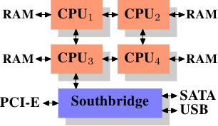

*图 2.3：整合式内存控制器*

采用这种架构，每个处理器都有一个可用的记忆库，例如在一台 4 核 CPU 的机器上，无需复杂的北桥即可将内存带宽提高 4 倍。
整合到 CPU 的内存控制器也具有一些额外的优点，但在此我们不会深究这些技术。

然而，这种架构也有一些缺点。
首先，由于系统上的所有内存都需要供所有处理器访问，内存不再是均匀的 (uniform)，
这种系统称为非均匀内存架构 (Non-Uniform Memory Architecture，简称 NUMA)。
当访问附属于其他处理器的内存时，必须借助处理器之间的交互连接 (interconnect)，
从 CPU1 访问 CPU2 的内存就需要一条交互连接，而从 CPU1 访问 CPU4 的内存则需要两条交互连接。

每次这样的通信都会带来一些成本，我们称之为“NUMA 因子”(NUMA factor)，用于描述访问远程 (remote) 内存所需的额外时间。
在图 2.3 所示的示例架构中，每颗 CPU 都有两个层级：与其邻近的 CPU 和相隔两条交互连接的 CPU，在较复杂的系统中，层级的数量会显著增加。
某些架构 (如 IBM 公司的 x445 和 SGI 公司的 Altix 系列) 具有不止一种连接类型。CPU 被组织成节点，访问同一节点内的内存具有一致或较低的 NUMA 因子。
然而，节点之间的连接成本很高，NUMA 因子也很高。

现在商用的 NUMA 机器已问世，并可能在未来扮演更重要的角色。预计到 2008 年末，每个 SMP 机器都将使用 NUMA[^5]。
当一个程序在 NUMA 机器上运行时，了解 NUMA 相关的成本非常重要。我们将在第五节中讨论更多有关机器架构以及 Linux 核心 (kernel[^6]) 为这些程序提供的技术。

除了本节描述的技术细节外，尚有许多其他影响 RAM 性能的因素无法由软件控制，这也是为何它们不在本节中涵盖。
对于对 RAM 技术希望有更全面理解的读者来说，这些因素有助于在购买计算机时做出更好的选择。

接下来的二节将在逻辑闸 (gate) 层级讨论硬件细节，并介绍内存控制器和 DRAM 芯片之间的通信协议 (protocol)。
对程序员而言，这些信息可能会带来更深入的理解，因为它们解释 RAM 访问的运作原理。
然而，这些都是选读的知识，对于那些更关注与日常生活直接相关的主题的读者来说，可直接跳到第 2.2.5 节。

[^1]: 超线程 (HT) 使得一颗处理器核仅需少量的额外硬件，就能被用来同时处理 2 个或多个任务。
[^3]: 我们不会在本文讨论多埠 RAM，因为这种 RAM 在商用硬件中并不常见，至少不在寻常程序员可访问的范围内。多埠 RAM 主要用于依赖极限速度的专用硬件，例如网络路由器等设备中。
[^4]: 完整起见，这里需要提到一下，这类内存控制器布局可以被用于其他用途，像是“内存 RAID”，它很适合与热插拔（hotplug）内存组合使用。
[^2]: 这句的原文是 "the standard system in the data center will have up to 64 virtual processors"，注意到本文发表的时间点在 2007 年，本句是 Red Hat 公司之前的推论，64 个虚拟处理器核意味着 4 个插槽、HT (即 2 个硬件线程)，和每个 CPU 要有 8 核，不过这样的硬件配置要到 2014 年的 [POWER8](https://en.wikipedia.org/wiki/POWER8) 才出现，后者的每个 CPU 可有 6 或 12 核。原文作者 Ulrich Drepper 编写文章时，任职于 Red Hat 公司，这也是为何文中提及 Red Hat，后来他一度在高盛服务，并于 2017 年回归。
[^5]: 这陈述不成立，如今 SMP 架构广为个人计算机、移动设备，甚至是嵌入式系统所采纳，但 NUMA 仍只在部分 SMP 系统存在。
[^6]: 为了区分 (OS) kernel 和 (processor) core，本文将前者称为“核心”(例如 Linux 核心)，而将后者称为“核”(例如处理器核)。

## 2.1 RAM 类型

这些年来，已经有许多不同种类的 RAM，而每种类型有时会出现非常显著的差异。只有历史学家会对那些较老旧的类型有兴趣。而我们将不会探究它们的细节。我们将会聚焦于现代的 RAM 类型；我们仅会触及其问题的表面，探究系统内核或是应用程序能通过其性能特性看见的一些细节。

第一个有趣的事情是，围绕在同一台机器中会有不同种类的 RAM 的原因。更具体地说，为何既有静态 RAM（Static RAM，SRAM[^1]）又有动态 RAM（Dynamic RAM，DRAM）。前者更加快速，而且提供了相同的功能。为何一台机器里的 RAM 不全是 SRAM？答案是 ── 也许正是你所预期的 ── 成本。生产与使用 SRAM 比起 DRAM 都更加昂贵。这两个成本因素都很重要，而且后者变得越来越重要。为了了解这些差异，我们要稍微研究一下 SRAM 与 DRAM 存储的实现方式。

在本节的其余部分，我们将会讨论到一些 RAM 实现的底层细节。我们将会让细节尽可能地底层。最后，我们将会从“逻辑层级”讨论信号（signal），而非从硬件设计师所需的那种层级。那种细节层级对我们这里的目的来说是不必要的。

[^1]: 根据不同前后文，SRAM 指的可能是“同步（synchronous）RAM”。

### 2.1.1 静态 RAM

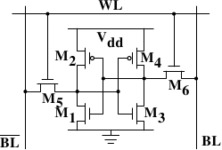

*图 2.4：6-T 静态 RAM*

图 2.4 展示了一组由 6 个晶体管 (transistor) 构成的 SRAM 记忆单元（cell）的结构。这个记忆单元的中心是四个晶体管 $$ \mathbf{M_{1}} $$ 到 $$ \mathbf{M_{4}} $$，其形成两个交叉耦合（cross-coupled）的反相器（inverter）。它们有两个稳定状态，分别表示 0 与 1。只要 $$ \mathbf{V_{dd}} $$ 维持通电，状态就是稳定的。

若是需要访问记忆单元的状态，就提高字访问线路（word access line）$$ \mathbf{WL} $$ 的电位。若是必须复写记忆单元的状态，则要先将 $$ \mathbf{BL} $$ 与 $$ \overline{\mathbf{BL}} $$ 线路设为想要的值，然后再提高 $$ \mathbf{WL} $$ 的电位。由于外部的驱动者（driver）强于四个晶体管（$$ \mathbf{M_{1}} $$ 到 $$ \mathbf{M_{4}} $$），这使得旧的状态得以被覆写。

需要更多记忆单元运作方式的详细描述，请见 [20]。为了接下来的讨论，要注意的重点是

* 一个记忆单元需要六个晶体管。也有四个晶体管的变体，但其有些缺点。
* 维持记忆单元的状态需要持续供电。
* 当提高字访问线路 $$ \mathbf{WL} $$ 的电位时，几乎能立即取得记忆单元的状态。其信号如同其他晶体管控制的信号，是直角的（rectangular）（在两个二元状态间迅速地转变）。
* 记忆单元的状态是稳定的，不需要刷新周期（refresh cycle）。

也有其他可用的 SRAM 形式——较慢且较省电。但因为我们寻求的是更快的 RAM，所以在此我们对它并不感兴趣。这些慢的变种引发关注的主要原因是，它们比起动态 RAM 更容易被用在系统中，因为它们的接口较为简单。

### 2.1.2 动态 RAM

动态 RAM 在其结构上比静态 RAM 简单许多。图 2.5 示意了常见的 DRAM 记忆单元设计结构。它仅由一个晶体管以及一个电容（capacitor）组成。复杂度上的巨大差异，自然意味着其与静态 RAM 的运作方式非常不同。

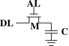

*图 2.5：1-T 动态 RAM*

一个动态 RAM 的记忆单元在电容 $$ \mathbf{C} $$ 中保存其状态。晶体管 $$ \mathbf{M} $$ 用以控制状态的访问。为了读取记忆单元的状态，要提高访问线路 $$ \mathbf{AL} $$ 的电位；这要不使得电流流经数据线路（data line） $$ \mathbf{DL} $$、要不没有，取决于电容中的电量。要写到记忆单元中，则要适当地设置数据线路 $$ \mathbf{DL} $$，然后将 $$ \mathbf{AL} $$ 的电位提高至足够长的时间，以让电容充电或放电。

动态 RAM 有许多设计上的难题。使用电容意味着读取记忆单元时会对电容放电。这件事无法不断重复，必须在某个时间点上对电容重新充电。更糟的是，为了容纳大量的记忆单元（芯片有着 109 或者更多的记忆单元在现今是很普遍的），电容的电量必须很低（在飞〔femto，10-15〕法拉范围内或者更小）。完全充电后的电容容纳了数万个电子。尽管电容的电阻很高（几兆欧姆），耗尽电容仍旧只需要很短的时间。这个问题被称为“漏电（leakage）”。

这种泄漏是 DRAM 必须被持续充电的原因。对于现今大部分 DRAM 芯片，每 64ms 就必须重新充电一次。在重新充电的期间内是无法访问内存的，因为重新充电基本上就是直接丢弃结果的读取操作。对某些工作而言，这个额外成本可能会延误高达 50% 的内存访问（见 [3]）。

第二个——因微小电量而造成——的问题是，从记忆单元读取的信息无法直接使用。数据线路必须被连接到感测放大器（sense amplifier），其能够根据仍需计作 1 的电量范围来分辨存储的 0 或 1。

第三个问题是，从记忆单元进行读取会消耗电容的电量。这代表每次的读取操作都必须接着进行重新对电容充电的操作。这能够通过将感测放大器的输出喂回到电容里头来自动达成。虽然这代表读取内存内容需要额外的电力以及——更为重要地——时间。

第四个问题是，对电容充放电并不是立即完成的。由于感测放大器接收到的信号并不是直角的，因此必须使用一个谨慎的估计，以得知何时可以使用记忆单元的输出。对电容充放电的公式为

$$
\begin{aligned}
Q_{\text{Charge}}(t) &= Q_{0}(1 - e^{-\frac{t}{RC}})
\\
Q_{\text{Discharge}}(t) &= Q_{0} e^{-\frac{t}{RC}}
\end{aligned}
$$

这代表让电容充电或放电需要一些时间（由电量 C 与电阻 R 决定）。这也代表无法立即使用能被感测放大器检测的电流。图 2.6 显示了充电与放电的曲线。X 轴以 RC（电阻乘上电量）为单位，这是一种时间单位。

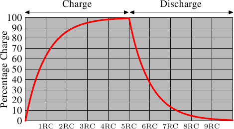

*图 2.6：电容充电与放电时间*

不像静态 RAM 能够在字访问线路的电位提高时立即取得输出结果，它会花费一些时间以让电容被充分放电。这个延迟严重地限制了 DRAM 能够达到的速度。

简单的方法也有其优点。最主要的优点是容量。比起一个 SRAM 的记忆单元，一个 DRAM 的记忆单元所需的芯片面积要小好几倍。SRAM 记忆单元也需要个别的电力来维持晶体管的状态。DRAM 记忆单元的结构也较为简单，这代表能较轻易地将许多记忆单元紧密地塞在一起。

总体来说，赢在（极为戏剧性的）成本差异。除了在专门的硬件——举例来说，网络路由器——之外，我们必须采用基于 DRAM 的主存。这对程序员有着巨大的影响，我们将会在本文的其余部分讨论它们。但首先，我们需要先多理解一些实际使用 DRAM 记忆单元的细节。

### 2.1.3 DRAM 访问

一个程序使用虚拟地址（virtual address）来选择内存位置。处理器将其转换（translate）成物理地址（physical address），最终由内存控制器选择对应于这个地址的 RAM 芯片。为了选择 RAM 芯片中的个别记忆单元，物理地址的一部分会以数条地址线（address line）的形式被传递进去。

由内存控制器个别寻址（address）内存位置是极为不切实际的：4GB 的 RAM 会需要 232 条地址线。作为替代，地址会使用较小的一组地址线，编码成二进制数值传递。以这种方式传递到 DRAM 芯片的地址必须先被解多任务（demultiplex）。有 $$ N $$ 条地址线的解多路复用器（demultiplexer）将会有 2$$ N $$ 条输出线（output line）。这些输出线能被用以选择记忆单元。对于小容量的芯片而言，使用这种直接的方法是没什么大问题的。

但假如记忆单元的数量增加，这个方法就不再合适。一个 1Gbit[^1] 容量的芯片将会需要 30 条地址线以及 230 选择线（select line）。在不牺牲速度的前提下，解多路复用器的容量会随着输入线（input line）的数量以指数成长。用于 30 条地址线的解多路复用器需要大量的芯片空间，外加解多路复用器的（尺寸与时间）复杂度。更重要的是，同时在地址线上传输 30 个脉冲（impulse）比“只”传输 15 个脉冲还要难得多。只有少数的地址线能够以长度完全相同或适当安排时间的方式排版。[^2]

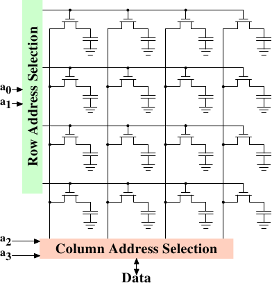

*图 2.7：动态 RAM 示意图*

图 2.7 显示了以极高层角度示意的 DRAM 芯片。DRAM 记忆单元被组织在列（row）与行（column）中。虽然它们可以全都排成一列，但 DRAM 芯片会因而需要一个庞大的解多路复用器。借助数组（array）的方式，便能够以各为一半容量的一个解多路复用器与一个多路复用器达到这种目的。[^3]这从各方面来说都是个大大的节约。在这个例子中，地址线 $$ \mathbf{a_{0}} $$ 与 $$ \mathbf{a_{1}} $$ 通过*列地址选择（row address selection）*（$$ \overline{\text{RAS}} $$）[^4]解多路复用器选择一整列记忆单元的地址线。在读取时，所有记忆单元的内容都能够被*行地址选择（column address selection）*多路复用器（multiplexer）（$$ \overline{\text{CAS}} $$）取得。基于地址线 $$ \mathbf{a_{2}} $$ 与 $$ \mathbf{a_{3}} $$，其中一行的内容便能够提供给 DRAM 芯片的数据针脚（pin）。这会在许多 DRAM 芯片上并行地发生多次，以产生对应于数据总线宽度的所有位。

对于写入操作，新的记忆单元的值会被置于数据总线中，然后 ── 当记忆单元借助 $$ \overline{\text{RAS}} $$ 与 $$ \overline{\text{CAS}} $$ 选取时 ── 存储到数据单元中。相当直观的设计。这实际上有着显然地更多的困难。需要规范发出信号之后，在数据能够由数据总线读取之前有多少延迟。如同上节所述，电容无法立即充放电。来自于记忆单元的信号太微弱了，以致于它非得被放大（amplify）不可。对于写入操作，必须指定设置完 $$ \overline{\text{RAS}} $$ 与 $$ \overline{\text{CAS}} $$ 之后，数据必须在总线维持多久，才能够成功地在记忆单元中存储新值（再提醒一次，电容不会立即被充放电）。这些时间常数（constant）对于 DRAM 芯片的性能而言是至关重要的。我们将会在下一节讨论这些。

一个次要的可扩展性问题是，令 30 条地址线都连接到每个 RAM 芯片也不大可行。一个芯片的针脚是个宝贵的资源。必须尽可能多地并行传输数据（像是一次 64 位）已经够“糟”。内存控制器必须能够寻址每个 RAM 模块（module）（RAM 芯片的集合）。假如因为性能因素，需要并行访问多个 RAM 模块，并且每个 RAM 模块需要它所拥有的一组 30 条或者更多条地址线，那么仅为了处理地址，以 8 个 RAM 模块而言，内存控制器就必须要有多达 240+ 根针脚。

为了克服这些次要的可扩展性问题，DRAM 芯片长期以来必须自行多任务地址。这代表地址会被转变成两个部分。由地址位（图 2.7 的例子中的 $$ \mathbf{a_{0}} $$ 与 $$ \mathbf{a_{1}} $$）组成的第一个部分选取列。这个选择直到撤销之前都会维持有效。接着第二个部分，地址位 $$ \mathbf{a_{2}} $$ 与 $$ \mathbf{a_{3}} $$，选取行。决定性的差异在于，只需要两条外部的地址线。[^5]需要额外一些少量的线路来代表能否取得 $$ \overline{\text{RAS}} $$ 与 $$ \overline{\text{CAS}} $$ 的线路，但这对于减半地址线来说，这只是个很小的代价。不过，这种地址多任务带来了一些自身的问题。我们将会在 2.2 节讨论这些问题。

[^1]: 我厌恶这些 [SI 前缀（prefix）](https://www.nist.gov/pml/weights-and-measures/metric-si-prefixes)。对我来说一个 giga-bit 永远是 230 而非 109 位。

[^2]: 现代 DRAM 类型（如 DDR3）可以自动调整时序，但可以容忍的范围有限。

[^3]: 多路复用器与解多路复用器是对等的，并且这里的多路复用器在写入时需要如解多路复用器一般运作。所以从现在开始我们要忽略其差异。

[^4]: 名字上的线表示信号是反相的（negated）。

[^5]: 这里的意思单看字面可能比较难理解。以图 2.7 为例，内存由 4 × 4 的记忆单元组成。对外仅提供两条地址线。在选择记忆单元时，首先由两条外部地址线指定列，并将结果临时起来。接着，再利用同样的两条外部地址线指定行。便能够只用两条外部地址线来指定 16 个记忆单元中的一个。详见 2.2 节。

### 2.1.4 结论

若是本节中的细节稍微令人喘不过气，别担心。要从本节得到的重点为：

* 有着为何不是所有内存都为 SRAM 的理由
* 记忆单元需要被个别选取使用
* 地址线的数量直接反映内存控制器、主板（motherboard）、DRAM 模块、与 DRAM 芯片的成本
* 在读取或写入操作的结果有效之前得花上一段时间

接下来的章节将会深入更多访问 DRAM 内存的实际过程的细节。我们不会深入访问 SRAM 的细节，它通常是直接寻址的。这是基于速度考量，并且因为 SRAM 内存受限于其容量。SRAM 目前被用于 CPU 缓存并内建于芯片上（on-die），其连接较少、并且完全在 CPU 设计者的控制中。CPU 缓存是我们将会在之后谈及的主题，但我们所需知道的是，SRAM 记忆单元有着确切的最大速度，这取决于在 SRAM 上所花的努力。速度可以从略微慢于 CPU 核到慢于一或两个数量级。

## 2.2 DRAM 访问技术细节

在介绍 DRAM 的章节中，我们看到为了节省地址针脚，DRAM 芯片多任务了地址。我们也看到因为记忆单元中的电容无法立即放电以产生稳定的信号，访问 DRAM 记忆单元会花点时间；我们也看到 DRAM 记忆单元必须被重新充电。现在，是时候将这全都摆在一起，看看这些因子是如何决定 DRAM 访问是怎么运作的。

我们将会聚焦于目前的技术上；我们不会讨论非同步（asynchronous）DRAM 及其变种，因为它们完全与此无关。对这个主题感兴趣的读者请参见 [3] 与 [19]。我们也不会谈及 Rambus DRAM（RDRAM），纵使这项技术并不过时。只是它并没有被广泛使用于系统内存中。我们仅会聚焦于同步 DRAM（Synchronous DRAM，SDRAM）与其后继者双倍数据传输速率 DRAM（Double Data Rate DRAM，DDR）。

同步 DRAM，如同名称所暗示的，其运作与一种时间源（time source）有关。内存控制器提供一个时钟（clock），其频率决定前端总线（FSB）── DRAM 芯片使用的内存控制器接口 ── 的速度。在编写此文时，频率可达 800MHz、1,066MHz、甚至到 1,333MHz，并宣称在下个世代会达到更高的频率（1,600MHz）。这不代表用于总线的频率真的这么高。而是现今的总线都是二或四倍频（double- or quad-pumped），代表数据在每个周期传输二或四次。数字越高、卖得越好，因此厂商惯于将四倍频 200MHz 总线宣传成“实质上的（effective）”800MHz 总线。

对于现今的 SDRAM 来说，每次数据传输以 64 位 (即 8 字节) 组成。FSB 的传输率因此为 8 字节乘上实际的总线频率（以四倍频 200MHz 总线来说，6.4GB/s）。这听起来很多，但这是尖峰速度 ── 永远无法超越的最大速度。如同我们将会看到的，现今与 RAM 模块沟通的协议中有许多的闲置期（downtime），这时是没有数据可以被传输的。这个闲置期正是我们必须了解、并减到最小，以达到最佳性能的东西。

### 2.2.1 读取协议

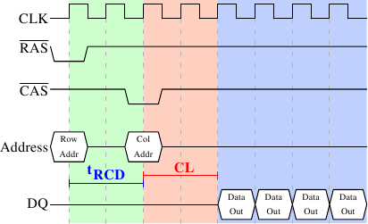

*图 2.8：SDRAM 读取时序*

图 2.8 显示 DRAM 模块上一些连接的活动，发生在三个标上不同颜色的阶段。像往常一样，时间从左到右流动。许多细节被省略。这里我们仅讨论总线时钟、$$ \overline{\text{RAS}} $$ 与 $$ \overline{\text{CAS}} $$ 信号、以及地址与数据总线。读取周期从内存控制器在地址总线提供列地址、并降低 $$ \overline{\text{RAS}} $$ 信号的电位开始。所有信号都会在时钟（CLK）的上升边沿（rising edge）被读取，因此若是信号并不是完全的方波也无所谓，只要在读取的这个时间点是稳定的就行。设置列地址会使得 RAM 芯片锁上（latch）指定的列。

经过 tRCD（$$ \overline{\text{RAS}} $$ 至 $$ \overline{\text{CAS}} $$ 的延迟）个时钟周期之后，便能发出 $$ \overline{\text{CAS}} $$ 信号。这时行地址便能借助地址总线提供、以及降低 $$ \overline{\text{CAS}} $$ 线路的电位来传输。这里我们可以看到，地址的两个部分（约莫是对半分，其余的情况并不合理）是如何通过同样的地址总线来传输。

现在寻址已经完成，可以传输数据。为此 RAM 芯片需要一点时间准备。这个延迟通常被称作 $$ \overline{\text{CAS}} $$ 延迟（$$ \overline{\text{CAS}} $$ Latency，CL）。在图 2.8 中，$$ \overline{\text{CAS}} $$ 延迟为 2。这个值可高可低，取决于内存控制器、主板、以及 DRAM 模块的质量。延迟也可以是半周期。以 CL=2.5 而言，数据将能够在蓝色区块的第一个*下降*边沿时取得。

对于取得数据的这些准备工作而言，仅传输一个字的数据是很浪费的。这即是为何 DRAM 模块允许内存控制器指定要传输多少数据。通常选择在 2、4、或 8 字之间。这便能在不提供新的 $$ \overline{\text{RAS}} $$／$$ \overline{\text{CAS}} $$ 序列的情况下填满缓存中的整行（line）。内存控制器也能够在不重设列的选取的情况下发出新的 $$ \overline{\text{CAS}} $$ 信号。借助这种方式，能够非常快速地读取或写入连续的内存地址，因为不必发出 $$ \overline{\text{RAS}} $$ 信号，也不必将列无效化（deactivate）（见后文）。内存控制器必须决定是否让列保持“开启（open）”。一直任其开启，对实际的应用程序来说有些负面影响（见 [3]）。发出新的 $$ \overline{\text{CAS}} $$ 信号仅受 RAM 模块的命令速率（command rate）控制（通常设为 T*x*，其中 *x* 为像是 1 或 2 的值；每个周期都接受命令的高性能 DRAM 模块会设为 1）。

在这个例子中，SDRAM 在每个周期吐出一个字。第一世代就是这么做的。DDR 能够在每个周期传输两个字。这减少传输时间，但没有改变延迟。虽然在实践上看起来不同，但原理上 DDR2 运作如斯。这里没有再深入细节的必要。能够注意到 DDR2 可以变得更快、更便宜、更可靠、并且更省电（更多信息见 [6]）就够。

### 2.2.2 预充电与激活

图 2.8 未涵盖整个周期。它只显示出访问 DRAM 的完整循环的一部分。在能够发送新的 $$ \overline{\text{RAS}} $$ 信号之前，必须无效化（deactivate）目前锁上的列，并对新的列预充电（precharge）。这里我们仅聚焦在借助明确命令来执行的情况。有些协议上的改进 ── 在某些情况下 ── 能够避免这个额外步骤。不过由预充电引入的延迟仍然会影响操作。

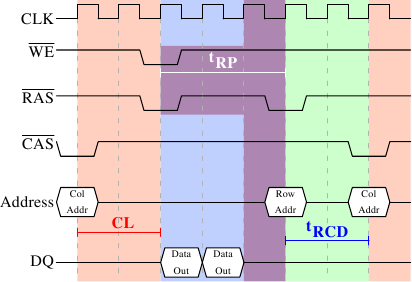

*图 2.9：SDRAM 预充电与激活*

图 2.9 示意从 $$ \overline{\text{CAS}} $$ 信号开始、到另一列的 $$ \overline{\text{CAS}} $$ 信号为止的活动。与先前一样，经过 CL 周期后，便能够取得以第一个 $$ \overline{\text{CAS}} $$ 信号请求的数据。在这个例子中，请求两个字，其 ── 在一个简易的 SDRAM 上 ── 花了两个周期来传输。也可以想像成是在一张 DDR 芯片上传输四个字。

即使在命令速率为 1 的 DRAM 模块上，也无法立即发出预充电命令。它必须等待与传输数据一样长的时间。在这个例子中，它花了两个循环。虽然与 CL 相同，但这只是巧合。预充电信号没有专用的线路；有些实现是借助同时降低允写（Write Enable，$$ \overline{\text{WE}} $$）与 $$ \overline{\text{RAS}} $$ 的电位来发出这个命令。这个组合本身没什么特别意义（编码细节见 [18]）。

一旦发出预充电命令，它会花费 tRP（列预充电时间）个周期，直到列能被选取为止。在图 2.9 中，大部分的时间（以紫色标示）与内存传输时间（浅蓝）重叠。这满好的！但 tRP 比传输时间还长，所以下一个 $$ \overline{\text{RAS}} $$ 信号会被延误一个周期。

假使我们延伸图表的时间轴，我们会发现下一次数据传输发生在前一次停止的 5 个周期之后。这表示在七个周期中，只有两个周期有用到数据总线。将这乘上 FSB 的速度，对 800MHz 总线而言，理论上的 6.4GB/s 就变成 1.8GB/s。这太糟，而且必须避免。在第六节描述的技术能帮忙提升这个数字。程序员通常也得尽一份力。

对于 SDRAM 模块，还有一些没有讨论过的时间值。在图 2.9 中，预充电命令受限于数据传输时间。另一个限制是，在 $$ \overline{\text{RAS}} $$ 信号之后，SDRAM 模块需要一些时间才能够为另一列预充电（记作 tRAS）。这个数字通常非常大，为 tRP 值的二到三倍。假如 ── 在 $$ \overline{\text{RAS}} $$ 信号之后 ── 只有一个 $$ \overline{\text{CAS}} $$ 信号，并且数据传输在少数几个周期内就完成，这就是问题。假设在图 2.9 中，起始的 $$ \overline{\text{CAS}} $$ 信号是直接接在 $$ \overline{\text{RAS}} $$ 信号之后，并且 tRAS 为 8 个周期。预充电命令就必须要延迟一个额外的周期，因为 tRCD、CL、与 tRP（因为它比数据传输时间还长）的总和只有 7 个周期。

DDR 模块经常以一种特殊的标记法描述：w-x-y-z-T。举例来说：2-3-2-8-T1。这代表：

<table>
  <tr>
    <td>w</td>
    <td>2</td>
    <td>$$ \overline{\text{CAS}} $$ 延迟（CL）</td>
  </tr>
  <tr>
    <td>x</td>
    <td>3</td>
    <td>$$ \overline{\text{RAS}} $$ 至 $$ \overline{\text{CAS}} $$ 延迟（tRCD）</td>
  </tr>
  <tr>
    <td>y</td>
    <td>2</td>
    <td>$$ \overline{\text{RAS}} $$ 预充电（tRP）</td>
  </tr>
  <tr>
    <td>z</td>
    <td>8</td>
    <td>激活至预充电延迟（tRAS）</td>
  </tr>
  <tr>
    <td>T</td>
    <td>T1</td>
    <td>命令速率</td>
  </tr>
<table>

还有许多其他会影响命令的发送或处理方式的时间常数。不过在实践上，这五个常数就足以判定模块的性能。

知道这些关于计算机的信息，有时有助于解释某些测量结果。购买计算机的时候，知道这些细节显然是有用的，因为它们 ── 以及 FSB 与 SDRAM 模块的速度 ── 是决定一台计算机速度的最重要因素。

非常大胆的读者也可以试着调校（tweak）系统。有时候 BIOS 允许修改某些或者全部的值。SDRAM 模块拥有能够设定这些值的可程序化寄存器（register）。通常 BIOS 会挑选最佳的默认值。如果 RAM 模块的质量很好，可能可以在不影响计算机稳定性的前提下降低某些延迟。网络上众多的超频网站提供大量的相关文件。尽管如此，请自行承担风险，可别说你没被警告过。

### 2.2.3 刷新

谈及 DRAM 访问时，一个最常被忽略的主题是刷新（recharging）。如同 2.1.2 节所述，DRAM 记忆单元必须被持续地重新充电。对于系统的其余部分来说，这并不那么容易察觉。在对列[^1]重新充电的时候，是不能对它访问的。在 [3] 的研究中发现“*出乎意料地，DRAM 刷新的安排可能大大地影响性能*”。

根据 JEDEC（联合电子设备工程委员会，Joint Electron Device Engineering Council）规范，每个 DRAM 记忆单元每隔 64ms 都必须重新充电。假如一个 DRAM 数组有 8,192 列，这代表内存控制器平均每 7.8125μs 都得发出刷新命令（刷新命令能够伫列等待〔queue〕，因此在实践上，两次请求间的最大间隔能更长一些）。为刷新命令调度是内存控制器的职责。DRAM 模块纪录最后一次刷新的列的地址，并且自动为新的请求增加地址计数器。

关于刷新与发出命令的时间点，程序员能做的真的不多。但在解释测量结果时，务必将 DRAM 生命周期的这个部分记在心上。假如必须从正在被重新充电的列中取得一个关键的字，处理器会被延误很长一段时间。重新充电要花多久则视 DRAM 模块而定。

[^1]: 不管 [3] 与其他文献怎么说，列都是刷新的单位（见 [18]）。

### 2.2.4 内存类型

值得花点时间来看看目前以及即将到来的内存类型。我们将从 SDR（单倍数据传输速率，Single Data Rate）SDRAM 开始，因为它们是 DDR（双倍数据传输速率，Double Data Rate）SDRAM 的基础。SDR 十分简单。记忆单元与数据传输速率是一致的。

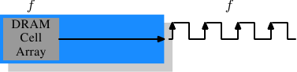

*图 2.10：SDR SDRAM 的运作*

在图 2.10 中，记忆单元数组能够以等同于经由内存总线传输的速率输出内存内容。假如 DRAM 记忆单元数组能够以 100MHz 运作，单一记忆单元的总线的数据传输率便为 100Mb/s。所有组件的频率 $$ f $$ 都是一样的。由于耗能会随着频率增加而增加，因此提升 DRAM 芯片的吞吐量（throughput）的代价很高。由于使用大量的数组单元，代价高得吓人。[^1]实际上，提升频率通常也需要提升电压，以维持系统的稳定性，这更是一个问题。DDR SDRAM（追溯地称为 DDR1）设法在不提高任何相关频率的情况下提升吞吐量。

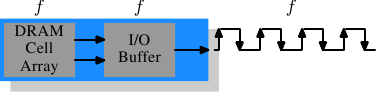

*图 2.11：DDR1 SDRAM 的运作*

SDR 与 DDR1 之间的差异是 ── 如同在图 2.11 所见、以及从它们名称来猜测的 ── 每个周期传输两倍的数据量。也就是说，DDR1 芯片会在上升*与*下降边沿传输数据。这有时被称作一条“两倍频（double-pumped）”总线。为了不提升记忆单元数组的频率，必须引入一个缓冲区（buffer）。这个缓冲区会持有每条数据线的两个位。这转而要求令 ── 图 2.7 的记忆单元数组中的 ── 数据总线由两条线路组成。实现的方式很直观：只要对两个 DRAM 记忆单元使用相同的行地址，并且并行访问它们就行。这个实现对记忆单元数组的改变也非常小。

SDR DRAM 直接采用其频率来命名（例如 PC100 代表 100MHz SDR）。由于 DDR1 DRAM 的频率不会改变，厂商必须想出新的命名方式，让它听起来更厉害。他们提出的名字包含一个 DDR 模块（拥有 64 位总线）能够维持、以字节为单位的传输速率：

$$
100\text{MHz} \times 64\text{bit} \times 2 = 1,600\text{MB/s}
$$

于是一个频率为 100MHz 的 DDR 模块就称为 PC1600。因为 1600 > 100，满足一切销售需求；这听起来更棒，纵使实际上*只*提升成两倍而已。[^2]

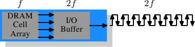

*图 2.12：DDR2 SDRAM 的运作*

为了突破这些内存技术，DDR2 包含少许额外的革新。能从图 2.12 上看到的最明显的改变是，总线的频率加倍。频率加倍意味着带宽加倍。由于频率加倍对记忆单元数组来说并不经济，因此现在需要由 I/O 缓冲区在每个时钟周期读取四个位，然后才送到总线上。这代表 DDR2 模块的改变是，只让 DIMM 的 I/O 缓冲区组件拥有能以更快速度运转的能力。这当然是可能的，而且不需太多能量，因为这只是个小组件，而非整个模块。厂商为 DDR2 想出的名称与 DDR1 的名称相似，只是在计算值的时候，乘以二变成乘以四（我们现在有条四倍频〔quad-pumped〕总线）。表 2.1 显示现今使用的模块名称。

<table>
    <tr>
      <th>数组频率</th>
      <th>总线频率</th>
      <th>数据速率</th>
      <th>名称（速率）</th>
      <th>名称（FSB）</th>
    </tr>
    <tr>
      <td>133MHz</td>
      <td>266MHz</td>
      <td>4,256MB/s</td>
      <td>PC2-4200</td>
      <td>DDR2-533</td>
    </tr>
    <tr>
      <td>166MHz</td>
      <td>333MHz</td>
      <td>5,312MB/s</td>
      <td>PC2-5300</td>
      <td>DDR2-667</td>
    </tr>
    <tr>
      <td>200MHz</td>
      <td>400MHz</td>
      <td>6,400MB/s</td>
      <td>PC2-6400</td>
      <td>DDR2-800</td>
    </tr>
    <tr>
      <td>250MHz</td>
      <td>500MHz</td>
      <td>8,000MB/s</td>
      <td>PC2-8000</td>
      <td>DDR2-1000</td>
    </tr>
    <tr>
      <td>266MHz</td>
      <td>533MHz</td>
      <td>8,512MB/s</td>
      <td>PC2-8500</td>
      <td>DDR2-1066</td>
    </tr>
  </table>

*表 2.1：DDR2 模块名称*

命名上还有个别扭之处。用于 CPU、主板、以及 DRAM 模块的 FSB 速度是使用*实质上的*频率来指定的。也就是将时钟周期的两个边沿都纳入传输的因素，从而浮夸数字。因此，一个拥有 266MHz 总线的 133MHz 模块，它的 FSB“频率”为 533MHz。

沿着转变到 DDR2 的路线，DDR3（真正的 DDR3，而非用于显卡中的假 GDDR3）的规范寻求更多的改变。电压从 DDR2 的 1.8V 降至 DDR3 的 1.5V。由于功率消耗公式是使用电压的平方来算的，因此光这点就改善 30%。加上晶粒（die）尺寸的缩小以及其他电气相关的改进，DDR3 能够在相同的频率下降低一半的功率消耗。或者，在相同功率包络（envelope）的情况下达到更高的频率。又或者，在维持相同热能排放量的情况下加倍容量。

DDR3 模块的记忆单元数组会以外部总线的四分之一速度运转，其需要将 DDR2 的 4 位 I/O 缓冲区加大到 8 位。示意图见图 2.13。

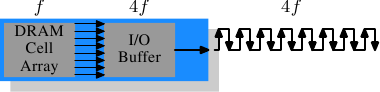

*图 2.13：DDR3 SDRAM 的运作*

起初，DDR3 模块的 $$ \overline{\text{CAS}} $$ 延迟可能会略高一些，因为 DDR2 技术更为成熟。这会导致 DDR3 只有在频率高于 DDR2 能达到的频率时才有用，且更甚的是通常只有在带宽比延迟更加重要的时候才有用。已有达到与 DDR2 相同 $$ \overline{\text{CAS}} $$ 延迟的 1.3V 模块的风声。无论如何，因更快的总线而达到更高速度的可能性将会比增加的延迟更重要。

一个 DDR3 的可能问题是，对于 1,600Mb/s 或更高的传输率，每个通道的模块数量可能会减至仅剩一个。在早期的版本中，对于任何频率都有这个要求，所以可以期待在某个时间点，这项要求会被剔除。否则会严重地限制系统的能力。

表 2.2 列出我们很可能会看到的 DDR3 模块名称。JEDEC 到目前为止接受前四种。鉴于 Intel 的 45nm 处理器拥有速度为 1,600Mb/s 的 FSB，1,866Mb/s 便为超频市场所需。随着 DDR3 的发展，我们大概会看到更多的类型。

<table>
    <tr>
      <th>数组频率</th>
      <th>总线频率</th>
      <th>数据速率</th>
      <th>名称（速率）</th>
      <th>名称（FSB）</th>
    </tr>
    <tr>
      <td>100MHz</td>
      <td>400MHz</td>
      <td>6,400MB/s</td>
      <td>PC3-6400</td>
      <td>DDR3-800</td>
    </tr>
    <tr>
      <td>133MHz</td>
      <td>533MHz</td>
      <td>8,512MB/s</td>
      <td>PC3-8500</td>
      <td>DDR3-1066</td>
    </tr>
    <tr>
      <td>166MHz</td>
      <td>667MHz</td>
      <td>10,667MB/s</td>
      <td>PC3-10667</td>
      <td>DDR3-1333</td>
    </tr>
    <tr>
      <td>200MHz</td>
      <td>800MHz</td>
      <td>12,800MB/s</td>
      <td>PC3-12800</td>
      <td>DDR3-1600</td>
    </tr>
    <tr>
      <td>233MHz</td>
      <td>933MHz</td>
      <td>14,933MB/s</td>
      <td>PC3-14900</td>
      <td>DDR3-1866</td>
    </tr>
  </table>

*表 2.2：DDR3 模块名称*

所有的 DDR 内存都有个问题：总线频率的提升，会使得建立并行数据总线变得困难。DDR2 模块有 240 根针脚。必须要规划所有连接到数据与地址针脚的布线，以让它们有大略相同的长度。还有个问题是，假如多过一个 DDR 模块被菊花连接（daisy-chain）在同一条总线上，对于每个附加的模块而言，信号会变得越来越歪曲。DDR2 规范只允许在每个总线（亦称作通道）上有两个模块，DDR3 规范在高频时只能有一个。由于每个通道有 240 根针脚，使得单一北桥无法合理地驱动多于两个通道。替代方式是拥有外部的内存控制器（如图 2.2），但这代价不小。

这所代表的是，商用主板受限于至多持有四个 DDR2 或 DDR3 模块。这大大地限制一个系统能够拥有的内存总量。即使是老旧的 32 位 IA-32 处理器都能拥有 64GB 的 RAM，即使对于家用，内存需求也在持续增长，所以必须做点什么。

一个解决办法是将内存控制器加到每个处理器中，如同第二节所述。AMD 的 Opteron 系列就是这么做的，Intel 也将以他们的 CSI 技术来达成。只要处理器所能使用的、适当的内存容量都能被连接到单一处理器上，这会有所帮助。在某些情况下并非如此，这个设置会引入 NUMA 架构，伴随着其负面影响。对某些情况来说，则需要另外的解法。

Intel 针对大型服务器机器的解法 ── 至少在现在 ── 被称为全缓冲 DRAM （Fully Buffered DRAM，FB-DRAM）。FB-DRAM 模块使用与现今 DDR2 模块相同的内存芯片，这使得它的生产相对便宜。差异在连接到内存控制器的连接中。FB-DRAM 使用的并非并行数据总线，而是一条序列总线（也能追溯 Rambus DRAM、PATA 的后继者 SATA 以及 PCI/AGP 的后继者 PCI Express）。序列总线能以极高频驱动、恢复序列化的负面影响，甚至提升带宽。使用序列总线的主要影响为

1. 每个通道能使用更多模块。
2. 每个北桥／内存控制器能使用更多通道。
3. 序列总线是被设计成全双工的（fully-duplex）（两条线）。
4. 实现一条差动（differential）总线（每个方向两条线）足够便宜，因而能提高速度。

相比于 DDR2 的 240 根针脚，一个 FB-DRAM 模块只有 69 根针脚。由于能较为妥善地处理总线的电气影响，菊花连接 FB-DRAM 模块要简单许多。FB-DRAM 规范允许每通道至多 8 个 DRAM 模块。

以双通道北桥的连接需求来比较，现在可能以更少的针脚来驱动 FB-DRAM 的六个通道：2 × 240 根针脚对比于 6 × 69 根针脚。每个通道的布线更为简单，这也有助于降低主板的成本。

对于传统 DRAM 模块来说，全双工并行总线贵得吓人，因为要将所有线路变为两倍的成本高昂。使用序列线路（即使是如 FB-DRAM 所需的差动式）情况就不同，序列总线因而被设计为全双工，意味着在某些情况下，理论上光是如此带宽就能加倍。但这并非唯一使用并行化来提升带宽之处。由于一个 FB-DRAM 控制器能够同时连接多达六个通道，即使对于较小 RAM 容量的系统，使用 FB-DRAM 也能够提升带宽。在具有四个模块的 DDR2 系统拥有两个通道的情况下，相同的能力得以使用一个普通的 FB-DRAM 控制器，经由四个通道来达成。序列总线的实际带宽取决于用在 FB-DRAM 模块的 DDR2（或 DDR3） 芯片类型。

我们能像这样总结优点：

 | DDR2 | FB-DRAM——- |——- |——-
针脚数 | 240 | 69
通道数 | 2 | 6
DIMM 数／通道数 | 2 | 8
最大内存[^3] | 16GB[^4] | 192GB
吞吐量[^5] | ~10GB/s | ~40GB/s

如果要在一个通道上使用多个 DIMM，FB-DRAM 有几个缺点。在连接的每个 DIMM 上，信号会被延迟 ── 尽管很小，因而增加延迟。第二个问题是，由于非常高的频率和驱动总线的需求，芯片驱动序列总线需要大量的能量。但有着同样频率、同样内存容量的 FB-DRAM 总是比 DDR2 与 DDR3 还快，至多四个的 DIMM 每个都能拥有自己的通道；对于大型内存系统，DDR 完全没有任何使用商用组件的解决方法。

[^1]: 功率 = 动态电容 × 电压2 × 频率

[^2]: 我会使用二作为倍率，但我不必喜欢浮夸的数字。

[^3]: 假设为 4GB 模块。

[^4]: 一份 Intel 的简报 ── 基于某些我不理解的原因 ── 说是 8GB...

[^5]: 假设为 DDR2-800 模块。

### 2.2.5 结论

这一节应该已经显示出访问 DRAM 并不是一个非常快速的过程。至少与处理器执行、以及访问寄存器与缓存的速度相比并不怎么快。务必将 CPU 与内存频率之间的差异放在心上。一颗以 2.933GHz 运作的 Intel Core 2 处理器以及一条 1.066GHz FSB 的时钟比率（clock ratio）为 11:1（注：1.066GHz 总线是四倍频的）。每在内存总线延误一个周期，意味着延误处理器 11 个周期。对于大多数机器来说，实际使用的 DRAM 要更慢一些，也因此增加延迟。当我们在接下来的章节中谈论延误的时候，要把这些数字记在心中。

读取命令的时序图显示 DRAM 模块的持续数据传输速率（sustained data rate）很高。整个 DRAM 列能够在毫无延误的情况下传输。数据总线能够 100% 持续使用。对于 DDR 模块而言，这代表每个周期传输两个 64 位的字。以 DDR2-800 模块与双通道来说，这代表速率为 12.8GB/s。

但是，除了为此而设计的情况，DRAM 并非总是顺序访问的。使用不连续的内存区域，意味着需要预充电以及新的 $$ \overline{\text{RAS}} $$ 信号。这即是工作慢下来、并且 DRAM 需要协助的时候。能越早进行预充电以及发送 $$ \overline{\text{RAS}} $$，真的需要那列时的损失（penalty）就越小。

硬件与软件预取（prefetch）（见 6.3 节）能够用以创造更多时间上的重叠并减少延误。预取也有助于及时搬移内存操作，以让之后 ── 在数据真的被需要之前 ── 少点争夺。当必须存储这一轮所产生的数据、并且必须读取下一轮所需的数据时，这是个常见的问题。借助及时搬移读取操作，就不必在基本上相同的时间发出写入与读取操作。

## 2.3 主存的其他用户

除了 CPU 之外，还有其他能够访问主存的系统组件。像是网络与大容量存储设备控制器等高性能扩展卡（card）无法负担通过 CPU 输送所有它所需要或提供的数据的成本。作为替代，它们会直接从／往主存读取或写入数据（直接内存访问〔Direct Memory Access〕，DMA）。图 2.1 中，我们能够看到，扩展卡能够通过南北桥直接与内存沟通。其他总线，像是 USB，也需要 FSB 带宽 ── 即使它们并不使用 DMA，因为南桥也会经由北桥、通过 FSB 连接到处理器。

虽然 DMA 无疑是有益的，但它意味着有更多 FSB 带宽的竞争。在 DMA 流量很大的时候，CPU 可能会在等待从主存来的数据时，延误得比平常更久。假如有对的硬件的话，有许多绕过这个问题的方法。借助如图 2.3 的架构，可以设法确保使用不受 DMA 影响的节点上的内存来进行运算。也可能让一个南桥依附在每一个节点上，均等地分配 FSB 在每个节点上的负载。还有无数的可能性。在第六节，我们将会介绍可望从软件上协助达成改进的技术与程序设计接口。

最后需要提一下，有些廉价系统的图形系统缺乏独立且专用的视讯 RAM（video RAM）。这些系统会使用主存的一部分作为视讯 RAM。由于视讯 RAM 的访问很频繁（对于一个 16 bpp、60Hz 的 1024x768 的显示器而言，即为 94MB/s），而且系统内存 ── 不像显卡上的 RAM ── 并不具有两个埠，而这会严重地影响系统性能，尤其是延迟。当以性能为优先时，最好是忽略这种系统。它们的问题比它们的价值还多。购买这些机器的人们知道它们无法获得最好的性能。
