# 第 3 章 CPU 缓存

比起仅仅 25 年前的 CPU，现今的 CPU 复杂得多。当时，CPU 核的频率与内存总线在相同的等级，主内存访问仅略慢于寄存器访问。但这点在 1990 年代初期有所改观，那时 CPU 设计者提升 CPU 核的频率，但内存总线的频率以及 RAM 芯片的性能并无等比例地成长。这不是因为无法发展出更快的 RAM，而是如前一节所解释的。这是可能的，但并不经济。与目前 CPU 核一样快的 RAM，比起任何动态 RAM 都要贵上好几个数量级。

一台有着非常小、非常快的 RAM 的机器，以及一台有着许多相对快速的 RAM 的机器，如果要在二者间择一，在给定超过小小的 RAM 容量的工作集（working set）容量、以及访问硬盘这类二级存储（secondary storage）媒体的成本之后，后者永远是赢家。这里的问题在于二级存储设备——通常是硬盘——的速度，它必须用以保存部分被移出（swap out）的工作集。访问这些硬盘甚至比 DRAM 访问要慢上好几个数量级。

幸运的是，不必做出非全有即全无 (all-or-nothing) 的选择。一台计算机可以有一个小容量的高速 SRAM，再加上大容量的 DRAM。一个可能的实现会是，将处理器地址空间的某块区域划分来容纳 SRAM，剩下的则给 DRAM。操作系统的任务就会是优化地分配数据以善用 SRAM。基本上，在这种情境下，SRAM 是作为处理器的寄存器集的扩展来使用的。

虽然这是可能的实现，但并不可行。忽略将 SRAM 内存的物理资源映射到处理器的虚拟（virtual）地址空间的问题（这本身就非常难），这个方法会需要使每个进程（process）在软件上管理内存区域的分配。内存区域的容量因处理器而异（也就是说，处理器有着不同容量的昂贵 SRAM 内存）。组成一个程序的每个模块都会要求它的那份快速内存，这会由于同步的需求而引入额外的成本。简而言之，拥有快速内存的获益将会完全被管理资源的间接成本（overhead）给吃掉。

所以，并非将 SRAM 置于操作系统或者用户的控制之下，而是让它变成由处理器透明地使用与管理的资源。在这种方式下，SRAM 是用以产生主存中可能不久就会被处理器用到的数据的暂时副本。因为代码与数据具有时间（temporal）与空间局部性（spatial locality）。这表示，在短时间内，很可能会重复用到同样的代码或数据。对代码来说，这表示非常有可能会在代码中循环（loop），使得相同的代码一次又一次地执行（*空间局部性*的完美例子）。数据访问在理想上也会被限定在一小块区域中。即使在短时间内用到的内存并非邻近，同样的数据也有很高的机会在不久后再次用到（*时间局部性*）。对代码来说，代表——举例来说——在一轮循环中会产生一次函数调用（function call），这个函数在内存中可能很远，但调用这个函数在时间上则会很接近。对数据来说，代表一次使用的内存总量（工作集容量）理想上是有限的，但使用的内存——由于 RAM *随机*访问的本质——并不是相邻的。理解局部性的存在是 CPU 缓存概念的关键，因为我们至今仍在使用它们。

一个简单的计算就能看出缓存在理论上有多有效。假设访问主存花费 200 个周期，而访问缓存花费 15 个周期。接着，程序使用 100 个数据元素各 100 次，若是没有缓存，将会在内存操作上耗费 2,000,000 个循环，而若是所有数据都被缓存过，只要 168,500 个周期。提升了 91.5%。

用作缓存的 SRAM 容量比起主存小了好几倍。根据作者使用具有 CPU 缓存的工作站（workstation）的经验，缓存的容量总是主存容量的 1/1000 左右（现今：4MB 缓存与 4GB 主存）。单是如此并不会形成问题。假如工作集（正在处理的数据集）的容量小于缓存，这无伤大雅。但是计算机没理由不拥有大量的主存。工作集必定会比缓存还大。尤其是执行多个进程的系统，其工作集的容量为所有个别的进程与系统内核的容量总和。

应对缓存的容量限制所需要的是，一组能在任何给定的时间点决定什么该缓存的策略。由于并非所有工作集的数据都会*正好*在相同的时间点使用，所以我们可以使用一些技术来暂时地将一些缓存中的数据替换成别的数据。而且这也许能在真的需要数据之前就搞定。这种预取会去除一些访问主存的成本，因为对程序的执行而言，这是非同步进行的。这所有的技术都能用来让缓存看起来比实际上还大。我们将会在 3.3 节讨论它们。一旦探究完这全部的技术，协助处理器就是程序员的责任了。这些做法将会在第六节中讨论。

## 3.1 CPU 缓存概览

在深入 CPU 缓存的技术细节之前，某些读者或许会发现，先理解缓存是如何融入现代计算机系统的“大局（big picture）”是有所帮助的。

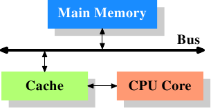

*图 3.1：最简易的缓存配置*

图 3.1 显示了最简易的缓存配置。其与能在早期找到的、采用 CPU 缓存的系统架构是一致的。CPU 核不再直接连接到主存。[^1]所有的加载与存储都必须经过缓存。CPU 核与缓存之间的连接是一条特殊的、快速的连接。在这个简化的示意图上，主存与缓存都被连接到系统总线，其也会用来跟其他系统组件通信。我们已经以“FSB”介绍过系统总线，这是它现今使用的名称；见 2.2 节。在这一节中，我们会省略北桥；假定它存在，以方便 CPU 与主存的沟通。

即便过去数十年来的大多计算机都采用冯·诺依曼架构（von Neumann architecture），但实验证实分离代码与数据的缓存是比较好的。Intel 自 1993 年起采用分离代码与数据的缓存，就再也没有回头过。代码与数据所需的内存区域彼此相当独立，这也是独立的缓存运作得更好的原因。近年来，另一个优点逐渐浮现：对大多数常见的处理器而言，指令解码（decoding）的步骤是很慢的；缓存解码过的指令能够让执行加速，在不正确地预测或者无法预测的分支（branch）使得流水线（pipeline）为空的情况下尤其如此。

在引入缓存之后不久，系统变得越来越复杂。缓存与主存之间的速度差异再次增加，直到加入了另一层级的缓存，比起第一层缓存来得更大也更慢。仅仅提升第一层缓存的容量，以经济因素来说并非一个可行的办法。今日，甚至有正常使用、具有三层缓存的机器。具有这种处理器的系统看起来就像图 3.2 那样。随着单一 CPU 中的核数增加，未来缓存层级也许会变得更多。

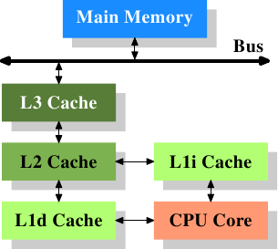

*图 3.2：具有三层缓存的处理器*

图 3.2 显示了三层缓存，并引入了我们将会在本文其余部分使用的术语。L1d 是一级数据缓存、L1i 是一级指令缓存等等。注意，这只是张示意图；实际上数据流从处理器核到主存的路上并不需要通过任何较高层级的缓存。CPU 设计者在缓存接口的设计上有着很大的自由。对程序员来说，是看不到这些设计上的抉择的。

此外，我们有多核的处理器，每个处理器核都能拥有多条“线程”(thread)。一个处理器核与一条线程的差别在于，不同的处理器核拥有（几乎[^2]）所有硬件资源各自的副本。除非同时用到相同的资源——像是对外连接，否则处理器核是能够完全独立运作的。另一方面，线程则共享几乎所有处理器的资源。Intel 的线程实现只让其拥有个别的寄存器，甚至还是有限的——某些寄存器是共享的。所以，现代 CPU 的完整架构看起来就像图 3.3。

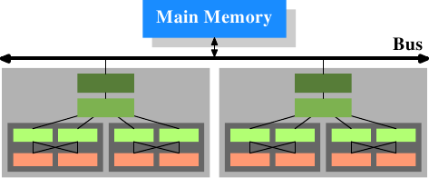

*图 3.3：多处理器、多核、多线程*

在这张图中，我们有两颗处理器，每颗两个核，各自拥有两个线程。线程共享一级缓存。处理器核（以深灰色为底）拥有独立的一级缓存。所有 CPU 核共享更高层级的缓存。两颗处理器（两个浅灰色为底的大方块）自然不会共享任何缓存。这些全都很重要，在我们讨论缓存对多进程与多线程应用程序的影响时尤为如此。

[^1]: 在更早期的系统中，缓存是如同 CPU 与主存一样接到系统总线上的。这比起实际的解法，更像是一种临时解（hack）。

[^2]: 早期的多核处理器甚至有分离的第 2 阶缓存 (L2)，且无第 3 阶缓存。

## 3.2 缓存操作的高层视角

我们必须结合第二节所学到的机器架构与 RAM 技术、以及前一节所描述的缓存结构，以了解使用缓存的开销与节约之处。

默认情况下，由 CPU 核读取或写入的所有数据都存在缓存中。有些内存区域无法被缓存，但只有操作系统实现者得去挂虑这点；这对应用程序员而言是不可见的。也有一些指令能令程序员刻意地绕过某些缓存。这些将会在第六节中讨论。

假如 CPU 需要一个数据字，会先从缓存开始搜寻。显而易见地，缓存无法容纳整个主存的内容（不然我们就不需要缓存），但由于所有内存地址都能被缓存，所以每个缓存条目（entry）都会使用数据字在主存中的地址来*标记（tag）*。如此一来，读取或写入到某个地址的请求便会在缓存中搜寻符合的标记。在这个情境中，地址可以是虚拟或物理的，视缓存的实现而有所不同。

除了真正的内存之外，标记也会需要额外的空间，因此使用一个字作为缓存的粒度（granularity）是很浪费的。对于一台 x86 机器上的一个 32 位字而言，标记本身可能会需要 32 位以上。再者，由于空间局部性是作为缓存基础的其中一个原理，不将此纳入考量并不太好。由于邻近的内存很可能会一起被用到，所以它也应该一起被加载到缓存中。也要记得我们在 2.2.1 节所学到的：假如 RAM 模块能够在不需新的 $$ \overline{\text{CAS}} $$、甚至是 $$ \overline{\text{RAS}} $$ 信号的情况下传输多个数据字，这是更有效率的。所以存储在缓存中的项目并非单一字，而是多个连续字的“行（line）”。在早期的缓存中，这些行的长度为 32 字节；如今一般是 64 字节。假如内存总线的宽度是 64 位，这表示每个缓存行要传输 8 次。DDR 有效地支持这种传输方式。

当内存内容为处理器所需时，整个缓存行都会被加载到 L1d 中。每个缓存行的内存地址会根据缓存行的容量，以掩码（mask）地址值的方式来计算。对于一个 64 字节的缓存行来说，这表示低 6 位为零。舍弃的位则用作缓存行内的偏移量（offset）[^1]。剩余的位在某些情况下用以定位缓存中的行、以及作为标记。在实践上，一个地址值会被切成三个部分。对于一个 32 位的地址来说，这看来如下：

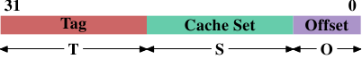

一个容量为 2<sup>$$ \mathbf{O} $$</sup> 的缓存行，低 $$ \mathbf{O} $$ 位用作缓存行内的偏移量。接下来的 $$ \mathbf{S} $$ 位选择“缓存组（cache set）”。我们马上就会深入更多为何缓存行会使用集合——而非一个一组（single slot）——的细节。现在只要知道有 2<sup>$$ \mathbf{S} $$</sup> 个缓存行的集合就够。剩下的 $$ 32 - \mathbf{S} - \mathbf{O} = \mathbf{T} $$ 字节成标记。这 $$ \mathbf{T} $$ 个位是与每个缓存行相关联、以区分在同一缓存组中所有*别名（alias）*[^2]的值。不必存储用以寻址缓存组的 $$ \mathbf{S} $$ 位，因为它们对同个集合中的所有缓存行而言都是相同的。

当一个指令修改内存时，处理器依旧得先加载一个缓存行，因为没有指令能够一次修改一整个缓存行（这个规则有个例外：合并写入〔write-combining〕，会在 6.1 节说明）。因此在写入操作之前，得先加载缓存行的内容。缓存无法持有不完全的缓存行。已被写入、并且仍未写回主存的缓存行被称为“脏的（dirty）”。一旦将其写入，脏位（dirty flag）便会被清除。

为了能够在缓存中加载新的数据，几乎总是得先在缓存中腾出空间。从 L1d 的逐出操作（eviction）会将缓存行往下推入 L2（使用相同的缓存行大小）。这自然代表 L2 也得腾出空间。这可能转而将内容推入 L3，最终到主存中。每次逐出操作都会越来越昂贵。这里所描述的是现代 AMD 与 VIA 处理器所优先采用的*独占式缓存（exclusive cache）*模型。Intel 实现*包含式缓存（inclusive caches）*[^3]，其中每个在 L1d 中的缓存行也会存在 L2 中。因此，从 L1d 进行逐出操作是更为快速的。有了足够的 L2 缓存的话，将内容存在二处而造成内存浪费的缺点是很小的，而这在逐出操作时会带来回报。独占式缓存的一个可能的优点是，加载一个新的缓存行只需碰到 L1d 而不需 L2，这会快上一些。

只要为了处理器架构而规定的内存模型没有改变，CPU 是被允许以它们想要的方式来管理缓存的。举例来说，善用少量或没有内存总线活动的时段，并主动地将脏的缓存行写回到主存中，对处理器来说是非常好的。x86 与 x86-64——不同厂商、甚至是同一厂商的不同型号之间——的处理器之间有着各式各样的缓存架构，证明内存模型抽象化的能力。

在对称式多处理器（Symmetric Multi-Processor，SMP）系统中，CPU 的缓存无法独立于彼此运作。所有处理器在任何时间都假定要看到相同的内存内容。这种内存一致观点的维持被称为“缓存一致性（cache coherency）”。假如一个处理器只看它自己拥有的缓存与主存，它就不会看到其他处理器中的脏缓存行的内容。提供从一个处理器到另一个处理器缓存的直接访问会非常昂贵，而且是个极大的瓶颈。取而代之地，处理器会在另一个处理器要读取或写入到某个缓存行时察觉到。

假如检测到一次写入访问，并且处理器在其缓存中有这个缓存行的干净副本，这个缓存行就会被标为无效（invalid）。未来的查询会需要重新加载这个缓存行。注意到在另一颗 CPU 上的读取访问并不需要进行无效化，多个干净副本能够被保存得很好。

更加复杂的缓存实现容许其他的可能性发生。假设在一个处理器缓存中的一个缓存行是脏的，并且第二个处理器想要读取或写入这个缓存行。在这个情况下，主存的内容太旧，而请求的处理器必须——作为替代——从第一个处理器取得缓存行的内容。第一个处理器经由监听注意到这个状况，并自动地将数据寄送给请求的处理器。这个动作绕过主存，虽然在某些实现中，是假定内存控制器会注意到这个直接传输、并将更新的缓存行内容存储到主存中。假如是为了写入而进行访问，第一个处理器便会将它的区域缓存行的副本无效化。

许多缓存一致化的协议随着时间被逐渐发展出来。最重要的为 MESI，我们将会 3.3.4 节中介绍它。这所有的结果可以被总结为一些简单的规则：

* 一个脏的缓存行不会出现在任何其他处理器的缓存中。
* 相同缓存行的干净副本能够存在任意数量的缓存中。

假如能够维持这些规则，即便在多处理器的系统中，处理器也能够高效地使用它们的缓存。所有处理器所需要做的，就是去监控其他处理器的写入访问，并将这个地址与它们区域缓存中的地址做比较。在下一节，我们将会深入更多实现、尤其是成本的一些细节。

最后，我们该至少给个缓存命中（hit）与未命中（miss）相关成本的印象。这些是 Intel 针对 Pentium M 列出的数字：

到 | 周期——- |——-
寄存器 | <= 1
L1d | ~3
L2 | ~14
主存 | ~240

这些是以 CPU 周期测量的实际访问时间。有趣的是，对内建于芯片上的 L2 缓存而言，大部分（甚至可能超过一半）的访问时间都是由线路延迟造成的。这是一个只会随着缓存容量变大而变糟的物理限制。只有制程的缩小（举例来说，从 Intel 系列中 Merom 的 60nm 到 Penryn 的 45nm）能提升这些数字。

表格中的数字看起来很大，但——幸运地——不必在每次发生缓存加载与未命中时都负担全部的成本。一部分的成本可以被隐藏。现今的处理器全都会使用不同长度的内部流水线，指令会在其中被解码、并且为执行而准备。部份的准备是从内存（或缓存）加载值，假如它们要被传输到寄存器的话。假如内存加载操作能够足够早就在流水线中开始，它也许会与其他操作并行进行，而整个加载成本就可能被隐藏。这对 L1d 经常是可能的；对某些有着长流水线的处理器来说，L2 亦是如此。

提早开始内存读取有着诸多阻碍。也许简单得像是没有足够的资源来访问内存，或者可能是加载的最终地址之后才会作为另一个指令的结果取得。在这些情况中，加载成本无法被（完全地）隐藏。

对于写入操作，CPU 不必一直等到值被安然地存储进内存中为止。只要接下来指令的执行就像是与值已被存入内存有着似乎相同的效果，就没有什么能阻止 CPU 走捷径。它能够早点开始执行下个指令。有着影子寄存器（shadow register）——其能够持有一般寄存器无法取得的值——的帮助，甚至可能改变未完成的写入操作所要存储的值。

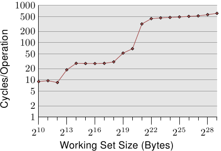

*图 3.4：随机写入的访问时间*

有关缓存行为影响的图表，见图 3.4。我们稍候会谈到产生数据的程序；这是个不停地以随机的方式访问可控制内存总量的程序的简易模拟。每笔数据有着固定的容量。元素的数量视选择的工作集容量而定。Y 轴表示处理一个元素所花费的 CPU 周期的平均；注意到 Y 轴为对数刻度。这同样适用于所有这类图表的 X 轴。工作集的容量总是以二的幂表示。

这张图显示三个不同的平稳阶段。这并不让人意外：这个处理器有 L1d 与 L2 缓存，但没有 L3。经由一些经验，我们可以推论这个 L1d 容量为 2<sup>13</sup> 字节，而 L2 容量为 2<sup>20</sup> 字节。假如整个工作集能塞进 L1d 中，对每个元素的每次操作的周期数会低于 10。一旦超过 L1d 的容量，处理器就必须从 L2 加载数据，而平均时间则迅速成长到 28 左右。一旦 L2 也不够大，时间便飙升到 480 个周期以上。这即是许多、或者大部分操作必须从主存加载数据的时候。更糟的是：由于数据被修改，脏的缓存行也必须被写回。

这张图应该有给予探究程序编写上的改进、以协助提升缓存使用方式的充分动机。我们在这里所谈论的并不是几个少得可怜的百分点；我们说的是有时可能的几个数量级的提升。在第六节，我们将会讨论能让我们写出更有效率的程序的技术。下一节会深入更多 CPU 缓存设计的细节。有这些知识很好，但对于本文其余部分并非必要。所以这一节可以跳过。

[^1]: 用来作为缓存行内某个字的索引。

[^2]: 所有地址有着相同 $$ \mathbf{S} $$ 部分的缓存行都被视为相同的别名。

[^3]: 这个概括并不完全正确。一些缓存是独占式的，而部分包含式缓存具有独占式缓存的特性。

## 3.3 CPU 缓存实现细节

缓存实现者有个麻烦是，在庞大的主存中，每个记忆单元都可能得被缓存。假如一个程序的工作集足够大，这表示有许多为了缓存中的各个地方打架的主存位置。先前曾经提过，缓存与主存容量的比率为 1 比 1000 的情况并不罕见。

### 3.3.1 关联度

实现一个每个缓存行都能保存任意内存位置副本的缓存是有可能的（见图 3.5）。这被称为一个*全相联缓存（fully associative cache）*。要访问一个缓存行，处理器核必须要将每个缓存行的标记与请求地址的标记进行比较。标记会由地址中不是缓存行偏移量的整个部分组成（这表示在 3.2 节图示中的 $$ \mathbf{S} $$ 为零）。

有些缓存是像这样实现的，但是看看现今使用的 L2 数量，证明这是不切实际的。给定一个有着 64B 缓存行的 4MB 缓存，这个缓存将会有 65,536 个项目。为了达到足够的性能，缓存逻辑必须要能够在短短几个周期内，从这所有的项目中挑出符合给定标记的那一个。实现这点要付出庞大的精力。

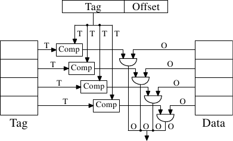

*图 3.5：全相联缓存示意图*

对每个缓存行来说，都需要一个比较器（comparator）来比对很大的标记（注意，$$ \mathbf{S} $$ 为零）。紧邻着每条连接的字母代表以位为单位的宽度。假如没有给定，那么它就是一条单一位的线路。每个比较器都必须比对两个 $$ \mathbf{T} $$ 位宽的值。接着，基于这个结果，选择合适的缓存行内容，并使它能被取得。有多少缓存行，都得合并多少组 $$ \mathbf{O} $$ 数据线。实现一个比较器所需的晶体管数量很大，特别是它必须运作地非常快的时候。迭代比较器（iterative comparator）是不可用的。节省比较器数量的唯一方式，就是反复地比较标记以减少比较器的数量。这与迭代比较器并不合适的理由相同：它太花时间了。

全相联缓存对小缓存（例如在某些 Intel 处理器的 TLB 缓存就是全相联的）来说是有实用价值的，但那些缓存都很小，非常小。我们所指的是至多只有几十个项目的情况。

对 L1i、L1d、以及更高层级的缓存来说，需要采用不同的方法。我们所能做的是限缩搜寻。在最极端的限制中，每个标记都恰好映射到一个缓存条目。计算方式很简单：给定 4MB／64B、有着 65,536 个项目的缓存，我们能够直接使用地址的 6 到 21 位（16 个位）来直接寻址每个项目。低 6 位是缓存行内部的索引。

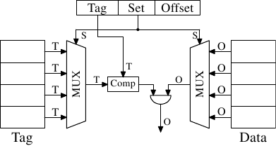

*图 3.6：直接映射缓存示意图*

如图 3.6 所见到的，这种*直接映射缓存（direct-mapped cache）*很快，而且实现起来相对简单。它需要一个比较器、一个多路复用器（在这张示意图中有两个，标记与数据是分离的，但在这个设计上，这点并不是个硬性要求）、以及一些用以选择有效缓存行内容的逻辑。比较器是因速度要求而复杂，但现在只有一个；因此，便能够花费更多的精力来让它变快。在这个方法中，实际的复杂之处都落在多路复用器上。在一个简易的多路复用器上，晶体管的数量以 $$ O(\log N) $$ 成长，其中 $$ N $$ 为缓存行的数量。这能够容忍，但可能会慢了点，在这种情况下，借助在多路复用器中增加更多的晶体管以并行化某些工作，便能够提升速度。晶体管的总数能够缓慢地随着缓存容量的成长而成长，使得这种解法非常有吸引力。但它有个缺点：只有在程序用到的地址，对于用以直接映射的位来说是均匀分布的情况下，它才能运作得很好。若非如此，而且经常这样的话，某些缓存条目会因为频繁地使用而被重复地逐出，而其余的项目则几乎完全没用到、或者一直是空的。

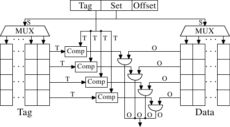

*图 3.7：组相联缓存示意图*

这个问题能借助让缓存*组相联（set associative）*来解决。一个组相联缓存结合了全相联以及直接映射缓存的良好特质，以在很大程度上避免了那些设计的弱点。图 3.7 显示了一个组相联缓存的设计。标记与数据的存储被分成集合，其中之一会被缓存行的地址所选择。这与直接映射缓存相似。但少数的值能以相同的组号缓存，而非令缓存中的每个组号都只有一个元素。所有集合内成员的标记会并行地比对，这与全相联缓存的运作方式相似。

结果是，缓存不容易被不幸地——或者蓄意地——以相同组号的地址选择所击败，同时缓存的容量也不会受限于能被经济地实现的比较器的数量。假如缓存增长，它（在这张图中）只有行数会增加，列数则否。行数（以及比较器）只会在缓存的关联度（associativity）增加的时候才会增加。现今的处理器为 L2 或者更高层级的缓存所使用的关联度层级高达 24。L1 缓存通常使用 8 个集合。

给定我们的 4MB／64B 缓存以及 8 路（8-way）组相联度，于是这个缓存便拥有 8,192 个集合，并且仅有 13 位的标记被用于寻址缓存组。要决定缓存组中的哪个（如果有的话）项目包含被寻址的缓存行，必须要比较 8 个标记。在非常短的时间内做到如此是可行的。借助实验我们能够看到，这是合理的。

<table>
    <tr>
      <th rowspan="3">L2 缓存容量</th>
      <th colspan="8">关联度</th>
    </tr>
    <tr>
      <th colspan="2">直接</th>
      <th colspan="2">2</th>
      <th colspan="2">4</th>
      <th colspan="2">8</th>
    </tr>
    <tr>
      <th>CL=32</th>
      <th>CL=64</th>
      <th>CL=32</th>
      <th>CL=64</th>
      <th>CL=32</th>
      <th>CL=64</th>
      <th>CL=32</th>
      <th>CL=64</th>
    <tr>
      <td>512k</td>
      <td>27,794,595</td>
      <td>20,422,527</td>
      <td>25,222,611</td>
      <td>18,303,581</td>
      <td>24,096,510</td>
      <td>17,356,121</td>
      <td>23,666,929</td>
      <td>17,029,334</td>
    </tr>
    <tr>
      <td>1M</td>
      <td>19,007,315</td>
      <td>13,903,854</td>
      <td>16,566,738</td>
      <td>12,127,174</td>
      <td>15,537,500</td>
      <td>11,436,705</td>
      <td>15,162,895</td>
      <td>11,233,896</td>
    </tr>
    <tr>
      <td>2M</td>
      <td>12,230,962</td>
      <td>8,801,403</td>
      <td>9,081,881</td>
      <td>6,491,011</td>
      <td>7,878,601</td>
      <td>5,675,181</td>
      <td>7,391,389</td>
      <td>5,382,064</td>
    </tr>
    <tr>
      <td>4M</td>
      <td>7,749,986</td>
      <td>5,427,836</td>
      <td>4,736,187</td>
      <td>3,159,507</td>
      <td>3,788,122</td>
      <td>2,418,898</td>
      <td>3,430,713</td>
      <td>2,125,103</td>
    </tr>
    <tr>
      <td>8M</td>
      <td>4,731,904</td>
      <td>3,209,693</td>
      <td>2,690,498</td>
      <td>1,602,957</td>
      <td>2,207,655</td>
      <td>1,228,190</td>
      <td>2,111,075</td>
      <td>1,155,847</td>
    </tr>
    <tr>
      <td>16M</td>
      <td>2,620,587</td>
      <td>1,528,592</td>
      <td>1,958,293</td>
      <td>1,089,580</td>
      <td>1,704,878</td>
      <td>883,530</td>
      <td>1,671,541</td>
      <td>862,324</td>
    </tr>
  </table>

*表 3.1：缓存容量、关联度、以及缓存行大小的影响*

表 3.1 显示了对于一个程序（在这个例子中是 gcc，根据 Linux 系统内核的人们的说法，它是所有基准中最重要的一个）在改变缓存容量、缓存行大小、以及关联度集合容量时，L2 缓存未命中的次数。在 7.2 节中，我们将会介绍对于这个测试，所需要用以模拟缓存的工具。

以防这些值的关联仍不明显，这所有的值的关系是，缓存的容量为

$$
\text{缓存行大小} \times \text{关联度} \times \text{集合的数量}
$$

地址是以 3.2 节的图中示意的方式，使用

$$
\begin{aligned}
\mathbf{O} &= \log_{2} \text{缓存行大小}
\\
\mathbf{S} &= \log_{2} \text{集合的数量}
\end{aligned}
$$

来映射到缓存中的。

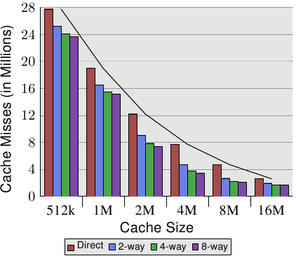

*图 3.8：缓存容量 vs 关联度（CL=32）*

图 3.8 让这个表格的数据更容易理解。它显示了缓存行大小固定为 32 字节的数据。看看对于给定缓存容量的数字，我们可以发现关联度确实有助于显著地降低缓存未命中的次数。以一个 8MB 缓存来说，从直接映射变成 2 路组相联避免了几乎 44% 的缓存未命中。相比于一个直接对应式缓存，使用一个组相联缓存的话，处理器能够在缓存中保存更多的工作集。

在文献中，偶尔会读到引入关联度与加倍缓存容量有着相同的影响。在某些极端的例子中，如同能够从 4MB 跳到 8MB 缓存所看到的，确实如此。但再一次加倍关联度的话，显然就不是如此了。如同我们能从数据中所看到的，接下来的提升要小得多。不过，我们不该完全低估这个影响。在示例程序中，内存使用的尖峰为 5.6M。所以使用一个 8MB 缓存，同样的缓存组不大可能被多次（超过两次）使用。有个较大的工作集的话，能够节约的更多。如同我们能够看到的，对于较小的缓存容量来说，关联度的获益较大。

一般来说，将一个缓存的关联度提升到 8 以上，似乎对一个单线程的工作量来说只有很小的影响。随着共享第一层缓存的 HT 处理器、以及使用一个共享 L2 缓存的多核处理器的引入，形势转变了。现在你基本上会有二支程序命中相同的缓存，这导致关联度会在实践上打对折（对四核处理器来说是四分之一）。所以能够预期，提升处理器核的数量，共享缓存的关联度也应该成长。一旦这不再可能（16 路组相联度已经很难了），处理器设计师就必须开始使用共享的 L3 或者更高层级的缓存，而 L2 缓存则是潜在地由处理器核的子集所共享。

我们能在图 3.8 学到的另一个影响是，增加缓存容量是如何提升性能的。这个数据无法在不知道工作集容量的情况下解释。显然地，一个与主存一样大的缓存，会导致比一个较小缓存更好的结果，所以一般来说不会有带着可预见优势的最大缓存容量的限制。

如同上面所提到的，工作集容量的尖峰为 5.6M。这并没有给我们任何最佳缓存容量的确切数字，但它能让我们估算出这个数字。问题是，并非所有被用到的内存都是连续的，因此我们会有——即使是以一个 16M 的缓存与一个 5.6M 的工作集——冲突（conflict）[^1]（看看 2 路组相联的 16MB 缓存相较于直接映射版本的优势）。但有把握的是，以同样的工作量，一个 32MB 缓存的获益是可以忽略不计的。但谁说过工作集容量必须维持不变了？工作量是随着时间成长的，缓存容量也应该如此。在购买机器、并且在你得去挑选愿意为此买单的缓存容量时，是值得去衡量工作集容量的。在图 3.10 中能够看到这件事何以重要。

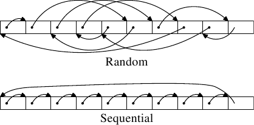

*图 3.9：测试内存布局*

执行了两种类型的测试。在第一个测试中，元素是顺序处理的。测试程序沿着指针（pointer）`n` 前进，但数组元素会以使它们以在内存中排列的顺序被遍历的方式连接。这能够在图 3.9 的下半部看到。有个来自最后一个元素的回溯参考。在第二个测试中（图中的上半部），数组元素是以随机顺序遍历的。在这两种情况中，数组元素都会形成一个循环的单向连接链表 (singly-linked list)。

[^1]: 这里指的是上文描述直接映射缓存时所提到的缺点。

### 3.3.2 缓存影响的测量

所有的图表都是由一支能模拟任意容量的工作集、读取与写入访问、以及顺序或随机访问的程序所产生的。我们已经在图 3.4 中看过一些结果。这支程序会产生与工作集容量相同、这种型别的数组：

```c
struct l {
  struct l *n;
  long int pad[NPAD];
};
```

所有的项目都使用 `n` 元素，以顺序或是随机的顺序，连接在一个循环的链表中。即使元素是顺序排列的，从一个项目前进到下一个项目总是会用到这个指针。`pad` 元素为数据负载（payload），并且能成长为任意容量。在某些测试中，数据会被修改，而在其余的情况中，程序只会执行读取操作。

在性能测量中，我们讨论的是工作集的容量。工作集是由一个 `struct l` 元素的数组所组成的。一个 2<sup>N</sup> 字节的工作集包含 2<sup>N</sup> / `sizeof(struct l)` 个元素。显而易见地，`sizeof(struct l)` 视 `NPAD` 的值而定。以 32 位的系统来说，`NPAD`=7 代表每个数组元素的容量为 32 字节，以 64 位的系统来说，容量为 64 字节。

### 单线程顺序访问

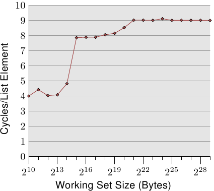

*图 3.10：顺序读取访问，NPAD=0*

最简单的情况就是直接走遍链表中的所有项目。链表元素是顺序排列、紧密地塞在一起的。不管处理的顺序是正向或反向都无所谓，处理器在两个方向上都能处理得一样好。我们这里——以及在接下来的所有测试中——所要测量的是，处理一个单向链表元素要花多久。时间单位为处理器周期。图 3.10 显示了这个结果。除非有另外说明，否则所有的测量都是在一台 Pentium 4 以 64 位模式获得的，这表示 `NPAD`=0 的结构 `l` 容量为八字节。

前两个测量结果受到了杂讯的污染。测量的工作量太小了，因而无法过滤掉其余系统的影响。我们能够放心地假设这些值都在 4 个周期左右。考虑到这点，我们能够看到三个不同的水平（level）：

* 工作集容量至多到 2<sup>14</sup> 字节。
* 从 2<sup>15</sup> 字节到 2<sup>20</sup> 字节。
* 2<sup>21</sup> 字节以上。

这些阶段能够轻易地解读：处理器拥有一个 16kB L1d 与 1MB L2。我们没有在从一个水平到另一个水平的转变之处看到尖锐的边缘，因为缓存也会被系统的其他部分用到，因此缓存并不是专门给这支程序的数据所使用的。特别是 L2 缓存，它是一个统一式缓存（unified cache），也会被用来存放指令（注：Intel 使用包含式缓存）。

或许完全没有预期到的是，对于不同工作集容量的实际时间。L1d 命中的时间是预期中的：在 P4 上，L1d 命中之后的加载时间大约是 4 个周期。但 L2 访问怎么样呢？一旦 L1d 不足以保存数据，可以预期这会让每个元素花上 14 个周期以上，因为这是 L2 的访问时间。但结果显示只需要大约 9 个周期。这个差异能够以处理器中的先进逻辑来解释。预期使用连续的内存区域时，处理器会*预取*下一个缓存行。这表示，当真的用到下个缓存行时，它已经加载一半了。等待下一个缓存行加载所需的延迟因而比 L2 访问时间要少得多。

一旦工作集容量成长到超过 L2 的容量，预取的效果甚至更明显。先前我们说过，一次主内存访问要花费 200+ 个周期。只有利用有效的预取，处理器才可能让访问时间维持在低至 9 个周期。如同我们能从 200 与 9 之间的差异所看到的，它的效果很好。

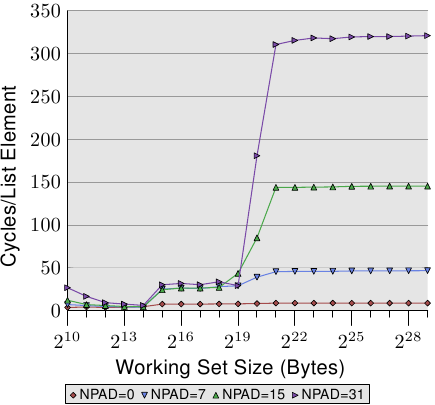

*图 3.11：顺序读取多种容量*

我们能够在预取的时候——至少间接地——观察处理器。在图 3.11 中，我们看到的是相同工作集容量的时间，但这次我们看到的是不同 `l` 结构容量的曲线。这表示在链表中有比较少、但比较大的元素。不同容量有着令（仍然连续的）链表中的 `n` 元素之间的距离成长的影响。在图中的四种情况，距离分别为 0、56、120、248 字节。

在底部我们可以看到图 3.10 的线，但这时它看起来差不多像是条平坦的线。其他情况的时间要糟得多了。我们也能在这张图中看到三个不同的水平，我们也看到在工作集容量很小的情况下有着很大的误差（再次忽略它们）。只要仅有 L1d 牵涉其中，这些线差不多都相互重合。因为不需要预取，所以每次访问时，所有元素大小都直接命中 L1d。

在 L2 缓存命中的情况下，我们看到三条新的线相互重合得很好，但它们位在比较高的水平上（大约 28）。这是 L2 访问时间的水平。这表示从 L2 到 L1d 的预取基本上失效了。即使是 `NPAD`=7，我们在循环的每一次迭代都需要一个新的缓存行；以 `NPAD`=0 而言，在需要下一个缓存行之前，循环得迭代八次。预取逻辑无法每个周期都加载一个新的缓存行。因此，我们看到的便是在每次迭代时，从 L2 加载的延误。

一旦工作集容量超过 L2 的容量，甚至变得更有趣了。现在四条线全都离得很远。不同的元素容量显然在性能差异上扮演着一个重大的角色。处理器应该要识别出步伐（stride）的容量，不为 `NPAD`=15 与 31 获取不必要的缓存行，因为元素的容量是比预取窗（prefetch window）还小的（见 6.3.1 节）。元素容量妨碍预取效果之处，是一个硬件预取限制的结果：它无法横跨分页（page）边界。我们在每次增加容量时，都减少了 50% 硬件调度器（scheduler）的效率。假如硬件预取器（prefetcher）被允许横跨分页边界，并且下一个分页不存在或者无效时，操作系统就得被卷入分页的定位中。这表示程序要经历并非由它自己产生的缺页（page fault）。这是完全无法接受的，因为处理器并不知道一个分页是不在内存内还是不存在。在后者的情况下，操作系统必须要中断进程。在任何情况下，假定——以 `NPAD`=7 或以上而言——每个链表元素都需要一个缓存行，硬件预取器便爱莫能助了。由于处理器一直忙着读取一个字、然后加载下一个元素，根本没有时间去从内存加载数据。

变慢的另一个主要原因是 TLB 缓存的未命中。这是一个存储了从虚拟地址到物理地址的转换结果的缓存，如同在第四节所详细解释的那样。由于 TLB 缓存必须非常地快，所以它非常地小。假如重复访问的分页数比 TLB 缓存拥有的还多，就必须不断地重算代表着虚拟到物理地址的转换结果的项目。这是一个非常昂贵的操作。对比较大的元素容量而言，一次 TLB 查询的成本是分摊在较少的元素上的。这表示对于每个链表元素，必须要计算的 TLB 项目总数较多。

为了观察 TLB 的影响，我们可以执行一个不同的测试。对于第一个测量，我们像往常一样顺序地摆放元素。我们使用 `NPAD`=7 作为占据一整个缓存行的元素。对于第二个测量，我们将每个链表元素放置在个别的分页中。每个分页的其余部分维持原样，我们不会将它算在工作集容量的总和中。[^1]结果是，对于第一个测量，每次链表迭代都需要一个新的缓存行，并且每 64 个元素一个新的分页。对第二个测量而言，每次迭代都需要加载一个在另一个分页上的缓存行。

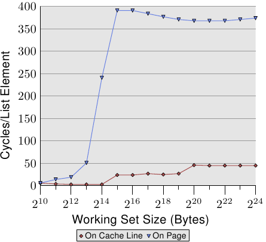

*图 3.12：TLB 对顺序读取的影响*

结果可以在图 3.12 中看到。测量都是在与图 3.11 相同的机器上执行的。由于可用 RAM 的限制，工作集容量必须限制在 2<sup>24</sup> 字节，其需要 1GB 以将对象放置在个别的分页上。下方的红色曲线正好对应到图 3.11 中的 `NPAD`=7 曲线。我们看到了显示了 L1d 与 L2 缓存容量的不同阶段。第两条曲线看起来完全不同。重要的特征是，当工作集容量达到 2<sup>13</sup> 字节时开始的大幅飙升。这即是 TLB 缓存溢出（overflow）的时候了。由于一个元素容量为 64 字节，我们能够计算出 TLB 缓存有 64 个项目。由于程序锁定了内存以避免它被移出，所以成本不会受缺页影响。

可以看出，计算物理地址、并将它存储在 TLB 中所花的周期数非常高。图 3.12 中的曲线显示了极端的例子，但现在应该能清楚的一点是，对于较大的 `NPAD` 值而言，一个变慢的重大因素即是 TLB 缓存效率的降低。由于物理地址必须要在缓存行能从 L2 或主存读取前算出来，因此地址转换的损失就被附加到了内存访问时间上。这在某种程度上解释了，为何每个链表元素在 `NPAD`=31 的总成本会比 RAM 在理论上的访问时间还高的原因。

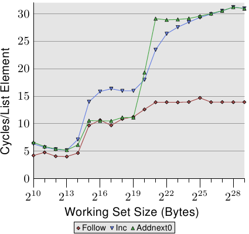

*图 3.13：顺序读取与写入，NPAD=1*

我们可以通过观察修改链表元素的测试执行的数据，来一瞥预取实现的多一些细节。图 3.13 显示了三条线。在所有情况中的元素宽度都是 16 字节。第一条线是现在已经很熟悉的链表遍历，它会被当作一条基准线。第两条线——标为“Inc”——仅会在前往下一个元素前，增加目前元素的 `pad[0]` 成员的值。第三条线——标为“Addnext0”——会取下一个元素的 `pad[0]` 的值，并加到目前链表元素的 `pad[0]` 成员中。

天真的假设大概是“Addnext0”测试跑得比较慢，因为它有更多任务作得做。在前进到下一个链表元素之前，就必须加载这个元素的值。这即是看到这个测试实际上——对于某些工作集容量而言——比“Inc”测试还快这点会令人吃惊的原因了。对此的解释是，加载下个链表元素基本上就是一次强制的预取。无论程序在何时前进到下个链表元素，我们都确切地知道这个元素已经在 L1d 缓存中了。因此我们看到，只要工作集容量能塞进 L2 缓存，“Addnext0”就执行得跟单纯的“Follow”一样好。

不过“Addnext0”测试比“Inc”测试更快耗尽 L2。因为它需要从主存加载更多的数据。这即是在工作集容量为 2<sup>21</sup> 字节时，“Addnext0”测试达到 28 个循环水平的原因了。28 循环水平是“Follow”测试所达到的 14 循环水平的两倍高。这也很容易解释。由于其他两个测试都修改了内存，L2 缓存为了腾出空间给新的缓存行的逐出操作便不能直接把数据丢掉。它必须被写到内存中。这表示 FSB 中的可用带宽被砍了一半，因此加倍了数据从主存传输到 L2 所花的时间。

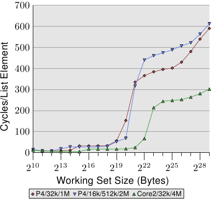

*图 3.14：较大 L2／L3 缓存的优势*

顺序、高效的缓存管理的最后一个面向是缓存的容量。虽然这应该很明显，但仍需要被提出来。图 3.14 显示了以 128 字节元素（在 64 位机器上，`NPAD`=15）进行 Increment 测试的时间。这次我们看到测量结果来自三台不同的机器。前二台机器为 P4，最后一台为 Core2 处理器。前二台由不同的缓存容量来区分它们自己。第一个处理器有一个 32k L1d 与一个 1M L2。第二个处理器有 16k L1d、512k L2、与 2M L3。Core2 处理器有 32k L1d 与 4M L2。

这张图有趣的部分不必然是 Core2 处理器相对于其他两个表现得有多好（虽然这令人印象深刻）。这里主要有兴趣的地方是，工作集容量对于各自的最后一级缓存来说太大、并使得主存得大大地涉入其中之处。

如同预期，最后一级的缓存越大，曲线在相应于 L2 访问成本的低水平停留得越久。要注意的重要部分是它所提供的性能优势。第二个处理器（它稍微旧了一点）在 2<sup>20</sup> 字节的工作集上能够以两倍于第一个处理器的速度执行。这全都归功于最后一级缓存容量的提升。有着 4M L2 的 Core2 处理器甚至表现得更好。

对于随机的工作量而言，这可能不代表什么。但若是工作量能被裁剪成最后一级缓存的容量，程序性能便能够极为大幅地提升。这也是有时候值得为拥有较大缓存的处理器花费额外金钱的原因。

### 单线程随机访问

我们已经看过，处理器能够借助预取缓存行到 L2 与 L1d，来隐藏大部分主存、甚至是 L2 的访问延迟。不过，这只有在能够预测内存的访问时才能良好运作。

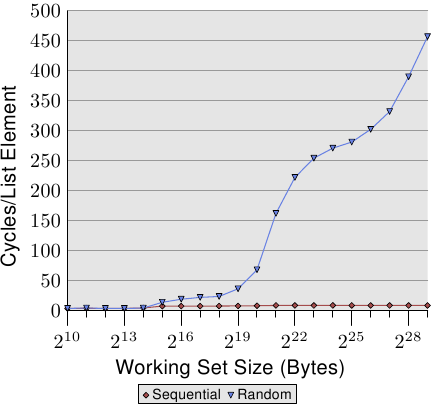

*图 3.15：顺序 vs 随机读取，NPAD=0*

若是访问模式是不可预测、或者随机的，情况便大大地不同。图 3.15 比较了顺序访问每个链表元素的时间（如图 3.10）以及当链表元素是随机分布在工作集时的时间。顺序是由随机化的连接链表所决定的。没有让处理器能够确实地预取数据的方法。只有一个元素偶然在另一个在内存中也彼此邻近的元素不久之后用到，这才能起得了作用。

在图 3.15 中，有两个要注意的重点。第一点是，增长工作集容量需要大量的周期数。机器能够在 200-300 个周期内访问主存，但这里我们达到了 450 个周期以上。我们先前已经看过这个现象了（对比图 3.11）。自动预取在这里实际上起了反效果。

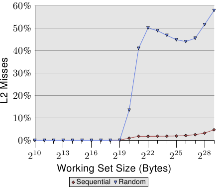

*图 3.16：L2d 未命中率*

第二个有趣的地方是，曲线并不像在顺序访问的例子中那样，在多个平缓阶段变得平坦。曲线持续上升。为了解释这点，我们能够针对不同的工作集容测量程序的 L2 访问次数。结果能够在图 3.16 与表 3.2 看到。

图表显示，当工作集容量大于 L2 的容量时，缓存未命中率（L2 访问数 / L2 未命中数）就开始成长了。这条曲线与图 3.15 的曲线有着相似的形式：它快速地上升、略微下降、然后再度开始上升。这与每链表元素所需循环数的曲线图有着密切的关联。L2 未命中率最终会一直成长到接近 100% 为止。给定一个足够大的工作集（以及 RAM），任何随机选取的缓存行在 L2 或是加载过程中的机率便能够被随心所欲地降低。

<table>
    <tr>
      <th rowspan="2">集合容量</th>
      <th colspan="5">顺序</th>
      <th colspan="5">随机</th>
    </tr>
    <tr>
      <th>L2 命中数</th>
      <th>L2 未命中数</th>
      <th>迭代次数</th>
      <th>未命中／命中比率</th>
      <th>每迭代 L2 访问数</th>
      <th>L2 命中数</th>
      <th>L2 未命中数</th>
      <th>迭代次数</th>
      <th>未命中／命中比率</th>
      <th>每迭代 L2 访问数</th>
    <tr>
      <td>2<sup>20</sup></td>
      <td>88,636</td>
      <td>843</td>
      <td>16,384</td>
      <td>0.94%</td>
      <td>5.5</td>
      <td>30,462</td>
      <td>4721</td>
      <td>1,024</td>
      <td>13.42%</td>
      <td>34.4</td>
    </tr>
    <tr>
      <td>2<sup>21</sup></td>
      <td>88,105</td>
      <td>1,584</td>
      <td>8,192</td>
      <td>1.77%</td>
      <td>10.9</td>
      <td>21,817</td>
      <td>15,151</td>
      <td>512</td>
      <td>40.98%</td>
      <td>72.2</td>
    </tr>
    <tr>
      <td>2<sup>22</sup></td>
      <td>88,106</td>
      <td>1,600</td>
      <td>4,096</td>
      <td>1.78%</td>
      <td>21.9</td>
      <td>22,258</td>
      <td>22,285</td>
      <td>256</td>
      <td>50.03%</td>
      <td>174.0</td>
    </tr>
    <tr>
      <td>2<sup>23</sup></td>
      <td>88,104</td>
      <td>1,614</td>
      <td>2,048</td>
      <td>1.80%</td>
      <td>43.8</td>
      <td>27,521</td>
      <td>26,274</td>
      <td>128</td>
      <td>48.84%</td>
      <td>420.3</td>
    </tr>
    <tr>
      <td>2<sup>24</sup></td>
      <td>88,114</td>
      <td>1,655</td>
      <td>1,024</td>
      <td>1.84%</td>
      <td>87.7</td>
      <td>33,166</td>
      <td>29,115</td>
      <td>64</td>
      <td>46.75%</td>
      <td>973.1</td>
    </tr>
    <tr>
      <td>2<sup>25</sup></td>
      <td>88,112</td>
      <td>1,730</td>
      <td>512</td>
      <td>1.93%</td>
      <td>175.5</td>
      <td>39,858</td>
      <td>32,360</td>
      <td>32</td>
      <td>44.81%</td>
      <td>2,256.8</td>
    </tr>
    <tr>
      <td>2<sup>26</sup></td>
      <td>88,112</td>
      <td>1,906</td>
      <td>256</td>
      <td>2.12%</td>
      <td>351.6</td>
      <td>48,539</td>
      <td>38,151</td>
      <td>16</td>
      <td>44.01%</td>
      <td>5,418.1</td>
    </tr>
    <tr>
      <td>2<sup>27</sup></td>
      <td>88,114</td>
      <td>2,244</td>
      <td>128</td>
      <td>2.48%</td>
      <td>705.9</td>
      <td>62,423</td>
      <td>52,049</td>
      <td>8</td>
      <td>45.47%</td>
      <td>14,309.0</td>
    </tr>
    <tr>
      <td>2<sup>28</sup></td>
      <td>88,120</td>
      <td>2,939</td>
      <td>64</td>
      <td>3.23%</td>
      <td>1,422.8</td>
      <td>81,906</td>
      <td>87,167</td>
      <td>4</td>
      <td>51.56%</td>
      <td>42,268.3</td>
    </tr>
    <tr>
      <td>2<sup>29</sup></td>
      <td>88,137</td>
      <td>4,318</td>
      <td>32</td>
      <td>4.67%</td>
      <td>2,889.2</td>
      <td>119,079</td>
      <td>163,398</td>
      <td>2</td>
      <td>57.84%</td>
      <td>141,238.5</td>
    </tr>
  </table>

*表 3.2：顺序与随机遍历时的 L2 命中与未命中，NPAD=0*

光是缓存未命中率的提高就能够解释一部分成本。但有着另一个因素。看看表 3.2，我们能够看到在 L2 / 迭代数那栏，程序每次迭代所使用的 L2 总数都在成长。每个工作集都是前一个的两倍大。所以，在没有缓存的情况下，我们预期主存的访问次数会加倍。有了缓存以及（几乎）完美的可预测性，我们看到显示在顺序访问的数据中，L2 使用次数增长得很保守。其增长除了工作集容量的增加以外，就没有别的原因了。

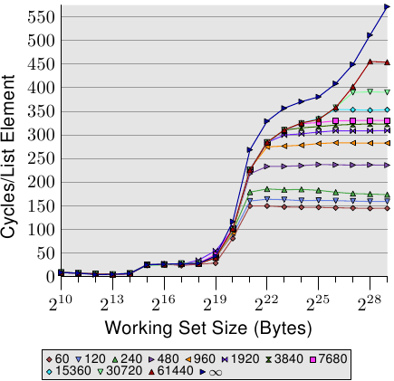

*图 3.17：逐页（page-wise）随机化，NPAD=7*

对于随机访问，每次工作集容量加倍的时候，每个元素的访问时间都超过两倍。这表示每个链表元素的平均访问时间增加了，因为工作集容量只有变成两倍而已。背后的原因是 TLB 未命中率提高了。在图 3.17 中，我们看到在 `NPAD`=7 时随机访问的成本。只是这次，随机化的方式被修改了。一般的情况下，是将整个链表作为一个区块（block）随机化（以标记〔label〕 $$ \infty $$ 表示），而其他的 11 条曲线则表示在比较小的区块内进行随机化。标记为“60”的曲线，代表每组由 60 个分页（245,760 字节）组成的集合会分别进行随机化。这表示在走到下一个区块的元素之前，会先遍历过所有区块内的链表元素。这使得在任何一个时间点使用的 TLB 项目的数量有所限制。

在 `NPAD`=7 时的元素容量为 64 字节，这与缓存行大小一致。由于链表元素的顺序被随机化了，因此硬件预取器不大可能有任何效果，尤其在有一堆元素的情况下。这表示 L2 缓存的未命中率与在一个区块内的整个链表随机化相比并不会有显著地不同。测试的性能随着区块容量增加而逐渐地逼近单一区块随机化的曲线。这表示后者的测试案例的性能显著地受到了 TLB 未命中的影响。假如 TLB 未命中次数能够降低，性能便会显著地提升（在我们稍候将会看到的测试中，高达 38%）。

[^1]: 是的，这有点不一致，因为在其他的测试中，我们把结构中没用到的部分也算在元素容量里，而且我们能够定义 `NPAD` 以让每个元素填满一个分页。在这种情况中，工作集的容量会差得很多。不过这并不是这个测试的重点，而且无论如何预取都没什么效率，因此没有什么差别。

### 3.3.3 写入行为

在我们开始研究在多执行环境（execution context）（线程或进程）使用相同内存的缓存行为之前，我们必须先探究一个缓存实现的细节。缓存是假定为一致的（coherent），而且对用户层级的程序而言，这个一致性是假定为完全透明的。系统内核程序是不同的情况；它偶尔会要求缓存刷新（flush）。

这具体意味着，假如一个缓存行被修改了，在这个时间点之后，对系统而言的结果与根本没有缓存、并且是主存位置本身被修改的情况是相同的。这能以两种方式或策略来实行：

* 直写式（write-through）缓存实现；
* 回写式（write-back）缓存实现。

直写式缓存是最简单的缓存一致性的实行方式。若是缓存行被写入的话，处理器也会立即将缓存行写到主存中。这保证了主存与缓存永远保持一致。能够在任何缓存行被取代的时候直接丢弃缓存的内容。这个缓存策略很简单，但并不是非常快。举例来说，一支不断地修改一个区域变量的程序会在 FSB 产生大量的流量，尽管数据很可能不会在别处用到、而且可能只会短临时在。

回写式策略更为复杂。这时处理器不会立即将被修改的缓存行写回到主存里。取而代之地，缓存行只会被标记为脏的。当缓存行在未来的某个时间点从缓存被丢弃时，脏位（dirty bit）将会在这时通知处理器去把数据写回去，而不是直接丢弃内容。

写回式缓存有机会做得好非常多，这即是大多有着像样处理器的系统中，内存都会以这种方式缓存的原因了。处理器甚至能在缓存行必须被清除之前，利用 FSB 的闲置容量来存储缓存行的内容。这使得脏位被清除，并且在需要缓存中的空间的时候，处理器能够直接丢弃这个缓存行。

但回写式实现也有个重大的问题。当有多于一个处理器（或是处理器核或 HT），并且访问到同样的内存时，它仍旧必须保证每个处理器看到的一直都是相同的内存内容。假如一个缓存行在一个处理器上是脏的（也就是说，它还没被写回去），并且第二个处理器试着读取相同的内存位置，这个读取操作就不能直接送到主存去。而是需要第一个处理器的缓存行的内容。在下一节，我们将会看到这在目前是如何实现的。

在此之前，还有两种缓存策略要提一下：

* 合并写入（write-combining）；以及
* 不可缓存（uncacheable）

这两种策略都是用在地址空间中、并非被真正的 RAM 所支持的特殊区域。系统内核为这些地址范围设置了这些策略（在使用了内存形态范围寄存器〔Memory Type Range Register，MTRR〕的 x86 处理器上），剩下的部分自动地进行。MTRR 也能用于在直写式与回写式策略之间选择。

合并写入是一种受限的缓存优化，更常用于显卡一类设备上的 RAM。由于对设备来说，传输成本比区域 RAM 访问的成本还高得多，因此避免过多的传输是更为重要的。仅因为缓存行中的一个字被修改，就传输一整个缓存行，在下一个操作修改了下一个字的情况下是很浪费的。能够轻易地想像，一种常见的情况是，表示屏幕上水平相邻的像素点的内存，在多数情况下也是相邻的。如同名字所暗示的，合并写入会在缓存行被写出去之前合并多个写入访问。在理想情况下，缓存行会被一个字接着一个字地修改，并且只有在写入最后一个字之后，缓存行才会被写到设备中。这能够显著地加速设备对 RAM 的访问。

最后，不可缓存的内存。这通常表示内存位置根本不被 RAM 所支持。它可能是一个被写死的特殊地址，以拥有某个在 CPU 外部实现的功能。对商用硬件来说，最常见的例子是内存映射的（memory-mapped）地址范围，转换为对附属于总线上的扩展卡以及设备（PCIe 等等）的访问。在嵌入式单板（embedded board）上，有时候会发现能够用来开关 LED 的内存地址。缓存这类地址显然是个坏点子。在这种情境下的 LED 是用以调试或者状态回报的，会想要尽可能快地看到它。在 PCIe 扩展卡上的内存能够在不与 CPU 互动的情况下改变，因此这种内存不应该被缓存。

### 3.3.4 多处理器支持

在上一节，我们已经指出，当多处理器开始起作用时我们会遇到的问题。多核处理器甚至有那些并没有被共享的缓存层级（至少 L1d）的问题。

提供从一个处理器到另一个处理器的缓存的直接访问是完全不切实际的。首先，连接根本不够快。实际的替代方案是，将缓存内容传输给另一个处理器——假如需要的话。注意到这也同样适用于不在相同处理器上共享的缓存。

现在的问题是，什么时候得传输这个缓存行？这是个相当容易回答的问题：当一个处理器需要读取或写入一个缓存行，而其在另一个处理器的缓存上是脏的。但处理器要怎么样才能判断一个缓存行在另一个处理器的缓存上是脏的呢？仅因为一个缓存行被另一个处理器加载就假定如此，（至多）也是次佳的（suboptimal）。通常，大多数的内存访问都是读取操作，产生的缓存行也不是脏的。处理器对缓存行的操作是很频繁的（那当然，不然我们怎么会有这篇论文？），这表示在每次写入操作之后，都去广播被改变的缓存行的信息是不切实际的。

这些年来所发展出来的就是 MESI 缓存一致性协议（修改〔Modified〕、独占〔Exclusive〕、共享〔Shared〕、无效〔Invalid〕）。这个协议的名称来自采用 MESI 协议时、一个缓存行能够变成的四个状态：

<dl>
  <dt>修改</dt>
  <dd>本地的处理器已经修改过缓存行。这也暗指它是在任何缓存中的唯一副本。</dd>

  <dt>独占</dt>
  <dd>缓存行没有被修改过，但已知没有被加载到任何其他处理器的缓存中。</dd>

  <dt>共享</dt>
  <dd>缓存行没有被修改过，并且可能存在于另一个处理器的缓存中。</dd>

  <dt>无效</dt>
  <dd>缓存行是无效的——也就是说，没有被使用。</dd>
</dl>

多年来，这个协议从比较不复杂、但也比较没效率的较简易版本开始发展。有了这四个状态，便可能有效率地实现回写式缓存，而又支持同时在不同的处理器上使用唯读的数据。

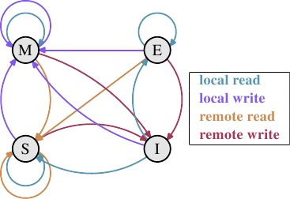

*图 3.18：MESI 协议的状态转换*

借助处理器监听——或者监听——其他处理器的运作，不用太多精力便得以完成状态改变。处理器执行的某些操作会被发布在外部针脚上，因而让处理器的缓存处理能被外界看到。处理中的缓存行地址能在地址总线上看到。在接下来对状态与其转换（显示在图 3.18）的描述中，我们会指出总线是何时被牵扯进来的。

起初所有缓存行都是空的，因此也是**无效**的。若是数据是为了写入而加载缓存，则改为**修改**。若是数据是为了读取而加载，新的状态则取决于另一个处理器是否也已加载这个缓存行。如果是的话，新的状态为**共享**，否则为**独占**。

若是一个**修改**的缓存行从本地处理器被读取或写入，这个指令能够使用目前的缓存内容，并且状态不变。若是第二个处理器想要读取这个缓存行，第一个处理器就必须将它的缓存内容寄送给第二个处理器，然后它就能将状态改为**共享**。寄送给第二个处理器的数据也会被内存控制器接收并处理，其会将内容存储在内存中。假如没有这么做，缓存行就不能被标为**共享**。若是第二个处理器想要写入缓存行，第一个处理器便会寄送缓存行的内容，并将自己的缓存行标为**无效**。这即是恶名昭彰的“所有权请求（Request For Ownership，RFO）”操作。在最后一个层级的缓存中执行这个操作，就像是 I→M 的转换一样，相当昂贵。对直写式缓存而言，我们也得加上它将新的缓存行内容写入到更高层缓存或主存所花费的时间，进而提高了成本。

若是一个缓存行处于**共享**状态，并且本地处理器要读取它，那么就不必改变状态，读取请求能够由这个缓存来达成。若是缓存行要在本地写入，也能够使用这个缓存行，但状态会被改成**修改**。这也需要使其他处理器的所有可能的缓存行副本被标为**无效**。因此，写入操作必须要通过一个 RFO 消息发布给其他处理器。若是缓存行被第二个处理器请求读取，那么什么也不必做。主存包含目前的数据，本地的状态也已经是**共享**了。在第二个处理器想要写入到缓存行的情况下（RFO），就直接将缓存行标为**无效**。不需要总线操作。

**独占**状态与**共享**状态大致相同，只有一个重大的不同：本地的写入操作不必发布到总线上。因为已经知道本地缓存是唯一一个持有这个独有的缓存行的了。这会是一个巨大的优势，所以处理器会试着令尽可能多的缓存行维持在**独占**状态，而非**共享**。后者是在这种时刻，无法取得这个信息的退而求其次。**独占**状态也能够在完全不引发功能问题的情况下被省去。唯一会变糟的只有性能，因为 E→M 转换比 S→M 转换要快得多了。

从这些状态转换的描述中，应该很清楚多处理器操作特有的成本在哪了。是的，填入缓存仍旧昂贵，但现在我们也必须留意 RFO 消息。每当必须发送这种消息时，工作就会变慢。

有两种必须要 RFO 消息的情况：

* 一条线程从一个处理器迁移到另一个，并且所有缓存行都必须一起移动到新的处理器上。
* 一个缓存行真的被两个不同的处理器所需要。[^1]

在多线程或多进程的程序中，总是有一些同步的需求；这种同步是使用内存实现的。所以有些有根据的 RFO 消息。它们仍旧得尽可能地降低频率。不过，还有其他 RFO 消息的来源。我们将会在第六节解释这些情况。缓存一致性协议的消息必须被分发给系统中的处理器。MESI 转换直到确定系统中的所有处理器都有机会回复消息之前都不会发生。这表示一个回复能花上的最长可能时间决定了一致性协议的速度。[^2]可能会有总线上的冲突、NUMA 系统的延迟会很长、而且突发的流量当然也会让事情变慢。这全都是专注在避免不必要流量的好理由。

还有一个与拥有多于一个处理器有关的问题。这个影响是与机器高度相关的，但原理上这个问题总是存在：FSB 是一个共享的资源。在大多数机器上，所有处理器会通过单一一条总线连接到内存控制器（见图 2.1）。假如单一个处理器能够占满总线（通常是这样），那么共享相同总线的二或四个处理器甚至会更加地限制每个处理器的可用带宽。

即使每个处理器都如图 2.2 一样，有它自己的、连接到内存控制器的总线，但仍旧有连接到内存模块的总线。通常这是唯一一条总线，而——即使在图 2.2 的扩展模型中——同时访问相同的内存模块将会限制带宽。

每个处理器都能拥有本地内存的 AMD 模型亦是如此。所有处理器确实能快速地并行访问它们的本地内存，尤其在使用整合式内存控制器的情况。但多线程与多进程程序——至少偶尔——必须访问相同的内存区域以进行同步。

并行是受可用于必要的同步实现的有限带宽所严重地限制的。程序需要被小心地设计，以将不同处理器核对相同内存位置的访问降到最小。接下来的测量将会显示这点、以及其他与多线程程序有关的缓存影响。

### 多线程访问

为了确保大家理解在不同处理器上同时使用相同缓存行所引入的问题的严重性，我们将会在这里多看到一些针对我们先前用过的相同程序的性能图表。不过，这次会同时执行多于一条线程。所要测量的是最快的线程的执行时间。这意味着完成所有线程的完整执行时间还会更长。使用的机器有四个处理器；测试使用至多四条线程。所有处理器共享连接到内存控制器的总线，而且仅有一条连接到内存模块的总线。

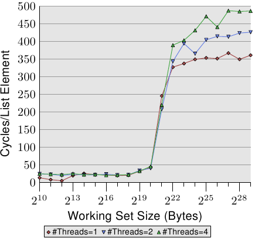

*图 3.19：顺序读取，多条线程*

图 3.19 显示了顺序唯读访问 128 字节项目的性能（在 64 位机器上，`NPAD`=15）。对於单线程的曲线，我们能预期是条与图 3.11 相似的曲线。测量使用了一台不同的机器，所以实际的数字会有所不同。

这张图中重要的部分当然是执行多条线程时的行为。注意到在走访连接链表时，没有内存会被修改，亦无让线程保持同步的企图。尽管不必有 RFO 消息、而且所有的缓存行都能被共享，但我们看到当使用两条线程时，性能减低了高达 18%，而使用四条线程时则高达 34%。由于没有必须在处理器之间传输的缓存行，因此变慢仅仅是由两个瓶颈中的一或二者所引起的：从处理器到内存控制的共享总线、以及从内存控制器到内存模块的总线。一旦工作集容量大于这台机器的 L3 缓存，图上三种数量的线程都会预取新的链表元素。即便只有两条线程，可用带宽也不足以线性延展（scale）（即，没有执行多条线程带来的损失）。

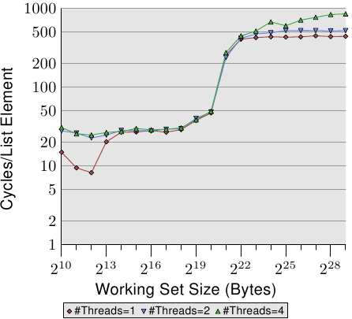

*图 3.20：顺序 Increase，多条线程*

当我们修改内存时，情况变得更可怕了。图 3.20 显示了顺序 Increase 测试的结果。这个图表的 Y 轴使用了对数尺度。所以，别被看似很小的差异给骗了。我们在执行两条线程的时候仍有大约 18% 的损失，而执行四条线程则是惊人的 93% 损失。这表示，在使用四条线程时，预取流量加上回写流量就把总线占得非常满了。

我们使用对数尺度来显示 L1d 范围的结果。能够看到的是，一旦执行了多于一条线程，L1d 基本上就没什么效果了。只有在 L1d 不足以容纳工作集的时候，单线程的访问时间才会超过 20 个周期。当执行了多条线程时，访问时间却立即就达到了——即便使用的是最小的工作集容量。

这里没有显示出问题的一个面向。这个特定的测试程序是难以测量的。即使测试修改了内存、而我们因此预期必定会有 RFO 消息，但当使用了多于一条线程时，我们并没有在 L2 范围内看到更高的成本。程序必须要使用大量的内存，并且所有线程必须要并行地访问相同的内存。没有大量的同步——其会占据大多的执行时间——这是很难实现的。

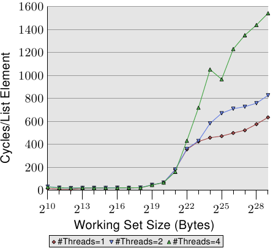

*图 3.21：随机 Addnextlast，多条线程*

最后在图 3.21，我们有 Addnextlast 测试以随机的方式访问内存的数据。提供这张图主要是为了显示出这些高得吓人的数字。现在在极端的状况下，处理一个单一的链表元素要花上大约 1,500 个周期。使用更多线程的情况还要更加严重。我们能使用一张表格来总结多条线程的效率。

<table>
    <tr>
      <th>#线程</th>
      <th>顺序读取</th>
      <th>顺序递增</th>
      <th>随机增加</th>
    </tr>
    <tr>
      <td>2</td>
      <td>1.69</td>
      <td>1.69</td>
      <td>1.54</td>
    </tr>
    <tr>
      <td>4</td>
      <td>2.98</td>
      <td>2.07</td>
      <td>1.65</td>
    </tr>
  </table>

*表 3.3：多条线程的效率*

表格显示了在图 3.19、3.20、与 3.21 中，多线程以最大工作集容量执行的效率。数据表示在使用二或四条线程处理最大的工作集容量时，测试程序可能达到的最佳加速。以两条线程而言，加速的理论极限为 2，对于四条线程而言为 4。两条线程的数据并没有那么糟。但对于四条线程，最后一个测试的数据显示了，几乎不值得扩展到超过两条线程。额外的获益是非常小的。如果我们以略为不同的方式表示图 3.21 的数据，我们便能更轻易地看出这点。

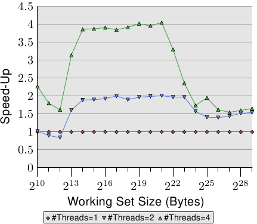

*图 3.22：经由并行化的加速*

图 3.22 的曲线显示了加速因子——也就是相比于以单一线程执行的程序的相对性能。我们得忽略最小容量的情况，因为测量结果不够精确。以 L2 与 L3 缓存的范围而言，我们能够看到我们确实达到了几乎是线性的加速。我们分别达到了差不多 2 与 4 倍速。但一旦 L3 缓存不足以容纳工作集，数字就往下掉了。两条与四条线程的加速因子都掉到一样的值（见表 3.3 的第四行）。这是难以找到主板有着超过四个全都使用同个内存控制器的 CPU 插槽的其中一个理由。有着更多处理器的机器必须要以不同的方式来做（见第五节）。

这些数字并不普遍。在某些情况下，甚至连能塞进最后一级缓存的工作集都无法做到线性加速。事实上，这才是常态，因为线程通常并不若这个测试程序的例子一般解耦（decoupled）。另一方面，是可能运作在大工作集上，而仍旧拥有多于两条线程的优势的。不过，做到这点需要一些思考。我们会在第六节讨论一些方法。

### 特例：Hyper-Threading

Hyper-Threading (简称 HT，有时称为对称多线程〔Symmetric Multi-Threading，SMT〕）由 CPU 实现，并且是个特例，因为个别线程无法真的同时执行。它们全都共享除寄存器组以外几乎所有的处理器资源。个别的处理器核与 CPU 仍然并行地运作，但实现在每颗处理器核上的线程会受到这个限制。理论上，每颗处理器核可以有许多线程，但是——到目前为止——Intel CPU 的每颗处理器核至多仅有两条线程。CPU 负责对线程进行分时复用（time-multiplex）。不过单是如此并没有太大意义。实际的优点是，当同时执行的 HT 被延迟时，CPU 可以调度另一条 HT ，并善用像是算术逻辑单元一类的可用资源。在大多情况下，这是由内存访问造成的延迟。

假如两条线程执行在一颗 HT 核上，那么只有在两条线程*合并的（combined）*执行时间小於单线程程序的执行时间时，程序才会比单线程程序还有效率。借助重叠经常重复发生的不同内存访问的延迟，这是可能的。一个简单的计算显示了为了达到某程度的加速，缓存命中率的最小需求。

一个程序的执行时间能够以一个仅有一层缓存的简易模型来估算，如下（见 [16]）：

$$
T_{\text{exe}} = N [ (1 - F_{\text{mem}}) T_{\text{proc}} + F_{\text{mem}} (G_{\text{hit}} T_{\text{cache}} + (1 - G_{\text{hit}}) T_{\text{miss}}) ]
$$

变量的意义如下：

$$
\begin{aligned}
N &= \text{指令数} \\
F_{\text{mem}} &= N \text{ 次中访问内存的比率} \\
G_{\text{hit}} &= \text{加载次数中命中缓存的比率} \\
T_{\text{proc}} &= \text{每个指令的周期数} \\
T_{\text{cache}} &= \text{缓存命中的周期数} \\
T_{\text{miss}} &= \text{缓存未命中的周期数} \\
T_{\text{exe}} &= \text{程序执行时间}
\end{aligned}
$$

为了要让使用两条线程有任何意义，两条线程任一的执行时间都必须至多为单线程代码的一半。在任一边的唯一变量为缓存命中的数量。若是我们求解方程，以得到使线程的执行不减慢超过 50% 以上所需的最小缓存命中率，我们会得到图 3.23 的结果。

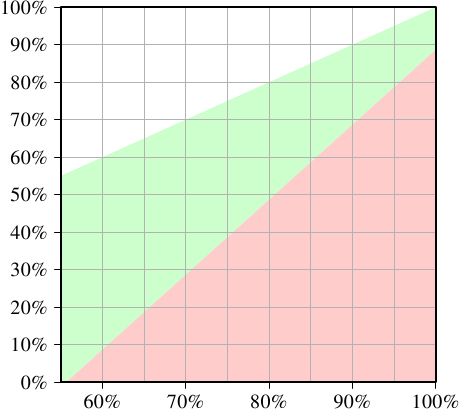

*图 3.23：加速的最小缓存命中率*

输入——刻在 X 轴上——为单线程代码的缓存命中率 $$ G_{\text{hit}} $$。Y 轴显示了多线程代码的缓存命中率。这个值永远不能高於单线程的命中率，不然单线程代码也会使用这个改良的代码。以单线程的命中率——在这个特定的情况下——低于 55% 而言，在所有情况下程序都能够因为使用线程而获益。由于缓存未命中，CPU 或多或少有足够的空闲来执行第两条 HT。

绿色的区域是目标。假如对线程而言的减慢小于 50%，且每条线程的工作量都减半，那么合并的执行时间就可能会小於单线程的执行时间。以用作模型的处理器（使用一个有着 HT 的 P4 的数据）而言，一支命中率为 60% 的单线程程序，对双线程程序来说需要至少 10% 的命中率。这通常是做得到的。但若是单线程程序的命中率为 95%，那么多线程程序就需要至少 80% 的命中率。这更难了。尤其——这是使用 HT 的问题——因为现在每条 HT 可用的有效缓存容量（这里是 L1d，在实际上 L2 也是如此）被砍半了。 HT 都使用相同的缓存来加载它们的数据。若是两条线程的工作集没有重叠，那么原始的 95% 命中率也会打对折，因而远低于所需要的 80%。

HT 因而只有在有限范围的情境中有用。单线程程序的缓存命中率必须足够低，以在给定上面的等式、以及减小的缓存容量时，新的命中率仍然满足要求。这时，也只有这时，才有任何使用 HT 的意义。实际上结果是否比较快，取决于处理器是否足以能将一条线程的延迟重叠在另一条线程的执行时间上。并行化代码的间接成本必须被加到新的总执行时间上，这个额外成本经常无法忽视。

在 6.3.4 节，我们将会看到一种线程紧密合作、而通过共有缓存的紧密耦合竟然是个优点的技术。这个技术能够用于多种情境，只要程序员乐于将时间与精力投入到扩展他们的代码的话。

应该清楚的是，假如两条 HT 执行完全不同的代码（也就是说，两条硬件线程被操作系统如同单独的处理器一般对待，以执行个别的进程），缓存容量固然会减半，这表示缓存未命中的显著攀升。除非缓存足够大，不然这种操作系统调度的实行是有问题的。除非机器由进程组成的负载确实——经由它们的设计——能够获益于 HT ，否则最好在计算机的 BIOS 把 HT 关掉。[^3]

[^1]: 以相同处理器上的两颗处理器核而言，在较小的层级也是如此。成本只小了一点点。RFO 消息可能会被多次送出。

[^2]: 这即是为何我们现今会看到——举例来说——有三个插槽的 AMD Opteron 系统的原因。假定处理器只拥有三条超连接（hyperlink），而且一条是北桥连接所需，每个处理器都正好相隔一跳（hop）。

[^3]: 另一个令 HT 维持开启的理由是调试。SMT 令人惊讶地善于在并进程序中找出好几组问题。

### 3.3.5 其他细节

到目前为止，我们已经讨论过由三个部分——标记、集合索引、以及缓存行偏移量——组成的地址。但实际使用的地址是什么呢？所有有关的处理器现今都是将虚拟地址空间提供给进程，这代表有两种不同的地址：虚拟的以及物理的。

虚拟内存的问题是，它们不是唯一的。虚拟内存能够——随着时间——指涉到不同的物理内存地址。在不同进程中的相同地址也可能会指涉到不同的物理地址。所以使用物理内存地址永远比较好，对吧？

这里的问题是，在执行期间使用的虚拟内存必须在内存管理单元（Memory Management Unit，MMU）的帮助下转换成物理地址。这是个不单纯的操作。在执行一个指令的流水线中，物理地址可能只有在之后的阶段才能取得。这表示缓存逻辑必须非常快速地判定这个内存位置是否被缓存了。若是能够使用虚拟地址，缓存查询就能够早点在流水线中进行，并且在缓存命中的情况下，就能够取得内存内容了。结果是，流水线能够隐藏更多内存访问的成本。

处理器设计者目前是使用虚拟地址来标记第一层级的缓存。这些缓存非常地小，而且清除也不会太费力。若是一个进程的页表树（page table tree）改变了，至少必须局部地清理缓存。假如处理器拥有能够指定被改变的虚拟地址范围的指令，就有可能避免一次完整的刷新。考虑到 L1i 与 L1d 缓存的延迟很短（~3 周期），使用虚拟地址几乎是强迫性的。

对于大一点的缓存，包含 L2、L3、... 缓存，是需要物理地址标记的。这些缓存有比较长的延迟，而虚拟→物理地址转换能够在时间内完成。因为这些缓存比较大（即，当它们被刷新时，会损失大量的信息），并且因为主内存访问的延迟，重新填入它们会花上很久的时间，因此刷新它们的代价经常不小。

一般来说，应该没必要知道在那些缓存中的地址管理的细节。它们无法改变，而且所有会影响性能的因子通常是应该避免、或者是与高成本相关联的东西。塞满缓存容量是很糟的，而且若是多数被使用的缓存行都落在同一组集合中，所有缓存都会很快地碰到问题。后者能够以虚拟寻址的缓存来避免，但对于用户层级的进程来说，要避免使用物理地址寻址的缓存是不可能的。或许唯一应该记住的细节是，可能的话，别在同个进程里将同个物理内存位置映射到两个以上的虚拟地址。

另一个对程序员来说满无趣的缓存细节是缓存的替换策略。大多缓存会先逐出近期最少使用的（Least Recently Used，LRU）元素。以较大的关联度（由于增加更多的处理器核，关联度可能会在接下来几年内进一步地增长）维持 LRU 清单会变得越来越昂贵，我们可能会看到被采用的不同策略。

至于缓存的替换，一个程序员能做的不多。若是缓存是使用物理地址的标记，就没有任何办法能找出虚拟地址与缓存组之间的关联。所有逻辑分页的缓存行可能都映射到相同的缓存组，留着大量的缓存不用。如果是这样的话，不让这太常发生就是操作系统的工作了。

随着虚拟化（virtualization）的出现，事情变得更加复杂。现在甚至不是操作系统拥有对物理内存指派的控制。而是虚拟机器监视器（Virtual Machine Monitor，VMM，又称 Hypervisor）有指派物理内存的职责。

一个程序员能做的最多就是 a) 完全使用逻辑内存分页 b) 使用尽可能大的页大小，以尽可能地多样化物理地址。较大的页大小也有其他好处，但这是另一个主题（见第四节）。

## 3.4 指令缓存

并非只有处理器用到的数据有被缓存；处理器执行的指令也会被缓存。然而，这个缓存比起数据缓存，问题少了许多。有几个理由：

* 执行的代码的量取决于所需的代码容量。代码的容量一般视问题的复杂度而定。而问题的复杂度是固定的。
* 程序的数据管理是由程序员所设计的，而程序的指令通常是由编译器产生的。编译器编写者知道产生良好程序的规则。
* 程序流程比起数据访问模式更加能够预测。现今的 CPU 非常擅于发现模式。这有助于预取。
* 代码总是有相当好的空间与时间局部性。

有一些程序员应该遵循的规则，但这些主要都是如何使用工具的规则。我们将会在第六节讨论它们。这里我们仅讨论指令缓存的技术细节。

自从 CPU 核时钟急遽增加、以及缓存（即使是第一层缓存）与核之间的速度差距成长以来，CPU 便以流水线来设计了。这表示一道指令的执行会分阶段进行。一道指令会先被解码、接着准备参数、最后再执行它。这种流水线能够非常长（以 Intel 的 Netburst 架构而言，> 20 个阶段）。一条很长的流水线意味着，若是流水线延误了（即，通过它的指令流被中断了），它会花上一段时间才能恢复速度。流水线拖延发生在——举例来说——下一道指令的位置无法被正确地预测、或者加载下一道指令花了太长时间（如，当它必须从内存读取的时候）的时候。

因此 CPU 设计者花费了大量的时间与芯片面积在分支预测上，以尽可能地降低流水线延误发生的频率。

在 CISC 处理器上，解码阶段也会花上一些时间。x86 与 x86-64 处理器尤其受此影响。在最近几年，这些处理器因而不在 L1i 上缓存指令的原始字节序列，而是缓存被解码的指令。在这种情况下的 L1i 被称作“跟踪缓存（trace cache）”。跟踪缓存使处理器能够在缓存命中的情况下略过流水线的前面几步，这在流水线被延误时格外有效。

如同先前说过的，L2 的缓存是包含代码与数据的统一式缓存。在这里，代码显然是以字节序列的形式被缓存，而不是被解码过的。

为了达到最好的性能，只有一些与指令缓存相关的规则：

1. 产生尽可能小的代码。有些例外，像是为了使用流水线的软件流水线化（software pipelining）需要建立额外的代码的时候、以及使用小代码的间接成本太高之处。
2. 协助处理器做出好的预取决策。这能够通过程序布局或是显式的预取来做到。

这些规则通常由编译器的代码产生（code generation）来强制执行。有一些程序员能做的事情，我们会在第六节讨论它们。

### 3.4.1 自我修改的代码

在计算机时代的早期，内存是很珍贵的。人们不遗余力地减少程序的容量，以为程序数据腾出更多的空间。一个经常使用的技巧是，随着时间改变程序自身。偶尔仍旧会找到这种自我修改的代码（Self Modifying Code，SMC），如今多半是为了性能因素、或者用在安全漏洞上。

一般来说应该避免 SMC。虽然它通常都被正确地执行，但有着并非如此的边界案例（boundary case），而且没有正确完成的话，它会产生性能问题。显然地，被改变的代码无法维持在保存被解码指令的跟踪缓存中。但即使代码完全（或者有时候）不会被执行，因而不会使用到跟踪缓存，处理器也可能会有问题。若是接下来的指令在它已经进入流水线的期间被改变，处理器就得丢掉大量的成果，然后从头开始。甚至有处理器的大多状态都必须被丢弃的情况。

最后，由于处理器假定——为了简化起见，而且因为这在 99.9999999% 的情况下都成立——代码分页是不可修改的（immutable），所以 L1i 的实现不会采用 MESI 协议，而是一种简化的 SI 协议。这表示，若是检测到修改，就必须做出许多的悲观假设。

强烈地建议尽可能避免 SMC。内存不再是如此稀有的资源。最好是编写各自的函数，而非根据特定的需求修改一个函数。或许有天 SMC 的支持能够是可选的，而我们就能够以这种方式检测出尝试修改代码的漏洞代码（exploit code）。若是真的必须使用 SMC，写入操作应该要绕过缓存，以免因为 L1i 所需的 L1d 的数据造成问题。关于这些指令的更多消息，见 6.1 节。

在 Linux 上，识别出包含 SMC 的程序通常非常容易。使用正规工具链（toolchain）建构的话，所有程序的代码都是防写的（write-protected）。程序员必须在连接期（link time）施展强大的魔法，以产生程序分页能够被写入的可可执行文件。当这种情况发生时，现代的 Intel x86 与 x86-64 处理器具有专门的、计算自我修改的代码使用次数的性能计数器。有了这些计数器的帮助，非常轻易就能够识别有着 SMC 的程序，即使程序由于宽松的许可而成功执行。

## 3.5 缓存未命中的因素

我们已经看过，在内存访问没有命中缓存时的成本一飞冲天。有时候这是无可避免的，而了解实际的成本、以及能做些什么来减轻问题是很重要的。

### 3.5.1 缓存与内存带宽

为了更好地理解处理器的能力，我们要测量在最理想情况下的可用带宽。这个测量格外有趣，因为不同处理器版本的差异很大。这即是本节充满着数个不同机器数据的原因。测量性能的程序使用 x86 与 x86-64 处理器的 SSE 指令以同时加载或存储 16 字节。就如同我们的其他测试一样，工作集从 1kB 增加到 512MB，并测量每个周期能够加载或存储多少字节。

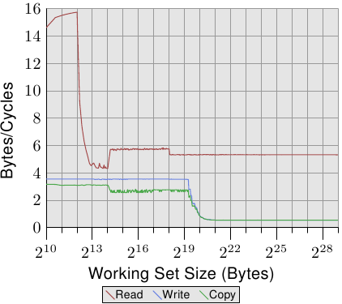

*图 3.24：Pentium 4 的带宽*

图 3.24 显示在一台 64 位 Intel Netburst 处理器上的性能。对于能够塞进 L1d 的工作集容量，处理器每个周期能够读取完整的 16 字节——即，每个周期执行一次加载指令（`movaps` 指令一次搬移 16 字节）。测试不会对读取的数据做任何事，我们测试的仅有读取指令本身。一旦 L1d 不再足够，性能就立刻大幅地降低到每周期少于 6 字节。在 2<sup>18</sup> 的一步是因为 DTLB 缓存的枯竭，表示每个新分页的额外工作。由于读取是顺序的，预取能够完美地预测访问，并且对于所有工作集容量，FSB 能以大约每周期 5.3 字节传输内存内容。不过，预取的数据不会传播到 L1d。这些当然是真实程序中永远无法达到的数字。将它们想成实际上的极限吧。

比起读取的性能，令人更为吃惊的是写入与复制的性能。写入的性能——即便对于很小的工作集容量——始终不会上升到每周期 4 字节以上。这暗示着，在这些 Netburst 处理器上，Intel 为 L1d 选择使用直写模式，其中的性能显然受限于 L2 的速度。这也代表复制测试——其从一个内存区域复制到第二个、不重叠的内存区域——的性能并没有显著地变差。所需的读取操作要快得多，并且能够与写入操作部分重叠。写入与复制测量中，最值得注意的细节是，当 L2 缓存不再足够时的低性能。性能跌落到每周期 0.5 字节！这表示写入操作比读取操作慢十倍。这意味着，对于这个程序的性能而言，优化那些操作是更加重要的。

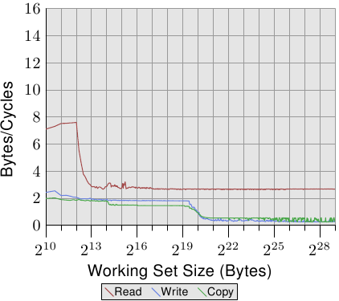

*图 3.25：有着 2 条 HT 的 P4 带宽*

在图 3.25 中，我们看到在相同处理器上、但以两条线程执行的结果，每条线程各自归属于处理器的两条 HT 的其中一条上。这张图表与前一张使用相同的刻度，以阐明二者的差异。曲线有些微抖动，仅是因为测量两条并行线程的问题。结果如同预期。由于 HT 共享寄存器以外的所有资源，每条线程都只有一半的缓存与可用带宽。这表示，即使每条线程都必须等待很久、并能够将执行时间拨给另一条线程，这也没有造成任何不同，因为另一条线程也必须等待内存。这忠实地显示使用 HT 的最差情况。

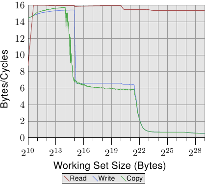

*图 3.26：Core 2 的带宽*

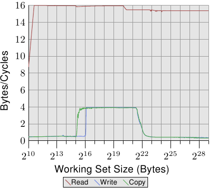

*图 3.27：有着 2 条 HT 的 Core 2 带宽*

对比图 3.24 与图 3.25，对于 Intel Core 2 处理器，图 3.26 与 3.27 的结果看起来差异甚大。这是一个有着共享 L2 的双核处理器，其 L2 是 P4 机器上的 L2 的四倍大。不过，这只解释写入与复制性能延后下降的原因。

有另一个、更大的不同。整个工作集范围内的读取性能停留在大约是最佳的每周期 16 字节。读取性能在 2<sup>20</sup> 字节之后的下降同样是因为工作集对 DTLB 来说太大。达到这么高的数字代表处理器不仅能够预取数据、还及时传输数据。这也代表数据被预取至 L1d 中。

写入与复制的性能也大为不同。处理器没有直写策略；写入的数据被存储在 L1d 中，而且仅会在必要时逐出。这使得写入速度接近于最佳的每周期 16 字节。一旦 L1d 不再足够，性能便显著地降低。如同使用 Netburst 处理器的情况，写入的性能显著地降低。由于读取性能很高，这里的差距甚至更大。事实上，当 L2 也不再足够时，速度差异甚至提升到 20 倍！这不代表 Core 2 处理器表现得很糟。相反的，它们的性能一直都比 Netburst 处理器核还好。

在图 3.27 中，测试执行两条线程，各自在 Core 2 处理器两颗处理器核的其中一颗上。两条线程都访问相同的内存，不过不需要完美地同步。读取性能的结果跟单线程的情况没什么不同。看得到稍微多一点的抖动，这在任何多线程的测试案例里都在预期之中。

有趣的一点是，对于能塞进 L1d 的工作集容量的写入与复制性能。如同图中能看到的，性能就像是数据必须从主存读取一样。两条线程都争夺着相同的内存位置，因而必须送出缓存行的 RFO 消息。麻烦之处在于，即使两颗处理器核共享缓存，这些请求也不是以 L2 缓存的速度处理。一旦 L1d 缓存不再足够，被修改的项目会从每颗处理器核的 L1d 刷新到共享的 L2。这时，由于 L1d 的未命中被 L2 缓存所弥补、而且只有在数据还没被刷新时才需要 RFO 消息，性能便显著地增加。这即是我们看到，对于这些工作集容量，速度降低 50% 的原因。这个渐近行为如同预期一般：由于两颗处理器核共享相同的 FSB，每颗处理器核会得到一半的 FSB 带宽，这表示对于大工作集而言，每条线程的性能大约是单线程时的一半。

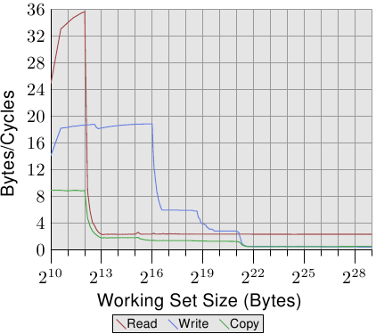

*图 3.28：AMD 10h 家族 Opteron 的带宽*

即使同个供应商的处理器版本之间都有显著的差异，所以当然也值得看看其他供应商的处理器性能。图 3.28 显示一个 AMD 10h 家族 Opteron 处理器的性能。这个处理器拥有 64kB L1d、512kB L2、以及 2MB 的 L3。L3 缓存被处理器的所有核所共享。性能测试的结果能在图 3.28 看到。

注意到的第一个关于数字的细节是，假如 L1d 缓存足够的话，处理器每个周期能够处理二道指令。读取性能超过每周期 32 字节，甚至连写入性能都很高——每周期 18.7 字节。不过，读取的曲线立刻就掉下去，而且非常低——每周期 2.3 字节。对于这个测试，处理器没有预取任何数据，至少不怎么有效率。

另一方面，写入曲线的表现则取决于不同缓存的容量。在 L1d 全满时达到性能高峰，于 L2 降到 6 字节，于 L3 降到 2.8 字节，最后在连 L3 也无法容纳所有数据时，降到每周期 .5 字节。在 L1d 缓存时的性能超越（较旧的）Core 2 处理器，L2 访问一样快（因为 Core 2 有个比较大的缓存），而 L3 与主内存访问则比较慢。

复制的性能无法比读取或写入的性能还要来得好。这即是我们看到，这条曲线起初被压在读取性能下面、而后又被压在写入性能下面的原因。

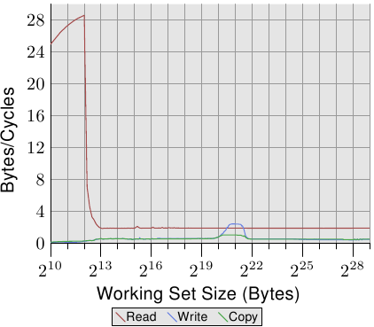

*图 3.29：有着 2 条 HT 的 AMD 10h 家族的带宽*

Opteron 处理器的多线程性能显示于图 3.29。读取性能基本上不受影响。每条线程的 L1d 与 L2 如先前一般运作，而在这个例子下的 L3 缓存也没预取得很好。两条线程没有因其目的而过分地压榨 L3。在这个测试中的大问题是写入的性能。所有线程共享的数据都得通过 L3 缓存。这种共享看起来非常没有效率，因为即使 L3 缓存的容量足以容纳整个工作集，成本也远大于一次 L3 访问。将这张图与图 3.27 相比，我们看到在适当的工作集容量范围中，Core 2 处理器的两条线程是以共享的 L2 缓存的速度来运作的。对于 Opteron 处理器，这种性能水平*只有*在一个非常小范围的工作集容量内才能达到，而即使在这里，它也只能接近 L3 的速度，比 Core 2 的 L2 还慢。

### 3.5.2 关键字的加载

内存以比缓存行大小还小的区块从主存传输到缓存中。现今是一次传输 64 *位*，而缓存行的容量为 64 或 128 *字节*。这表示每个缓存行需要 8 或 16 次传输。

DRAM 芯片能够以突发（burst）模式传输那些 64 字节的区块。这能够在没有来自内存控制器的额外命令、以及可能伴随的延迟的情况下填满缓存行。若是处理器预取缓存行，这可能是最好的操作方式。

若是一个程序的数据或缓存访问没有命中（这表示，这是个强制性缓存未命中〔compulsory cache miss〕——因为数据是第一次使用、或者是容量性缓存未命中〔capacity cache miss〕——因为受限的缓存容量需要逐出缓存行），情况便不同。程序继续执行所需的缓存行里头的字也许不是缓存行中的第一个字。即使在突发模式下、并以双倍数据速率来传输，个别的 64 位区块也会在明显不同的时间点抵达。每个区块会在前一个区块抵达之后 4 个 CPU 周期以上抵达。若是程序继续执行所需的字是缓存行的第八个，程序就必须在第一个字抵达之后，等待额外的 30 个周期以上。

事情并不必然非得如此。内存控制器能够以不同的顺序随意请求缓存行的字。处理器能够传达程序正在等待哪个字——即*关键字*，而内存控制器能够先请求这个字。一旦这个字抵达，程序便能够在缓存行其余部分抵达、并且缓存还不在一致状态的期间继续执行。这个技术被称为关键字优先与提早重新启动（Critical Word First & Early Restart）。

现今的处理器实现这项技术，但有些不可能达成的情况。若是处理器预取数据，并且关键字是未知的。万一处理器在预取操作的途中请求这个缓存行，就必须在不能够影响顺序的情况下，一直等到关键字抵达为止。

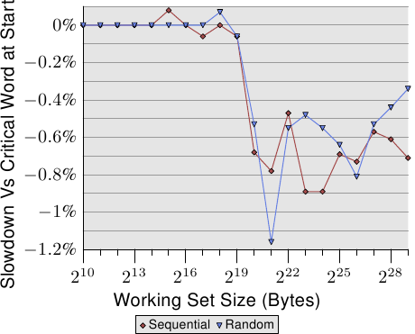

*图 3.30：在缓存行末端的关键字*

即使在适当的地方有了这些优化，关键字在缓存行的位置也很重要。图 3.30 显示顺序与随机访问的 Follow 测试结果。显示的是以用来遍历的指针位在第一个字来执行测试，对比指针位在最后一个字的情况下的速度减慢的结果。元素容量为 64 字节，与缓存行的容量一致。数字受到许多杂讯干扰，但能够看到，一旦 L2 不再足以持有工作集容量，关键字在末端时的性能立刻就慢约 0.7%。顺序访问似乎受到多一点影响。这与前面提及的、预取下个缓存行时的问题一致。

### 3.5.3 缓存的配置

缓存在与 HT 及处理器核的关系中的位置并不在程序员的控制之下。但程序员能够决定线程要在何处执行，于是缓存如何与使用的 CPU 共处就变得很重要。

这里我们不会深入在何时选择哪颗处理器核来执行线程的细节。我们只会描述在设置线程的亲和性（affinity）时，程序员必须要考虑的架构细节。

HT，根据定义，共享寄存器集以外的所有东西。这包含 L1 缓存。这里没什么好说的。有趣之处从一个处理器的个别处理器核开始。每颗处理器核至少拥有它自己的 L1 缓存。除此之外，现今共有的细节并不多：

* 早期的多核处理器完全不共享缓存。
* 之后的 Intel 模型的双核处理器拥有共享的 L2 缓存。对于四核处理器，我们必须为由两颗处理器核组成的每一对处理个别的 L2 缓存。没有更高层级的缓存。
* AMD 的 10h 处理器家族拥有独立的 L2 缓存与一个统一式 L3 缓存。

在处理器供应商的宣传品中已经写许多关于它们各自的模型的优点。若是由处理器核处理的工作集并不重叠，拥有不共享的缓存就有一些优势。这对於单线程程序而言非常有用。由于这仍经常是当下的真实情况，因此这种做法并不怎么差。但总是会有一些重叠的。缓存都包含通用执行期库（runtime library）中最活跃使用的部分，代表有一些缓存空间会被浪费。

与 Intel 的双核处理器一样完全共享 L1 以外的所有缓存有个大优点。若是在两颗处理器核上的线程工作集有大量的重叠，可用的缓存总量也会增加，工作集也能够更大而不致降低性能。若是工作集没有重叠，Intel 的进阶智慧型缓存（Advanced Smart Cache）管理应该要防止任何一颗处理器核独占整个缓存。

不过，如果两颗处理器核为了它们各自的工作集使用大约一半的缓存，也会有一些冲突。缓存必须不断地掂量两颗处理器核的缓存使用量，而作为这个重新平衡的一部分而执行的逐出操作可能会选得很差。为了看到这个问题，让我们看看另一个测试程序的结果。

测试程序拥有一个不断——使用 SSE 指令——读取或写入一个 2MB 内存区块的进程。选择 2MB 是因为这是这个 Core 2 处理器的 L2 缓存容量的一半。进程被钉在一颗处理器核上，而第二个进程则被钉在另一颗处理器核上。第二个进程读写一块可变容量的内存区域。图表显示每周期被读取或写入的字节数。显示四条不同的曲线，每条代表一种进程读取与写入的组合。其中 read/write 曲线代表一个总是写入 2MB 工作集的背景进程，和一个读取可变工作集、用于测量的进程。

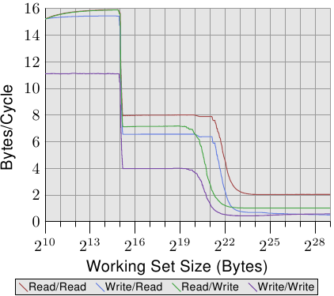

*图 3.31：两个进程的带宽*

这张图有趣的部分在于 2<sup>20</sup> 与 2<sup>23</sup> 字节之间。若是两颗处理器核的 L2 缓存完全分离，我们能够预期四个测试的性能全都会在 2<sup>21</sup> 与 2<sup>22</sup> 之间——这表示，L2 缓存耗尽的时候——往下掉。如同我们能在图 3.31 中看到的，情况并非如此。以在背景进程写入的情况而言，这是最明显的。性能在工作集容量达到 1MB 之前就开始下降。两个进程没有共享内存，因此进程也不会导致 RFO 消息被产生。这纯粹是逐出的问题。智慧型缓存管理有它的问题，导致感觉到的缓存容量比起每颗处理器核可用的 2MB，更接近于 1MB。只能期望，若是在处理器核之间共享的缓存依旧是未来处理器的特征的话，智慧型缓存管理所使用的演算法会被修正。

有一个拥有两个 L2 缓存的四核处理器仅是能够引入更高层级缓存之前的权宜之计。比起独立的插槽与双核处理器，这个设计并没有什么显著的性能优势。两颗处理器核通过在外部被视为 FSB 的相同的总线沟通。没有什么特别快的数据交换。

针对多核处理器的缓存设计的未来将会有更多的层级。AMD 的 10h 处理器家族起个头。我们是否会继续看到被一个处理器核的一个子集所共享的更低层级的缓存仍有待观察（在 2008 年处理器的世代中，L2 缓存没有被共享）。额外的缓存层级是必要的，因为高速与频繁使用的缓存无法被多颗处理器核所共享。性能会受到影响。也会需要非常大的高关联度缓存。缓存容量以及关联度二者都必须随着共享缓存的处理器核数量而增长。使用一个大的 L3 缓存以及合理容量的 L2 缓存是个适当的权衡。L3 缓存较慢，但它理想上并不如 L2 缓存一样常被使用。

对程序员而言，所有这些不同的设计都代表进行调度决策时的复杂性。为了达到最好的性能，必须知道工作负载以及机器架构的细节。幸运的是，我们拥有确定机器架构的依据。这些接口会在之后的章节中介绍。

### 3.5.4 FSB 的影响

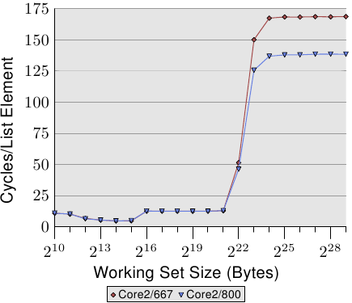

*图 3.32：FSB 速度的影响*

FSB 在机器的性能中扮演一个重要的角色。缓存内容只能以跟内存的连接所允许的一样快地被存储与写入。我们能够借助在二台仅在内存模块速度上有差异的机器上执行一个程序，来看看到底怎么样。图 3.32 显示以一台 64 位机器、`NPAD`=7 而言，Addnext0 测试（将下一个元素的 `pad[0]` 元素加到自己的 `pad[0]` 元素上）的结果。二台机器都拥有 Intel Core 2 处理器，第一台使用 667MHz DDR2 模块，第二台则是 800MHz 模块（提升 20%）。

数据显示，当 FSB 真的受很大的工作集容量所压迫时，我们的确看到巨大的优势。在这项测试中，测量到的最大性能提升为 18.2%，接近理论最大值。这表示，更快的 FSB 确实能够省下大量的时间。当工作集容量能塞入缓存时（这些处理器有一个 4MB L2），这并不重要。必须记在心上的是，这里我们测量的是一个程序。一个系统的工作集包含所有同时执行的进程所需的内存。如此一来，以小得多的程序就可能轻易超过 4MB 以上的内存。

现今，一些 Intel 的处理器支持加速到 1,333MHz 的 FSB，这可能代表着额外 60% 的提升。未来将会看到更高的速度。若是速度很重要、并且工作集容量更大，肯定是值得投资金钱在快速的 RAM 与很高的 FSB 速度的。不过必须小心，因为即使处理器可能会支持更高的 FSB 速度，但主板／北桥可能不会。检查规格是至关重要的。
