# 第 6 章 程序员能做些什么？

在前面几节的描述之后，无疑地，程序员有非常非常多——正向或者负向地——影响程序性能的机会。而这里仅讨论与内存有关的操作。我们将会全面地解释这些部分，由最底层的物理 RAM 访问以及 L1 缓存开始，一路涵盖到影响内存管理的操作系统功能。

## 6.1 绕过缓存

当数据被产生、并且没有（立即）被再次使用时，内存存储操作会先读取完整的缓存行然后修改缓存数据，这点对性能是有害的。这个操作会将可能再次用到的数据踢出缓存，以让给那些短期内不会再次被用到的数据。尤其是像矩阵——它会先被填值、接着才被使用——这类大数据结构。在填入矩阵的最后一个元素前，第一个元素就会因为矩阵太大被踢出缓存，导致写入缓存丧失效率。

对于这类情况，处理器提供对*非临时（non-temporal）*写入操作的支持。这个情境下的非临时指的是数据在短期内不会被使用，所以没有任何缓存它的理由。这些非临时的写入操作不会先读取缓存行然后才修改它；反之，新的内容会被直接写进内存。

这听来代价高昂，但并不是非得如此。处理器会试着使用合并写入（见 3.3.3 节）来填入整个缓存行。若是成功，那么内存读取操作是完全不必要的。如 x86 以及 x86-64 架构，gcc 提供若干 intrinsic 函数 [^1]：

```c
#include <emmintrin.h>
void _mm_stream_si32(int *p, int a);
void _mm_stream_si128(int *p, __m128i a);
void _mm_stream_pd(double *p, __m128d a);
#include <xmmintrin.h>
void _mm_stream_pi(__m64 *p, __m64 a);
void _mm_stream_ps(float *p, __m128 a);
#include <ammintrin.h>
void _mm_stream_sd(double *p, __m128d a);
void _mm_stream_ss(float *p, __m128 a);
```

最有效率地使用这些指令的情况是一次处理大量数据。数据从内存加载、经过一或多步处理、而后写回内存。数据“流（stream）”经处理器，这些指令便得名于此。

内存位置必须各自对齐至 8 或 16 字节。在使用多媒体扩展（multimedia extension）的代码中，也可以用这些非临时的版本替换一般的 `_mm_store_*` 指令。我们并没有在 A.1 节的矩阵相乘程序中这么做，因为写入的值会在短时间内被再次使用。这是串流指令无所助益的一个例子。6.2.1 节会更加深入这段代码。

处理器的合并写入缓冲区可以将部分写入缓存行的请求延迟一小段时间。一个接着一个执行所有修改单一缓存行的指令，以令合并写入能真的发挥功用通常是必要的。以下是一个如何实践的例子：

```c
#include <emmintrin.h>
void setbytes(char *p, int c)
{
  __m128i i = _mm_set_epi8(c, c, c, c,
                           c, c, c, c,
                           c, c, c, c,
                           c, c, c, c);
  _mm_stream_si128((__m128i *)&p[0], i);
  _mm_stream_si128((__m128i *)&p[16], i);
  _mm_stream_si128((__m128i *)&p[32], i);
  _mm_stream_si128((__m128i *)&p[48], i);
}
```

假设指针 `p` 被适当地对齐，调用这个函数会将指向的缓存行中的所有字节设为 `c`。合并写入逻辑会看到四个生成的 `movntdq` 指令，并仅在最后一个指令被执行之后，才对内存发出写入命令。总而言之，这段程序不仅避免在写入前读取缓存行，也避免缓存被并非立即需要的数据污染。这在某些情况下有着巨大的好处。一个经常使用这项技术的例子即是 C 库中的 `memset` 函数，它在处理大块内存时应该要使用类似于上述程序的做法。

某些架构提供专门的解法。PowerPC 架构定义 `dcbz` 指令，它能用以清除整个缓存行。这个指令不会真的绕过缓存，因为缓存行仍会被分配来存放结果，但没有任何数据会从内存被读出来。这相比于非临时存储指令更加受限，因为缓存行只能全部被清空而污染缓存（在数据为非临时的情况），但其不需合并写入逻辑来达到这个结果。

为了一探非临时指令的运作，我们将观察一个用以测量矩阵——由一个二维数组所组成——写入性能的新测试。编译器将矩阵置放于内存中，以令最左边的（第一个）索引指向一列在内存中连续置放的所有元素。右边的（第二个）索引指向一列中的元素。测试程序以两种方式迭代矩阵：第一种是在内部循环增加行号，第两种是在内部循环增加列号。这代表其行为如图 6.1 所示。

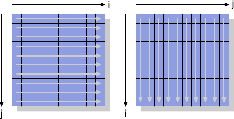

*图 6.1：矩阵访问模式*

我们测量初始化一个 3000 × 3000 矩阵所花的时间。为了观察内存的表现，我们采用不会使用缓存的存储指令。在 IA-32 处理器上，“非临时提示（non-temporal hint）”即被用在于此。作为比较，我们也测量一般的存储操作。结果见于表 6.1。

<table>
    <tr>
      <th rowspan="2"></th>
      <th colspan="2">内部循环增加</th>
    </tr>
    <tr>
      <th>列</th>
      <th>行</th>
    </tr>
    <tr>
      <td>一般</td>
      <td>0.048s</td>
      <td>0.127s</td>
    </tr>
    <tr>
      <td>非临时</td>
      <td>0.048s</td>
      <td>0.160s</td>
    </tr>
  </table>

*表 6.1：矩阵初始化计时*

对于使用缓存的一般写入操作，我们观察到预期中的结果：若是内存被顺序地使用，我们会得到比较好的结果，整个操作费 0.048s，相当于 750MB/s，几近于随机访问的情况却花 0.127s（大约 280MB/s）。这个矩阵已经大到令缓存没那么有效。

我们感兴趣的部分主要是绕过缓存的写入操作。可能令人吃惊的是，在这里顺序访问跟使用缓存的情况一样快。这个结果的原因是处理器执行上述的合并写入操作。此外，对于非临时写入的*内存排序（memory ordering）*规则亦被放宽：程序需要明确地插入内存屏障（memory barriers）（如 x86 与 x86-64 处理器的 `sfence` 指令）。意味着处理器在写回数据时有着更多的自由，因此能尽可能地善用可用的带宽。

内部循环以行向（column-wise）访问的情况就不同。无缓存访问的结果明显地慢于缓存访问（0.16s，约 225MB/s）。这里我们可以理解到，合并写入是不可能的，每个记忆单元都必须被独立处理。这需要不断地从 RAM 芯片上选取新的几列，附带着与此相应的延迟。结果是比有缓存的情况还慢 25%。

在读取操作上，处理器——直到最近——除了非临时访问（Non-Temporal Access，NTA）预取指令的弱提示之外，仍欠缺相应的支持。没有与合并写入对等的读取操作，这对诸如内存映射 I/O（memory-mapped I/O）这类无法被缓存的内存尤其糟糕。Intel 附带 SSE4.1 扩展引入 NTA 加载。它们以一些串流加载缓冲区（streaming load buffer）实现；每个缓冲区包含一个缓存行。针对一个缓存行的第一个 `movntdqa` 指令会将缓存行加载一个缓冲区——可能会替换掉另一个缓存行。随后，对同一个缓存行、以 16 字节对齐的访问操作将会由加载缓冲区以少量的成本来提供服务。除非有其他理由，缓存行将不会被加载到缓存中，于是便能够在不污染缓存的情况下加载大量的内存。编译器为这个指令提供一个 intrinsic 函数：

```c
#include <smmintrin.h>
__m128i _mm_stream_load_si128 (__m128i *p);
```

这个 intrinsic 函数应该要以 16 字节区块的地址做为参数执行多次，直到每个缓存行都被读取为止。在这时才应该开始处理下一个缓存行。由于只有少数几个串流读取缓冲区，可能要一次从两个内存位置进行读取。

我们应该从这个实验得到的是，现代的 CPU 非常巧妙地优化无缓存写入——近来甚至包括读取操作，只要它们是顺序操作的。在处理只会被用到一次的大数据结构时，这个知识是非常有用的。再者，缓存能够降低一些——但不是全部——随机内存访问的成本。在这个例子中，由于 RAM 访问的实现，导致随机访问慢 70%。在实现改变以前，无论何时都应该避免随机访问。

我们将会在谈论预取的章节再次一探非临时标志。

[^1]: intrinsic 函数可简称 intrinsics，由编译器提供，类似 inline 函数，但跟微处理器架构紧密相关，因为编译器知道如何运用最佳的方式来输出对应的微处理器指令。有些状况下，intrinsics 可能会调用标准库或执行环境的函数，甚至可能会有跨越处理器之间 intrinsics 的转换，例如译者维护的 [SSE2NEON](https://github.com/DLTcollab/sse2neon) 项目。

## 6.2 缓存访问

希望改进他们程序性能的程序员会发现，最好聚焦在影响一级缓存的改变上，因为这很可能会产生最好的结果。我们将会在讨论延伸到其他层级之前先讨论它。显然地，所有针对一级缓存的优化也会影响其他缓存。所有内存访问的主题都是相同的：改进局部性（空间与时间）并对齐代码与数据。

### 6.2.1 优化一级数据缓存访问

在 3.3 节，我们已经看过 L1d 缓存的有效使用能够提升性能。在这一节，我们会展示什么样的代码改变能够协助改进这个性能。延续前一节，我们首先聚焦在顺序访问内存的优化。如同在 3.3 节中看到的数字，处理器在内存被顺序访问的时候会自动预取数据。

使用的示例代码为矩阵乘法。我们使用两个 $$ 1000 \times 1000 $$ `double` 元素的方阵（square matrices）。对于那些忘记数学的人，给定元素为 $$ a_{ij} $$ 与 $$ b_{ij} $$ 的矩阵 $$ A $$ 与 $$ B $$，$$ 0 \leq i,j < N $$，乘积为

$$
(AB)_{ij} = \sum^{N - 1}_{k = 0} a_{ik} b_{kj} = a_{i1} b_{1j} + a_{i2} b_{2j} + \cdots + a_{i(N - 1)} b_{(N - 1)j}
$$

一个直观的 C 实现看起来可能像这样

```c
for (i = 0; i < N; ++i)
  for (j = 0; j < N; ++j)
    for (k = 0; k < N; ++k)
      res[i][j] += mul1[i][k] * mul2[k][j];
```

两个输入矩阵为 `mul1` 与 `mul2`。假定结果矩阵 `res` 全被初始化为零。这是个既好又简单的实现。但应该很明显的是，我们有个正好是在图 6.1 解释过的问题。在 `mul1` 被顺序访问的时候，内部的循环增加 `mul2` 的列号。这表示 `mul1` 是像图 6.1 中左边的矩阵那样处理，而 `mul2` 是像右边的矩阵那样处理。这可能不太好。

有一个能够轻易尝试的可能补救方法。由于矩阵中的每个元素会被多次访问，是值得在使用第二个矩阵 `mul2` 之前将它重新排列（数学术语的话，“转置〔transpose〕”）的。

$$
(AB)_{ij} = \sum^{N - 1}_{k = 0} a_{ik} b^{\text{T}}_{jk} = a_{i1} b^{\text{T}}_{j1} + a_{i2} b^{\text{T}}_{j2} + \cdots + a_{i(N - 1)} b^{\text{T}}_{j(N - 1)}
$$

在转置之后（通常以上标“T”表示），我们现在顺序地迭代两个矩阵。就 C 程序而言，现在看起来像这样：

```c
double tmp[N][N];
for (i = 0; i < N; ++i)
  for (j = 0; j < N; ++j)
    tmp[i][j] = mul2[j][i];
for (i = 0; i < N; ++i)
  for (j = 0; j < N; ++j)
    for (k = 0; k < N; ++k)
      res[i][j] += mul1[i][k] * tmp[j][k];
```

我们建立一个容纳被转置的矩阵的暂时变量（temporary variable）。这需要动到额外的内存，但这个成本会被——希望如此——弥补回来，因为每行 1000 次非顺序访问是更为昂贵的（至少在现代的硬件上）。是进行一些性能测试的时候。在有着 2666MHz 时钟的 Intel Core 2 上的结果为（以时钟周期为单位）：

<table>
  <tr>
    <th></th>
    <th>原始</th>
    <th>转置</th>
  </tr>
  <tr>
    <th>周期数</th>
    <td>16,765,297,870</td>
    <td>3,922,373,010</td>
  </tr>
  <tr>
    <th>相对值</th>
    <td>100%</td>
    <td>23.4%</td>
  </tr>
</table>

虽然只是个简单的矩阵转置，但我们能达到 76.6% 的加速！复制操作的损失完全被弥补。1000 次非顺序访问真的很伤。

下个问题是，我们是否能做得更好。无论如何，我们确实需要一个不需额外复制的替代方法。我们并不是总有余裕能进行复制：矩阵可能太大、或者可用的内存太小。

替代实现的探寻应该从彻底地检验涉及到的数学与原始实现所执行的操作开始。简单的数学知识让我们能够发现，只要每个加数（addend）正好出现一次，对结果矩阵的每个元素执行的加法顺序是无关紧要的。[^1]这个理解让我们能够寻找将执行在原始代码内部循环的加法重新排列的解法。

现在，让我们来检验在原始代码执行中的实际问题。被访问的 `mul2` 元素的顺序为：$$ (0, 0) $$、$$ (1, 0) $$、 ... 、$$ (N - 1, 0) $$、$$ (0,1) $$、$$ (1, 1) $$、 ...。元素 $$ (0, 0) $$ 与 $$ (0, 1) $$ 位于同一个缓存行中，但在内部循环完成一轮的时候，这个缓存行早已被逐出。以这个例子而言，每一轮内部循环都需要——对三个矩阵的每一个而言——1000 个缓存行（Core 2 处理器为 64 字节）。这加起来远比 L1d 可用的 32k 还多。

但若是我们在执行内部循环的期间，一起处理中间循环的两次迭代呢？在这个情况下，我们使用两个来自必定在 L1d 中的缓存行的 `double` 值。我们将 L1d 未命中率减半。[^2]这当然是个改进，但——视缓存行的容量而定——也许仍不是我们能够得到的最好结果。Core 2 处理器有个缓存行大小为 64 字节的 L1d。实际的容量能够使用

`sysconf (_SC_LEVEL1_DCACHE_LINESIZE)`

在执行期查询、或是使用命令列（command line）的 `getconf` 工具程序（utility），以让程序能够针对特定的缓存行大小编译。以 `sizeof(double)` 为 8 来说，这表示——为了完全利用缓存行——我们应该展开内部循环 8 次。继续这个想法，为了有效地使用 `res` 矩阵——即，为了同时写入 8 个结果——我们也该展开外部循环 8 次。我们假设这里的缓存行大小为 64，但这个代码也能在 32 字节缓存行的系统上运作，因为缓存行也会被 100% 利用。一般来说，最好在编译期像这样使用 `getconf` 工具程序来写死（hardcode）缓存行大小：

`gcc -DCLS=$(getconf LEVEL1_DCACHE_LINESIZE) ...`

若是二元档是假定为一般化（generic）的话，应该使用最大的缓存行大小。使用非常小的 L1d 表示并非所有数据都能塞进缓存，但这种处理器无论如何都不适合高性能程序。我们写出的代码看起来像这样：

```c
#define SM (CLS / sizeof (double))
for (i = 0; i < N; i += SM)
  for (j = 0; j < N; j += SM)
    for (k = 0; k < N; k += SM)
      for (i2 = 0, rres = &res[i][j],
           rmul1 = &mul1[i][k]; i2 < SM;
           ++i2, rres += N, rmul1 += N)
        for (k2 = 0, rmul2 = &mul2[k][j];
             k2 < SM; ++k2, rmul2 += N)
          for (j2 = 0; j2 < SM; ++j2)
            rres[j2] += rmul1[k2] * rmul2[j2];
```

这看起来超可怕的。在某种程度上它是如此，但只是因为它包含一些技巧。最显而易见的改变是，我们现在有六层巢状循环。外部循环以 `SM`（缓存行大小除掉 `sizeof(double)`）为间隔迭代。这将乘法切成多个能够以更多缓存局部性处理的较小的问题。内部循环迭代外部循环漏掉的索引。再一次，这里有三层循环。这里唯一巧妙的部分是 `k2` 与 `j2` 循环的顺序不同。这是因为在实际运算中，仅有一个表示式取决于 `k2`、但有两个取决于 `j2`。

这里其余的复杂之处来自 gcc 在优化数组索引的时候并不是非常聪明的结果。额外变量 `rres`、`rmul1`、与 `rmul2` 的引入，借助将内部循环的常用表示式（expression）尽可能地拉出来，以优化代码。C 与 C++ 语言默认的别名规则（aliasing rule）并不能帮助编译器做出这些决定（除非使用 `restrict`，所有指针访问都是别名的潜在来源）。这即是为何对于数值程序设计而言，Fortran 仍是一个偏好语言的原因：它令快速程序的编写更简单。[^3]

<table>
    <tr>
      <th></th>
      <th>原始</th>
      <th>转置</th>
      <th>子矩阵</th>
      <th>向量化</th>
    </tr>
    <tr>
      <th>周期数</th>
      <td>16,765,297,870</td>
      <td>3,922,373,010</td>
      <td>2,895,041,480</td>
      <td>1,588,711,750</td>
    </tr>
    <tr>
      <th>相对值</th>
      <td>100%</td>
      <td>23.4%</td>
      <td>17.3%</td>
      <td>9.47%</td>
    </tr>
  </table>

*表 6.2：矩阵乘法计时*

所有努力所带来的成果能够在表 6.2 看到。借助避免复制，我们增加额外的 6.1% 性能。此外，我们不需要任何额外的内存。只要结果矩阵也能塞进内存，输入矩阵可以是任意容量的。这是我们现在已经达成的一个通用解法的一个必要条件。

在表 6.2 中还有一栏没有被解释过。大多现代处理器现今包含针对向量化（vectorization）的特殊支持。经常被标为多媒体扩展，这些特殊指令能够同时处理 2、4、8、或者更多值。这些经常是 SIMD（单指令多数据，Single Instruction, Multiple Data）操作，借助其他操作的协助，以便以正确的形式获取数据。由 Intel 处理器提供的 SSE2 指令能够在一个操作中处理两个 `double` 值。指令参考手册列出提供对这些 SSE2 指令访问的 intrinsic 函数。若是使用这些 intrinsic 函数，程序执行会变快 7.3%（相对于原始实现）。结果是，一支以原始代码 10% 的时间执行的程序。翻译成人们认识的数字，我们从 318 MFLOPS 变为 3.35 GFLOPS。由于我们在这里仅对内存的影响有兴趣，程序的源代码被摆到 A.1 节。

应该注意的是，在最后一版的代码中，我们仍然有一些 `mul2` 的缓存问题；预取仍然无法运作。但这无法在不转置矩阵的情况下解决。或许缓存预取单元将会变得聪明地足以识别这些模式，那时就不需要额外的更动。不过，以一个 2.66 GHz 处理器上的单线程程序而言，3.19 GFLOPS 并不差。

我们在矩阵乘法的例子中优化的是被加载的缓存行的使用。一个缓存行的所有字节总是会被用到。我们只是确保在缓存行被逐出前会用到它们。这当然是个特例。

更常见的是，拥有塞满一或多个缓存行的数据结构，而程序在任何时间点都只会使用几个成员。我们已经在图 3.11 看过，大结构尺寸在只有一些成员被用到时的影响。

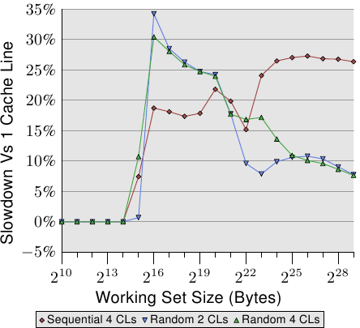

*图 6.2：散布在多个缓存行中*

图 6.2 显示使用现在已熟知的程序执行另一组基准测试的结果。这次会加上同个链表元素的两个值。在一个案例中，两个元素都在同一个缓存行内；在另一个案例中，一个元素位在链表元素的第一个缓存行，而第二个位在最后一个缓存行。这张图显示我们正遭受的性能衰减。

不出所料，在所有情况下，若是工作集塞得进 L1d 就不会有任何负面影响。一旦 L1d 不再充足，则是使用一个进程的两个缓存行来偿付损失，而非一个。红线显示链表被顺序地排列时的数据。我们看到寻常的二步模式：当 L2 缓存充足时的大约 17% 的损失、以及当必须用到主存时的大约 27% 的损失。

在随机内存访问的情况下，相对的数据看起来有点不同。对于塞得进 L2 的工作集而言的性能衰减介于 25% 到 35% 之间。再往后它下降到大约 10%。这不是因为损失变小，而是因为实际的内存访问不成比例地变得更昂贵。这份数据也显示，在某些情况下，元素之间的距离是很重要的。Random 4 CLs 的曲线显示较高的损失，因为用到第一个与第四个缓存行。

要查看一个数据结构对比于缓存行的布局，一个简单的方法是使用 pahole 程序（见 [4]）。这个程序检验定义在二进制文件中的数据结构。取一个包含这个定义的程序：

```c
struct foo {
  int a;
  long fill[7];
  int b;
};
```

当在一台 64 位机器上编译时，pahole 程序的输出（在其他东西之中）包含显示于图 6.3 的输出。这个输出结果告知我们很多东西。首先，它显示这个数据结构使用超过一个缓存行。这个工具假设目前使用的处理器的缓存行大小，但这个值能够使用一个命令列参数来覆写。尤其在结构容量几乎没有超过一个缓存行、以及许多这种型别的对象会被分配的情况下，寻求一个压缩这种结构的方式是合理的。或许几个元素能有比较小的型别、又或者某些字段实际上是能使用独立位来表示的标志。

在这个示例的情况中，压缩是很容易的，而且它也被这支程序所暗示。输出显示在第一个元素后面有个四位的洞（hole）。这个洞是由结构的对齐需求以及 `fill` 元素所造成的。很容易发现元素 `b`——其容量为四字节（由那行结尾的 4 所指出的）——完美地与这个间隔（gap）相符。在这个情况下的结果是，间隔不再存在，而这个数据结构塞得进一个缓存行中。pahole 工具能自己完成这个优化。若是使用 `--reorganize` 参数，并将结构的名称加到命令列的结尾，这个工具的输出即是优化的结构、以及使用的缓存行。除了移动字段以填补间隔之外，这个工具也能够优化位字段以及合并填充（padding）与洞。更多细节见 [4]。

有个正好大得足以容纳尾端元素的洞当然是个理想的情况。为了让这个优化有用，对象本身也必须对齐缓存行。我们马上就会开始处理这点。

pahole 输出也能够轻易看出元素是否必须被重新排列，以令那些一起用到的元素也会被存储在一起。使用 pahole 工具，很容易就能够确定哪些元素要在同个缓存行，而不是必须在重新排列元素时才能达成。这并不是一个自动的过程，但这个工具能帮助很多。

各个结构元素的位置、以及它们被使用的方式也很重要。如同我们已经在 3.5.2 节看到的，晚到缓存行的关键字的程序性能是很糟的。这表示一位程序员应该总是遵循下列两条原则：

1. 总是将最可能为关键字的结构元素移到结构的开头。
2. 访问数据结构、以及访问顺序不受情况所约束时，以它们定义在结构中的顺序来访问。

以小结构而言，这表示元素应该以它们可能被访问的顺序排列。这必须以灵活的方式处理，以允许其他像是补洞之类的优化也能被使用。对于较大的数据结构，每个缓存行大小的区块应该遵循这些原则来排列。

不过，若是对象自身不若预期地对齐，就不值得花时间来重新排列它。一个对象的对齐，是由数据型别的对齐需求所决定的。每个基础型别有它自己的对齐需求。对于结构型别，它的任意元素中最大的对齐需求决定这个结构的对齐。这几乎总是小于缓存行大小。这表示即使一个结构的成员被排列成塞得进同一个缓存行，一个被分配的对象也可能不具有相符于缓存行大小的对齐。有两种方法能确保对象拥有在设计结构布局时使用的对齐：

* 对象能够以明确的对齐需求分配。对于动态分配（dynamic allocation），调用 `malloc` 仅会以相符于最严格的标准型别（通常是 `long double`）的对齐来分配对象。不过，使用 `posix_memalign` 请求较高的对齐也是可能的。

    ```c
    #include <stdlib.h>
    int posix_memalign(void **memptr,
                       size_t align,
                       size_t size);
    ```

    这个函数将一个指到新分配的内存的指针存储到由 `memptr` 指到的指针变量中。内存区块容量为 `size` 字节，并在 `align` 字节边界上对齐。

    对于由编译器分配的对象（在 `.data`、`.bss` 等，以及在栈中），能够使用一个变量属性（attribute）：

    ```c
    struct strtype variable
       __attribute((aligned(64)));
    ```

    在这个情况下，不管 `strtype` 结构的对齐需求为何，`variable` 都会在 64 字节边界上对齐。这对全域变量与自动变量也行得通。

    对于数组，这个方法并不如你可能预期的那般运作。只有数组的第一个元素会被对齐，除非每个元素的容量是对齐值的倍数。这也代表每个单一变量都必须被适当地标注。`posix_memalign` 的使用也不是完全不受控制的，因为对齐需求通常会导致碎片与／或更高的内存消耗。

* 一个用户定义型别的对齐需求能够使用一个型别属性来改变：

    ```c
    struct strtype {
        ...members...
    } __attribute((aligned(64)));
    ```

    这会使编译器以合适的对齐来分配所有的对象，包含数组。不过，程序员必须留意针对动态分配对象的合适对齐的请求。这里必须再一次使用 `posix_memalign`。使用 gcc 提供的 `alignof` 运算子（operator）、并将这个值作为第二个参数传递给 `posix_memalign` 是很简单的。

之前在这一节提及的多媒体扩展几乎总是需要对齐内存访问。即，对于 16 字节的内存访问而言，地址是被假定以 16 字节对齐的。x86 与 x86-64 处理器拥有能够处理非对齐访问的内存操作的特殊变体，但这些操作比较慢。对于所有内存访问都需要完全对齐的大多 RISC 架构而言，这种严格的对齐需求并不新奇。即使一个架构支持非对齐的访问，这有时也比使用合适的对齐还慢，尤其是在不对齐导致一次加载或存储使用两个缓存行、而非一个的情况下。

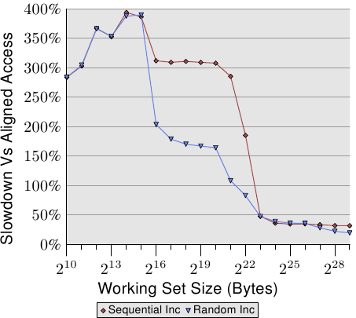

*图 6.4：非对齐访问的间接成本*

图 6.4 显示非对齐内存访问的影响。现已熟悉的测试会在（顺序或随机）走访内存被测量的期间递增一个数据元素，一次使用对齐的链表元素、一次使用刻意不对齐的元素。图表显示程序因非对齐访问而招致的性能衰减。顺序访问情况下的影响比起随机的情况更为显著，因为在后者的情况下，非对齐访问会部分地被一般来说较高的内存访问成本所隐藏。在顺序的情况下，对于塞得进 L2 缓存的工作集容量来说，性能衰减大约是 300%。这能够由 L1 缓存的有效性降低来解释。某些递增操作现在会碰到两个缓存行，而且现在在一个链表元素上操作经常需要两次缓存行的读取。L1 与 L2 之间的连接简直太壅塞。

对于非常大的工作集容量，非对齐访问的影响仍然是 20% 至 30%——考虑到对于这种容量的对齐访问时间很长，这是非常多的。这张图表应该显示对齐是必须被严加对待的。即使架构支持非对齐访问，也绝对不要认为“它们跟对齐访问一样好”。

不过，有一些来自这些对齐需求的附带结果。若是一个自动变量拥有一个对齐需求，编译器必须确保它在所有情况下都能够被满足。这并不容易，因为编译器无法控制调用点（call site）与它们处理栈的方式。这个问题能够以两种方式处理：

1. 产生的程序主动地对齐栈，必要时插入间隔。这需要程序检查对齐、建立对齐、并在之后还原对齐。
2. 要求所有的调用端都将栈对齐。

所有常用的应用程序二进制接口（application binary interface，ABI）都遵循第两条路。如果一个调用端违反规则、并且对齐为被调用端所需，程序很可能会失去作用。不过，对齐的完美保持并不会平白得来。

在一个函数中使用的一个栈框（frame）的容量不必是对齐的倍数。这表示，若是从这个栈框调用其他函数，填充就是必要的。很大的不同是，在大部分情况下，栈框的容量对编译器而言是已知的，因此它知道如何调整栈指针，以确保任何从这个栈框调用的函数的对齐。事实上，大多编译器会直接将栈框的容量调高，并以它来完成操作。

如果使用可变长度数组（variable length array，VLA）或 `alloca`，这种简单的对齐处理方式就不合适。在这种情况下，栈框的总容量只会在执行期得知。在这种情况下可能会需要主动的对齐控制，使得产生的代码（略微地）变慢。

在某些架构上，只有多媒体扩展需要严格的对齐；在那些架构上的栈总是当作普通的数据型别进行最低限度的对齐，对于 32 与 64 位架构通常分别是 4 或 8 字节。在这些系统上，强制对齐会招致不必要的成本。这表示，在这种情况下，我们可能会想要摆脱严格的对齐需求，如果我们知道不会依赖它的话。不进行多媒体操作的尾端函数（tail function）（那些不调用其他函数的函数）不必对齐。只调用不需对齐的函数的函数也不用。若是能够识别出够大一组函数，一个程序可能会想要放宽对齐需求。对于 x86 的二元档，gcc 拥有宽松栈对齐需求的支持：

`-mpreferred-stack-boundary=2`

若是这个选项（option）的值为 $$ N $$，栈对齐需求将会被设为 $$ 2^{N} $$ 字节。所以，若是使用 2 为值，栈对齐需求就被从默认值（为 16 字节）降低成只有 4 字节。在大多情况下，这表示不需额外的对齐操作，因为普通的栈推入（push）与弹出（pop）操作无论如何都是在四字节边界上操作的。这个机器特定的选项能够帮忙减少程序容量，也能够提升执行速度。但它无法被套用到许多其他的架构上。即使对于 x86-64，一般来说也不适用，因为 x86-64 ABI 要求在 SSE 寄存器中传递浮点数参数，而 SSE 指令需要完整的 16 字节对齐。然而，只要能够使用这个选项，就能造成明显的差别。

结构元素的高效摆放与对齐并非数据结构影响缓存效率的唯一面向。若是使用一个结构的数组，整个结构的定义都会影响性能。回想一下图 3.11 的结果：在这个情况中，我们增加数组元素中未使用的数据总量。结果是预取越来越没效果，而程序——对于大数据集——变得越来越没效率。

对于大工作集，尽可能地使用可用的缓存是很重要的。为了达到如此，可能有必要重新排列数据结构。虽然对程序员而言，将所有概念上属于一块儿的数据摆在同个数据结构是比较简单的，但这可能不是最大化性能的最好方法。假设我们有个如下的数据结构：

```c
struct order {
  double price;
  bool paid;
  const char *buyer[5];
  long buyer_id;
};
```

进一步假设这些纪录会被存在一个大数组中，并且有个经常执行的工作（job）会总和所有帐单的预期付款。在这种情境中，`buyer` 与 `buyer_id` 使用的内存是不必被加载到缓存中的。根据图 3.11 的数据来判断，程序将会表现得比它能达到的还糟了高达五倍。

将 `order` 切成二块，前两个字段存储在一个结构中，而另一个字段存储在别处要好得多。这个改变无疑提高程序的复杂度，但性能提升证明这个成本的正当性。

最后，让我们考虑一下另一个——虽然也会被应用在其他缓存上——主要是影响 L1d 访问的缓存使用的优化。如同在图 3.8 看到的，增加的缓存关联度有利于一般的操作。缓存越大，关联度通常也越高。L1d 缓存太大，以致于无法为全相联，但又没有足够大到要拥有跟 L2 缓存一样的关联度。若是工作集中的许多对象属于相同的缓存组，这可能会是个问题。如果这导致由于过于使用一组集合而造成逐出，即使大多缓存都没被用到，程序还是可能会受到延迟。这些缓存未命中有时被称为*冲突性未命中（conflict miss）*。由于 L1d 寻址使用虚拟地址，这实际上是能够受程序员控制的。如果一起被用到的变量也存储在一块儿，它们属于相同集合的可能性是被最小化的。图 6.5 显示多快就会碰上这个问题。

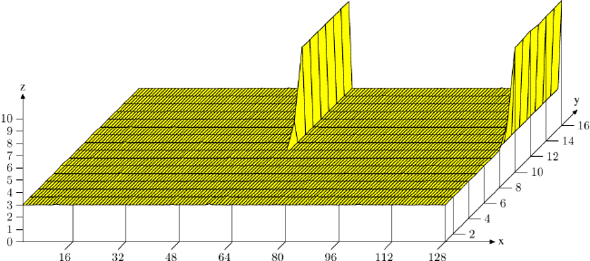

*图 6.5：缓存关联度影响*

在这张图中，现在熟悉的、使用 `NPAD`=15 的 Follow[^4] 测试是以特殊的配置来测量的。X 轴是两个链表元素之间的距离，以空链表元素为单位测量。换句话说，距离为 2 代表下一个元素的地址是在前一个元素的 128 字节之后。所有元素都以相同的距离在虚拟内存空间中摆放。Y 轴显示链表的总长度。仅会使用 1 至 16 个元素，代表工作集总容量为 64 至 1024 字节。Z 轴显示寻访每个链表元素所需的平均周期数。

图中显示的结果应该不让人吃惊。若是被用到的元素很少，所有的数据都塞得进 L1d，而每个链表元素的访问时间仅有 3 个周期。对于几乎所有链表元素的安排都是如此：虚拟地址以几乎没有冲突的方式，被良好地映射到 L1d 的槽（slot）中。（在这张图中）有两个情况不同的特殊距离值。若是距离为 4096 字节（即，64 个元素的距离）的倍数、并且链表的长度大于八，每个链表元素的平均周期数便大幅地增加。在这些情况下，所有项目都在相同的集合中，并且——一旦链表长度大于关联度——项目会从 L1d 被刷新，而下一轮必须从 L2 重新读取。这造成每个链表元素大约 10 个周期的成本。

使用这张图，我们能够确定使用的处理器拥有一个关联度 8、且总容量为 32kB 的 L1d 缓存。这表示，这个测试能够——必要的话——用以确定这些值。可以为 L2 缓存测量相同的影响，但在这里更为复杂，因为 L2 缓存是使用物理地址来索引的，而且它要大得多。

但愿程序员将这个数据视为值得关注组相联度的一种暗示。将数据摆放在二的幂的边界上足够常见于现实世界中，但这正好是容易导致上述影响与性能下降的情况。非对齐访问可能会提高冲突性未命中的可能性，因为每次访问都可能需要额外的缓存行。

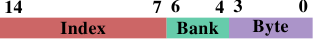

*图 6.6：AMD 上 L1d 的 Bank 地址*

如果执行这种优化，另一个相关的优化也是可能的。AMD 的处理器——至少——将 L1d 实现为多个独立的 bank。只有当两个数据字存储在不同的 bank 中或存储在同一索引（index）下相同的 bank 中，L1d 缓存才能在每一个周期里拿到两个字。bank 地址是以虚拟地址的低位编码的，如图 6.6 所示。假若会共同使用的变量也存储在一起，则它们也会有高可能性在不同的 bank 中或在同一索引下相同的 bank 中。

[^1]: 我们这里忽略可能会改变上溢位（overflow）、下溢位（underflow）、或是四舍五入（rounding）的发生的算术影响。

[^2]: 原文说法较简略，作者的意思是：在一开始三层循环的实现中，最内部的每一次 `k` 循环迭代同时处理 `res[i][j] += mul1[i][k] * mul2[k][j]` 与 `res[i][j + 1] += mul1[i][k] * mul2[k][j + 1]`。由于才刚访问过 `mul2[k][j]` 与 `res[i][j]`，所以 `mul2[k][j + 1]` 与 `res[i][j + 1]` 还在 L1d 缓存中，因而降低未命中率。后述的方法是这个方法的一般化（generalization）。

[^3]: 理论上在 1999 年修订版引入 C 语言的 `restrict` 关键字应该解决这个问题。不过编译器还是不理解。原因主要是存在着太多不正确的代码，其会误导编译器、并导致它产生不正确的目的码（object code）。

[^4]: 测试是在一台 32 位机器上执行的，因此 `NPAD`=15 代表每个链表元素一个 64 字节缓存行。

### 6.2.2 优化一级指令缓存访问

准备有效使用 L1i 的代码需要与有效使用 L1d 类似的技术。不过，问题是，程序员通常不会直接影响 L1i 的使用方式，除非他以组合语言来编写程序。若是使用编译器，程序员能够通过引导编译器建立更好的程序布局，来间接地决定 L1i 的使用。

程序有跳跃（jump）之间为线性的优点。在这些期间，处理器能够有效地预取内存。跳跃打破这个美好的想像，因为

* 跳跃目标（target）可能不是静态决定的；
* 而且即使它是静态的，若是它未命中所有缓存，内存获取可能会花上很长一段时间。

这些问题造成执行中的停顿，可能严重地影响性能。这即是为何现今的处理器在分支预测（branch prediction，BP）上费尽心思的原因。高度特制化的 BP 单元试着尽可能远在跳跃之前确定跳跃的目标，使得处理器能够开始将新的位置的指令加载到缓存中。它们使用静态与动态规则、而且越来越擅于判定执行中的模式。

对指令缓存而言，尽早将数据拿到缓存甚至是更为重要的。如同在 3.1 节提过的，指令必须在它们被执行之前解码，而且——为了加速（在 x86 与 x86-64 上很重要）——指令实际上是以被解码的形式、而非从内存读取的字节／字的形式被缓存的。

为了达到最好的 L1i 使用，程序员至少应该留意下述的代码产生的面向：

1. 尽可能地减少代码量（code footprint）。这必须与像是循环展开（loop unrolling）与行内展开（inlining）等优化取得平衡。
2. 程序执行应该是没有气泡（bubble）的线性的。[^1]
3. 合理的情况下，对齐代码。

我们现在要看一些根据这些面向、可用于协助优化程序的编译器技术。

编译器有启动不同优化层级的选项，特定的优化也能够个别地启用。在高优化层级（gcc 的 -O2 与 -O3）启用的许多优化处理循环优化与函数行内展开。一般来说，这些是不错的优化。如果以这些方式优化的代码占了程序总执行时间的很重要的一部分，便能够提升整体的性能。尤其是，函数的行内展开允许编译器一次优化更大的代码块（chunk），从而能够产生更好地利用处理器的流水线架构的机器码。当程序较大的一部分能被视为一个单一单元时，代码与数据的处理（通过死码消除〔dead code elimination〕或值域传播〔value range propagation〕、等等）的效果更好。

较大的程序容量意味着 L1i（以及 L2 与更高层层）缓存上的压力更大。这*可能*导致较差的性能。较小的程序可能比较快。幸运的是，gcc 有一个针对于此的优化选项。如果使用 -Os，编译器将会为程序容量优化。已知会增加程序容量的优化会被关掉。使用这个选项经常产生惊人的结果。尤其在编译器无法真的获益于循环展开与行内展开的情况下，这个选项就是首选。

行内展开也能被个别处理。编译器拥有引导行内展开的启发法（heuristic）与限制；这些限制能够由程序员控制。`-finlinelimit` 选项指定对行内展开而言，必须被视为过大的函数有多大。若是一个函数在多处被调用，在所有函数中行内展开它便会导致程序容量的剧增。但还有更多细节。假设一个函数 `inlcand` 在两个函数 `f1` 与 `f2` 中被调用。函数 `f1` 与 `f2` 本身是先后被调用的。

<table>
    <tr>
      <td><pre><code>start f1
  code f1
  inlined inlcand
  more code f1
end f1

start f2
  code f2
  inlined inlcand
  more code f2
end f2</code></pre></td>
      <td><pre><code>start inlcand
  code inlcand
end inlcand

start f1
  code f1
end f1

start f2
  code f2
end f2</code></pre></td>
    </tr>
  </table>

*表 6.3：行内展开 Vs 没有行内展开*

表 6.3 显示在两个函数中没有行内展开与行内展开的情况下，产生的代码看起来会怎么样。若是函数 `inlcand` 在 `f1` 与 `f2` 中被行内展开，产生的代码的容量为 size `f1` + size `f2` + $$ 2 \times $$ size `inlcand`。如果没有进行行内展开的话，总容量减少 size `inlcand`。这即是在 `f1` 与 `f2` 相互在不久后调用的话，L1i 与 L2 缓存额外所需的量。再加上：若是 `inlcand` 没被行内展开，代码可能仍在 L1i 中，而它就不必被再次解码。再加上：分支预测单元或许能更好地预测跳跃，因为它已经看过这段程序。如果对程序而言，被行内展开的函数容量上限的编译器默认值并不是最好的，它应该要被降低。

不过，有些行内展开总是合理的情况。假如一个函数只会被调用一次，它也应该被行内展开。这给编译器执行更多优化的机会（像是值域传播，其会显著地改进代码）。行内展开也许会受选择限制所阻碍。对于像这样的情况，gcc 有个选项来明确指定一个函数总是要被行内展开。加上 `always_inline` 函数属性会命令编译器执行恰如这个名称所指示的操作。

在相同的情境下，若是即便一个函数足够小也不该被行内展开，能够使用 `noinline` 函数属性。假如它们经常从多处被调用，即使对于小函数，使用这个属性也是合理的。若是 L1i 内容能被重复使用、并且整体的代码量减少，这往往弥补额外函数调用的附加成本。如今分支预测单元是非常可靠的。若是行内展开能够促成更进一步的优化，情况就不同。这是必须视情况来决定的。

如果行内展开的代码总是会被用到的话，`always_inline` 属性表现得很好。但假如不是这样呢？如果偶尔才会调用被行内展开的函数会怎么样：

```c
void fct(void) {
  ... code block A ...
  if (condition)
    inlfct()
  ... code block C ...
```

为这种程序序列产生的代码一般来说与源代码的结构相符。这表示首先会是程序区块 A、接着是一个条件式跳跃——假如条件式被求值为否（false），就往前跳跃。接下来是为行内展开的 `inlfct` 产生的代码，最后是程序区块 C。这看起来全都很合理，但它有个问题。

若是 `condition` 经常为否，执行就不是线性的。中间有一大块没用到的代码，不仅因为预取污染 L1i，它也会造成分支预测的问题。若是分支预测错，条件表示式可能非常没有效率。

这是个普遍的问题，而且并不专属于函数的行内展开。无论在何时用到条件执行、而且它是不对称的（即，表示式比起某一种结果还要更常产生另一种结果），就有不正确的静态分支预测、从而有流水线中的气泡的可能性。这能够借助告知编译器，以将较不常执行的代码移出主要的程序路径来避免。在这种情况下，为一个 `if` 叙述产生的条件分支将会跳跃到一个跳脱顺序的地方，如下图所示。

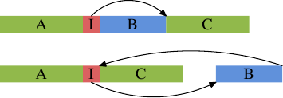

上半部表示单纯的程序布局。假如区域 B——即，由上面被行内展开的函数 `inlfct` 所产生的——因为条件 I 跳过它而经常不被执行，处理器的预取会拉进包含鲜少用到的区块 B 的缓存行。这能够借助区块的重新排列来改变，其结果能够在图的下半部看到。经常执行的代码在内存中是线性的，而鲜少执行的代码被移到不伤及预取与 L1i 效率的某处。

gcc 提供两个实现这点的方法。首先，编译器能够在重新编译代码的期间将性能分析（profiling）的输出纳入考量，并根据性能分析摆放程序区块。我们将会在第七节看到这是如何运作的。第二个方法则是借助明确的分支预测。gcc 认得 `__builtin_expect`：

```c
long __builtin_expect(long EXP, long C);
```

这个结构告诉编译器，表示式 `EXP` 的值非常有可能会是 `C`。返回值为 `EXP`。`__builtin_expect` 必须被用在条件表示式中。在几乎所有的情况中，它会被用在布林表示式的情境中，在这种情况下定义两个辅助巨集（macro）要更方便一些：

```c
#define unlikely(expr) __builtin_expect(!!(expr), 0)
#define likely(expr) __builtin_expect(!!(expr), 1)
```

然后可以像这样用这些巨集

```c
if (likely(a > 1))
```

若是程序员使用这些巨集、然后使用 `-freorder-blocks` 优化选项，gcc 会如上图那样重新排列区块。这个选项会随着 `-O2` 启用，但对于 `-Os` 会被停用。有另一个重新排列区块的 gcc 选项（`-freorder-blocks-and-partition`），但它的用途有限，因为它不适用于例外处理。

还有另一个小循环的大优点，至少在某些处理器上。Intel Core 2 前端有一个特殊的功能，称作循环指令流检测器（Loop Stream Detector，LSD）。若是一个循环拥有不多于 18 道指令（没有一个是对子程序〔routine〕的调用）、仅要求至多 4 次 16 字节的解码器撷取、拥有至多 4 条分支指令、并且被执行超过 64 次，那么这个循环有时会被锁在指令伫列中，因而在循环被再次用到的时候能够更为快速地使用。举例来说，这适用于会通过一个外部循环进入很多次的很小的内部循环。即使没有这种特化的硬件，小巧的循环也有优点。

就 L1i 而言，行内展开并非优化的唯一面向。另一个面向是对齐，就如数据一般。但有些明显的差异：程序大部分是线性的一团，其无法任意地摆在地址空间中，而且它无法直接受程序员影响，因为是编译器产生这些程序的。不过，有些程序员能够控制的面向。

对齐每条单一指令没有任何意义。目标是令指令流为连续的。所以对齐仅在战略要地上才有意义。为了决定要在何处加上对齐，理解能有什么好处是必要的。有条在一个缓存行开头的指令[^2]代表缓存行的预取是最大化的。对指令而言，这也代表着解码器是更有效的。很容易看出，若是执行一条在缓存行结尾的指令，处理器就必须准备读取一个新的缓存行、并对指令解码。有些事情可能会出错（像是缓存行未命中），代表平均而言，一条在缓存行结尾的指令执行起来并不跟在开头的指令一样有效。

如果控制权刚转移到在缓存行结尾的指令（因此预取无效），则情况最为严重。将以上推论结合后，我们得出对齐代码最有用的地方：

* 在函数的开头；
* 在仅会通过跳跃到达的基础区块的开头；
* 对某些扩展而言，在循环的开头。

在前两种情况下，对齐的成本很小。在一个新的位置继续执行，假如决定让它在缓存行的开头，我们便优化预取与解码。[^3]编译器借助无操作（no-op）指令的插入，填满因对齐程序产生的间隔，而实现这种对齐。这种“死码（dead code）”占用一些空间，但通常不伤及性能。

第三种情况略有不同：对齐每个循环的开头可能会造成性能问题。问题在于，一个循环的开头往往是连续地接在其他的代码之后。若是情况不是非常凑巧，便会有个在前一道指令与被对齐的循环开头之间的间隔。不像前两种情况，这个间隔无法完全不造成影响。在前一道指令执行之后，必须执行循环中的第一道指令。这表示，在前一道指令之后，要不是非得有若干条无操作指令以填补间隔、要不就是非得有个到循环开头的无条件跳跃。两种可能性都不是免费的。特别是循环本身并不常被执行的话，无操作指令或是跳跃的开销可能会比对齐循环所省下的还多。

有三种程序员能够影响程序对齐的方法。显然地，若是程序是以组合语言编写，其中的函数与所有的指令都能够被明确地对齐。组合语言为所有架构提供 `.align` 假指令（pseudo-op）以做到这点。对高层语言而言，必须将对齐需求告知编译器。不像数据型别与变量那样，这在源代码中是不可能的。而是要使用一个编译器选项：

`-falign-functions=N`

这个选项命令编译器将所有函数对齐到下一个大于 `N` 的二的幂的边界。这表示会产生一个至多 `N` 字节的间隔。对小函数而言，使用一个很大的 `N` 值是个浪费。对只有难得才会执行的程序也相同。在可能同时包含常用与没那么常用的接口的库中，后者可能经常发生。选项值的明智选择可以借助避免对齐来让工作加速或是节省内存。能够借助使用 1 作为 `N` 的值、或是使用 `-fno-align-functions` 选项来关掉所有的对齐。

有关前述的第两种情况的对齐——无法顺序达到的基础区块的开头——能够使用一个不同的选项来控制：

`-falign-jumps=N`

所有其他的细节都相同，关于浪费内存的警告也同样适用。

第三种情况也有它自己的选项：

`-falign-loops=N`

再一次，同样的细节与警告都适用。除了在这里，如同先前解释过的，对齐会造成执行期的成本，因为在对齐的地址会被顺序地抵达的情况下，要不是必须执行无操作指令就是必须执行跳跃指令。

gcc 还知道一个用来控制对齐的选项，在这里提起它仅是为了完整起见。`-falign-labels` 对齐了程序中的每个单一标记（label）（基本上是每个基础区块的开头）。除了一些例外状况之外，这都会让程序变慢，因而不该被使用。

[^1]: 气泡生动地描述在一个处理器的流水线中执行的空洞，其会在执行必须等待资源的时候发生。关于更多细节，请读者参阅处理器设计的文献。

[^2]: 对某些处理器而言，缓存行并非指令的最小区块（atomic block）。Intel Core 2 前端会将 16 字节区块发给解码器。它们会被适当的对齐，因此没有任何被发出的区块能横跨缓存行边界。对齐到缓存行的开头仍有优点，因为它优化预取的正面影响。

[^3]: 对于指令解码，处理器往往会使用比缓存行还小的单元，在 x86 与 x86-64 的情况中为 16 字节。

### 6.2.3 优化二级与更高层缓存访问

关于一级缓存的优化所说的一切也适用于二级与更高层缓存访问。有两个最后一级缓存的额外面向：

* 缓存未命中一直都非常昂贵。L1 未命中（希望）频繁地命中 L2 与更高层缓存，于是限制其损失，但最后一级缓存显然没有后盾。
* L2 缓存与更高层缓存经常由多颗处理器核与／或 HT 所共享。每个执行单元可用的有效缓存容量因而经常小于总缓存容量。

为了避免缓存未命中的高成本，工作集容量应该配合缓存容量。若是数据只需要一次，这显然不是必要的，因为缓存无论如何都没有效果。我们要讨论的是被需要不只一次的数据集的工作负载。在这种情况下，使用一个太大而不能塞得进缓存的工作集将会产生大量的缓存未命中，即使预取成功地执行，也会拖慢程序。

即使数据集太大，一个程序也必须完成它的职责。以最小化缓存未命中的方式完成工作是程序员的职责。对于最后一级缓存，是可能——如同 L1 缓存——以较小的部分来执行工作的。这与表 6.2 优化的矩阵乘法非常雷同。不过，有一点不同在于，对于最后一级缓存，要处理的数据区块可能比较大。如果也需要 L1 优化，程序会变得更加复杂。想像一个矩阵乘法，其数据集——两个输入矩阵与输出矩阵——无法同时塞进最后一级缓存。在这种情况下，或许适合同时优化 L1 与最后一级缓存访问。

众多处理器世代中的 L1 缓存行大小经常是固定的；即使不同，差异也很小。假设为较大的容量是没什么大问题的。在有着较小缓存容量的处理器中，会用到两个或更多缓存行、而非一个。在任何情况下，写死缓存行大小、并为此优化程序都是合理的。

对于较高层级的缓存，若程序是假定为一般化的话，就不是这样。那些缓存的容量可能有很大的差异。八倍或更多倍并不罕见。将较大的缓存容量假定为默认容量是不可能的，因为这可能表示，除了那些有着最大缓存的机器之外，程序在所有机器上都会表现得很差。相反的选择也很糟：假定为最小的缓存，代表浪费掉 87% 或者更多的缓存。这很糟；如同我们能从图 3.14 看到的，使用大缓存对程序的速度有着巨大的影响。

这表示程序必须动态地将自身调整为缓存行大小。这是一种程序特有的优化。我们这里能说的是，程序员应该正确地计算程序的需求。不仅数据集本身需要，更高层级的缓存也会被用于其他目的；举例来说，所有执行的指令都是从缓存加载的。若是使用库里头的函数，这种缓存的使用可能会总和为一个可观的量。那些库函数也可能需要它们自己的数据，进一步减少可用的内存。

一旦我们有一个内存需求的公式，我们就能够将它与缓存容量作比较。如同先前所述，缓存可能会被许多其他处理器核所共享。目前[^1]，在没有写死知识的情况下，取得正确信息的唯一方法是通过 `/sys` 文件系统。在表 5.2，我们已经看过系统内核发布的有关于硬件的信息。程序必须在目录：

`/sys/devices/system/cpu/cpu*/cache`

找到最后一级缓存。这能够由在这个目录里的层级文件中的最高数值来辨别出来。当目录被识别出来时，程序应该读取在这个目录中的 `size` 文件的内容，并将数值除以 `shared_cpu_map` 文件中的位掩码中设置的数字。

以这种方式计算的值是个安全的下限。有时一个程序会知道多一些有关其他线程或进程的行为。若是那些线程被调度在共享这个缓存的处理器核或 HT 上、并且已知缓存的使用不会耗尽它在总缓存容量中所占的那份，那么计算出的限制可能会太小，而不是最佳的。是否要比公平共享应该使用的还多，真的要视情况而定。程序员必须做出抉择，或者必须让用户做个决定。

[^1]: 当然很快就会有更好的方法！

### 6.2.4 优化 TLB 使用

有两种 TLB 使用的优化。第一种优化是减少一个程序必须使用的分页数。这会自动导致较少的 TLB 未命中。第两种优化是借助减少必须被分配的较高层目录表的数量，以令 TLB 查询便宜一些。较少的目录表代表使用的内存较少，这可能使得目录查询有较高的缓存命中率。

第一种优化与缺页的最小化密切相关。我们将会在 7.5 节仔细地涵盖这个主题。缺页经常是个一次性的成本，但由于 TLB 缓存通常很小而且会被频繁地刷新，因此 TLB 未命中是个长期的损失。缺页比起 TLB 未命中还贵了数个数量级，但若是一个程序跑得足够久、而且程序的某些部分会被足够频繁地执行，TLB 未命中甚至可能超过缺页的成本。因此重要的是，不仅要从缺页的角度、也要从 TLB 未命中的角度来考虑分页优化。差异在于，缺页的优化只要求分页范围内的代码与数据分组，而 TLB 优化则要求——在任何时间点——尽可能少的 TLB 项目。

第两种 TLB 优化甚至更难控制。必须使用的分页目录数量是视进程的虚拟地址空间中使用的地址范围分布而定的。地址空间中广泛多样的位置代表着更多的目录。

一个难题是，地址空间布局随机化（Address Space Layout Randomization，ASLR）恰好造成这种状况。栈、DSO、堆、与可能的可可执行文件的加载地址会在执行期随机化，以防止机器的攻击者猜出函数或变量的地址。

只有在最大性能至关重要的情况下，才应该关掉 ASLR。额外目录的成本低到足以令这步是不必要的，除了一些极端的状况之外。系统内核能随时执行的一个可能的优化是，确保一个单一的映射不会横跨两个目录之间的内存空间边界。这会以最小的方式限制 ASLR，但不足以大幅地削弱它。

程序员直接受此影响的唯一方式是在明确请求一个地址空间区域的时候。这会在以 `MAP_FIXED` 使用 `mmap` 的时候发生。以这种方式分配地址空间区域非常危险，人们几乎不会这么做。如果程序员使用上述方法且允许自由选取地址，则他们应该要知道最后一级分页目录的边界，及适当挑选所请求的地址。

## 6.3 预取

预取的目的是隐藏内存访问的延迟。现今处理器的命令管道与乱序（out-of-order，简称 OoO）执行的功能能够隐藏一些延迟，但最多也只是对命中缓存的访问而言。要掩盖主内存访问的延迟，命令伫列可能得要非常地长。某些没有 OoO 的处理器试着借助提高核的数量来补偿，但除非所有使用的代码都被并行化，否则这是个不太好的交易。

预取能进一步帮助隐藏延迟。处理器靠它自己执行预取，由某些事件触发（硬件预取）或是由程序明确地请求（软件预取）。

### 6.3.1 硬件预取

CPU 启动硬件预取的触发，通常是二或多个缓存未命中的某种模式的序列。这些缓存未命中可能在缓存行之前或之后。在旧的实现中，只有邻近缓存行的缓存未命中会被识别出来。使用当代硬件，步伐也会被识别出来，代表跳过固定数量的缓存行会被识别为一种模式并被适当地处理。

若每次单一的缓存未命中都会触发一次硬件预取，对于性能来说大概很糟。随机内存访问模式——例如访问全域变量——是非常常见的，而产生的预取会大大地浪费 FSB 带宽。这即是为何启动预取需要至少两次缓存未命中。处理器现今全都预期有多于一条内存访问的串流。处理器试着自动将每个缓存未命中指派给这样的一条串流，并且在达到门槛时启动硬件预取。CPU 现今能跟踪更高层缓存的八到十六条单独的串流。

负责模式识别的单元与各自的缓存相关联。可以有一个 L1d 与 L1i 缓存的预取单元。很可能有一个 L2 与更高层缓存的预取单元。L2 与更高层缓存的预取单元是被所有使用相同缓存的其他处理器核与 HT 所共享。八到十六条单独串流预取单元的数量便因而迅速减少。

预取有个大弱点：它无法跨越分页边界。理解到 CPU 支持需求分页（demand paging）时，原因应该很明显。若是预取被允许横跨分页边界，访问可能会触发一个事件，以令分页能够被取得。这本身可能很糟，尤其是对性能而言。更糟的是预取器并不知道程序或操作系统本身的语义（semantic）。它可能因此预取实际上永远不会被请求的分页。如此意味着预取器会运行超过处理器曾以可识别模式访问过的内存区域尽头。这不只可能，而且非常有可能。若是处理器——作为一次预取的一个副作用——触发对这样的分页的请求，操作系统甚至可能会在这种请求永远也不会发生时完全扔掉它的跟踪纪录。

因此重要的是认识到，无论预取器在预测模式上有多厉害，程序也会在分页边界上历经缓存未命中，除非它明确地从新的分页预取或是读取。这是如 6.2 节描述的优化数据布局、以借助将不相关的数据排除在外来最小化缓存污染的另一个理由。

由于这个分页限制，处理器现今并没有非常复杂的逻辑来识别预取模式。以仍占主导地位的 4k 页大小而言，有意义的也就这么多。这些年来已经提高识别步伐的地址范围，但超过现今经常使用的 512 字节窗格（window）可能没太大意义。目前的预取单元并不认得非线性的访问模式。这种模式较有可能是真的随机、或者至少足够不重复到令试着识别它们不具意义。

若是硬件预取被意外地触发，能做的只有这么多。一个可能是试着找出这个问题，并稍微改变量据与／或程序布局。这大概满困难的。可能有特殊的在地化（localized）解法，像是在 x86 与 x86-64 处理器上使用 `ud2` 指令[^1]。这个无法自己执行的指令是在一条间接的跳跃指令后被使用；它被作为指令获取器（fetcher）的一个信号使用，表示处理器不应浪费精力解码接下来的内存，因为执行将会在一个不同的位置继续。不过，这是个非常特殊的情况。在大部分情况下，必须要忍受这个问题。

能够完全或部分地停用整个处理器的硬件预取。在 Intel 处理器上，一个特定模型寄存器（Model Specific Register，MSR）便用于此（IA32\_MISC\_ENABLE，在许多处理器上为位 9；位 19 只停用邻近缓存行预取）。这在大多情况下必须发生在系统内核中，因为它是个特权操作。若是数据分析显示，执行于系统上的一个重要的应用程序因硬件缓存而遭受带宽耗竭与过早的缓存逐出，使用这个 MSR 是一种可能性。

[^1]: 或是 non-instruction。这是推荐的未定义操作码。

### 6.3.2 软件预取

硬件预取的优势在于不必调整程序。缺点如同方才描述的，访问模式必须很直观，而且预取无法横跨分页边界进行。因为这些原因，我们现在有更多可能性，软件预取它们之中最重要的。软件预取不需借助插入特殊的指令来修改源代码。某些编译器支持编译指示（pragma）以或多或少地自动插入预取指令。
在 x86 和 x86-64，intrinsic 函数会由编译器产生特殊的指令:

```c
#include <xmmintrin.h>
enum _mm_hint
{
  _MM_HINT_T0 = 3,
  _MM_HINT_T1 = 2,
  _MM_HINT_T2 = 1,
  _MM_HINT_NTA = 0
};
void _mm_prefetch(void *p,
                  enum _mm_hint h);
```

程序能够在程序中的任何指针上使用 `_mm_prefetch` intrinsic 函数。许多处理器（当然包含所有 x86 与 x86-64 处理器）都会忽略无效指针产生的错误，这令程序员的生活好过非常多。若是被传递的指针指向合法的内存，会命令预取单元将数据加载到缓存中，并且——必要的话——逐出其他数据。不必要的预取应该被确实地避免，因为这会降低缓存的有效性，而且它会耗费内存带宽（在被逐出的缓存行是脏的情况下，可能需要两个缓存行的带宽）。

要与 `_mm_prefetch` 一起使用的不同提示（hint）是由实现定义的。这表示每个处理器版本能够（稍微）不同地实现它们。一般能说的是，`_MM_HINT_T0` 会为包含式缓存将数据获取到所有缓存层级，并为独占式缓存获取到最低层级的缓存。若是数据项目在较高层级的缓存中，它会被加载到 L1d 中。`_MM_HINT_T1` 提示将数据拉进 L2 而非 L1d。若是有个 L3 缓存，`_MM_HINT_T2` 能做到类似于此的事情。不过，这些是没怎么被明确指定的细节，需要对所使用的实际处理器进行验证。一般来说，若是数据在使用 `_MM_HINT_T0` 之后立刻被用到就没错。当然这要求 L1d 缓存容量要大得足以容纳所有被预取的数据。若是立即被使用的工作集容量太大，将所有东西预取到 L1d 就是个坏点子，而应该使用其他两种提示。

第四种提示，`_MM_HINT_NTA` 能够吩咐处理器特殊地对待预取的缓存行。NTA 代表非临时对齐（non-temporal aligned），我们已经在 6.1 节解释过。程序告诉处理器应该尽可能地避免以这个数据污染缓存，因为数据只在一段很短的期间内会被使用。对于包含式缓存实现，处理器因而能够在加载时避免将数据读取进较低层级的缓存。当数据从 L1d 逐出时，数据不必被推进 L2 或更高层级的缓存中，但能够直接写到内存中。可能有其他处理器设计师在给定这个提示时能够布署的其他手法。程序员必须谨慎地使用这个提示：若是目前的工作集容量太大，并强制逐出以 NTA 提示加载的缓存行，就要重新从内存加载。

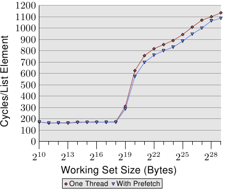

*图 6.7：使用预取的平均，NPAD=31*

图 6.7 显示使用现已熟悉的指针追逐框架（pointer chasing framework）的测试结果。链表是随机地被摆放在内存中的。与先前测试的不同之处在于，程序真的会在每个链表节点上花一些时间（大约 160 周期）。如同我们从图 3.15 的数据中学到的，一旦工作集容量大于最后一级缓存，程序的性能就会受到严重的影响。

我们现在能够试着在计算之前发出预取请求来改善这种状况。即，我们在循环的每一轮预取一个新元素。链表中被预取的节点与正在处理的节点之间的距离必须被谨慎地选择。假定每个节点在 160 周期内被处理、并且我们必须预取两个缓存行（`NPAD`=31），五个链表元素的距离便足够。

图 6.7 的结果显示预取确实有帮助。只要工作集容量不超过最后一级缓存的容量（这台机器拥有 512kB = 2<sup>19</sup>B 的 L2），数字就是相同的。预取指令并不会增加能测量出来的额外负担。一旦超过 L2 容量，预取省下 50 到 60 周期之间，高达 8%。预取的使用无法隐藏任何损失，但它稍微有点帮助。

AMD 在它们 Opteron 产品线的 [10h 家族](https://en.wikipedia.org/wiki/AMD_10h)实现另一个指令：`prefetchw`。在 Intel 这边迄今仍没有这个指令的等价物，也不能通过 intrinsic 使用。`prefetchw` 指令要求 CPU 将缓存行预取到 L1 中，就如同其他预取指令一样。差异在于缓存行会立即变成“M”状态。若是之后没有接着对缓存行的写入，这将会是个不利之处。但若是有一或多次写入，它们将会被加速，因为写入操作不必改变缓存状态——其在缓存行被预取时就被设好。这对于竞争的缓存行尤为重要，其中在另一个处理器的缓存中的缓存行的一次普通的读取操作会先在两个缓存中将状态改成“S”。

预取可能有比我们这里达到的微薄的 8% 还要更大的优势。但它是众所皆知地难以做得正确，尤其是在预期相同的二元档在各种各样的机器上都表现良好的情况。由 CPU 提供的性能计数器能够帮助程序员分析预取。能够被计数并取样的事件包含硬件预取、软件预取、有用的／使用的软件预取、在不同层级的缓存未命中、等等。在 7.1 节，我们将会介绍这些事件。这所有的计数器都是机器特有的。

在分析程序时，应该要先看看缓存未命中。找出大量缓存未命中来源的所在时，应该试着针对碰上问题的内存访问加上预取指令。这应该一次处理一个地方。每次修改的结果应该借助观察测量有用预取指令的性能计数器来检验。若是那些计数器没有提升，那么预取可能是错的，它并没有给予足够的时间来从内存加载，或者预取从缓存逐出仍然需要的内存。

gcc 现今能够在唯一一种情况下自动发出预取指令。若是一个循环迭代在一个数组上，能够使用下面的选项：

`-fprefetch-loop-arrays`

编译器会计算出预取是否合理，以及——如果是的话——它应该往前看多远。对小数组而言，这可能是个不利之处，而且若是在编译期不知道数组的容量的话，结果可能更糟。gcc 手册提醒道，这个好处极为仰赖于代码的形式，而在某些情况下，程序可能真的会跑得比较慢。程序员必须谨慎地使用这个选项。

### 6.3.3 特殊预取：推测执行

一个现代处理器的 OoO 执行能力允许在不与彼此冲突的情况下搬移指令。举例来说（这次使用 IA-64 为例）：

```
st8        [r4] = 12
add        r5 = r6, r7;;
st8        [r18] = r5
```

这段程序序列将 12 存储至由寄存器 `r4` 指定的地址、将 `r6` 与 `r7` 寄存器的内容相加、并将它存储在寄存器 `r5` 中。最后，它将总和存储至由寄存器 `r18` 指定的地址。这里的重点在于，加法指令能够在第一个 `st8` 指令之前——或者同时——执行，因为并没有数据的依赖关系。但假如必须加载其中一个加数会怎么样呢？

```
st8        [r4] = 12
ld8        r6 = [r8];;
add        r5 = r6, r7;;
st8        [r18] = r5
```

额外的 `ld8` 指令将值加载到由 `r8` 指令的地址。在这个加载指令与接下来的 `add` 指令之间有个明确的数据依赖关系（这便是指令后面的 `;;` 的理由，感谢提问）。这里的关键在于，新的 `ld8` 指令——不若 `add` 指令——无法被移到第一个 `st8` 前面。处理器无法在指令解码的期间足够快速地决定存储与加载是否冲突——即，`r4` 与 `r8` 是否可能有相同的值。假如它们有相同的值，`st8` 指令会决定加载到 `r6` 的值。更糟的是，在加载未命中缓存的情况下，`ld8` 可能也会随之带来漫长的延迟。IA 64 架构针对这种情况支持猜测式加载（speculative load）：

```
ld8.a      r6 = [r8];;
[... other instructions ...]
st8        [r4] = 12
ld8.c.clr  r6 = [r8];;
add        r5 = r6, r7;;
st8        [r18] = r5
```

新的 `ld8.a` 与 `ld8.c.clr` 指令是一对的，并取代前一段程序序列的 `ld8` 指令。`ld8.a` 为猜测式加载。这个值无法被直接使用，但处理器能开始运作。这时，当到达 `ld8.c.clr` 指令的时候，这个内容可能已经被加载（假定这个间隔中有足够数量的指令）。这个指令的引数（argument）必须与 `ld8.a` 指令相符。若是前面的 `st8` 指令没有覆写这个值（即 `r4` 与 `r8` 相同[^1]），就什么也不必做。猜测式加载做它的工作，而加载的延迟被隐藏。若是加载与存储冲突，`ld8.c.clr` 会重新从内存加载值，而我们最终会得到一个正常的 `ld8` 指令的语义。

猜测式加载（仍？）没有被广泛使用。但如同这个例子所显示的，它是个非常简单而有效的隐藏延迟的方法。预取基本上是等同的东西，并且对有着少量寄存器的处理器而言，猜测式加载可能没多大意义。猜测式加载有直接将值加载到寄存器中，而不加载到可能会被再次逐出的缓存行（举例来说，当线程被移出调度〔deschedule〕的时候）这个（有时很大的）优点。如果能够使用猜测的话，应该要使用它。

[^1]: `r4` 与 `r8` 相同指的是“值会被覆写的情况”。

### 6.3.4 辅助线程

在尝试使用软件预取时，往往会碰到程序复杂度的问题。若是程序必须迭代于一个数据结构上（在我们的情况中是个链表），必须在同个循环中实现两个独立的迭代：执行作业的普通迭代、与往前看以使用预取的第二个迭代。这轻易地变得足够复杂到容易产生未命中。

此外，决定要往前看多远是必要的。太短的话，内存将无法及时被加载。太远的话，刚加载的数据可能会被再一次逐出。另一个问题是，虽然它不会阻挡或等待内存加载，但预取指令很花时间。指令必须被解码，假如解码器太忙碌的话——举例来说，由于良好编写／产生的代码——这可能很明显。最后，循环的程序容量会增加。这降低 L1i 的效率。若借助一次发出多个预取指令来试着避免部分成本，则会碰到显著的预取请求数的问题。

一个替代方法是完全独立地执行一般的操作与预取。这能使用两条普通的线程来进行。线程显然必须被调度，以令预取线程填充一个被两条线程访问的缓存。有两个值得一提的特殊解法：

* 在相同的处理器核上使用 HT （见 3.3.4 节，Hyper-Threading）。在这种情况下，预取能够进入 L2（或者甚至是 L1d）。
* 使用比 SMT 线程“更愚笨的（dumber）”线程，其除预取与其他简单的操作之外什么也不做。这是个处理器厂商可能会探究的选项。

HT 的使用是尤其令人感兴趣的。如同我们已经在 3.3.4 节看到的，假如 HT 执行独立的代码的话，缓存的共享是个问题。反而，在一条线程被用作一条预取辅助线程（helper thread）时，这并不是个问题。与此相反，这是个令人渴望的结果，因为最低层级的缓存被预载。此外，由于预取线程大多是空闲或者在等待内存，所以假如不必自己访问主存的话，其余 HT 的一般操作并不会太受干扰。后者正好是预取辅助线程所预防的。

唯一棘手的部分是确保辅助线程不会往前跑得太远。它不能完全污染缓存，以致最早被预取的值被再次逐出。在 Linux 上，使用 `futex` 系统调用 [7] 或是——以稍微高一些的成本——使用 POSIX 线程同步基本指令（primitive），是很容易做到同步的。

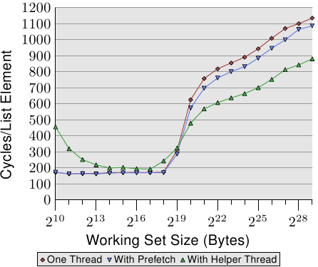

*图 6.8：使用辅助线程的平均，NPAD=31*

这个方法的好处能够在图 6.8 中看到。这是与图 6.7 中相同的测试，只不过加上额外的结果。新的测试建立一条额外的辅助线程，往前执行大约 100 个链表项目，并读取（不只预取）每个链表元素的所有缓存行。在这种情况下，我们每个链表元素有两个缓存行（在一台有着 64 字节缓存行大小的 32 位机器上，`NPAD`=31）。

两条线程被调度在相同处理器核的两条 HT 上。测试机仅有一颗处理器核，但结果应该与多于一颗处理器核的结果大致相同。亲和性函数——我们将会在 6.4.3 节介绍——被用来将线程绑到合适的 HT 上。

要确定操作系统知道哪两个 (或更多) 处理器为 HT ，可以使用来自 libNUMA 的 `NUMA_cpu_level_mask` 接口（见附录 D）。

```c
#include <libNUMA.h>
ssize_t NUMA_cpu_level_mask(size_t destsize,
                            cpu_set_t *dest,
                            size_t srcsize,
                            const cpu_set_t*src,
                            unsigned int level);
```

这个接口能用来决定通过缓存与内存连接的 CPU 阶层架构。这里感兴趣的是对应于 HT 的一级缓存。为在两条 HT 上调度两条线程，能够使用 libNUMA 函数（为简洁起见，省略错误处理）：

```c
cpu_set_t self;
NUMA_cpu_self_current_mask(sizeof(self),
                           &self);
cpu_set_t hts;
NUMA_cpu_level_mask(sizeof(hts), &hts,
                    sizeof(self), &self, 1);
CPU_XOR(&hts, &hts, &self);
```

在执行这段程序之后，我们有两个 CPU 位集。`self` 能用来设定目前线程的亲和性，而 `hts` 中的掩码能被用来设定辅助线程的亲和性。这在理想上应该在线程被建立前发生。在 6.4.3 节，我们会介绍设定亲和性的接口。若是没有可用的 HT ，`NUMA_cpu_level_mask` 函数会返回 1。这能够用以作为避免这个优化的征兆。

这个基准测试的结果可能出乎意料（也可能不会）。若是工作集塞得进 L2，辅助线程的间接成本将性能降低 10% 到 60% 之间（主要在比较低的那端，再次忽略最小的工作集容量，杂讯太多）。这应该在预料之中，因为若是所有数据都已经在 L2 缓存中，预取辅助线程仅仅使用系统资源，却没有对执行有所贡献。

不过，一旦不再足够的 L2 容量耗尽，情况就改变。预取辅助线程协助将执行时间降低大约 25%。我们仍旧看到一条上升的曲线，只不过是因为无法足够快速地处理预取。不过，主线程执行的算术操作与辅助线程的内存加载操作彼此互补。资源冲突是最小的，其导致这种相辅相成的结果。

这个测试的结果应该能够被转移到更多其他的情境。由于缓存污染而经常无用的 HT ，在这些情境中表现出众，并且应该被善用。附录 D 介绍的 NUMA 库使线程兄弟的找寻非常容易（见这个附录中的示例）。若是库不可用，`sys` 文件系统令一个程序能够找出线程的兄弟（见表 5.3 的 `thread_siblings` 字段）。一旦能够取得这个信息，程序就必须定义线程的亲和性，然后以两种模式执行循环：普通的操作与预取。被预取的内存总量应该视共享的缓存容量而定。在这个例子中，L2 容量是有关的，程序能够使用

`sysconf(_SC_LEVEL2_CACHE_SIZE)`

来查询容量。辅助线程的进度是否必须被限制取决于程序。一般来说，最好确定有一些同步，因为调度细节可能会导致显著的性能降低。

### 6.3.5 直接缓存访问

在现代操作系统中，缓存未命中的一个来源是到来的数据流量的处理。像网络接口卡（Network Interface Card，NIC）与硬盘控制器等现代硬件，能够在不涉及 CPU 的情况下，直接将接收或读取的数据写入到内存中。这对于我们现今拥有的设备的性能而言至关重要，但它也造成问题。假使有个从网络传入的数据包：操作系统必须检查数据包的头部（header）以决定要如何处理它。NIC 将数据包摆进内存，然后通知处理器它的到来。处理器没有机会去预取数据，因为它并不知道数据将何时抵达，甚至可能不会确切知道它将会被存在哪。结果是在读取头部时的一次缓存未命中。

Intel 已经在它们的芯片组与 CPU 中加上技术以缓解这个问题 [14]。构想是将数据包的数据填入将会被通知到来的数据包的 CPU 的缓存。数据包的有效载荷在这里并不重要，这个数据一般将会由更高层的函数——要不是在系统内核中、就是在用户层级——处理。数据包首部被用来决定数据包必须以什么方式处理，因此这个数据是立即所需的。

网络 I/O 硬件已有 DMA 以写入数据包。这表示它直接地与潜在整合在北桥中的内存控制器进行沟通。内存控制器的另一边是通过 FSB 到处理器的接口（假设内存控制器没有被整合到 CPU 自身）。

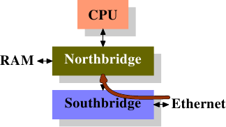

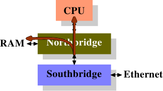

*图 6.9：直接缓存访问（上：启动 DMA；下：执行 DMA 与 DCA）*

直接缓存访问（Direct Cache Access，DCA）背后的想法是，扩展 NIC 与内存控制器之间的通信协议。在图 6.9 中，第一张图显示在一台有着南北桥的正规机器上的 DMA 传输的起始。NIC 被连接到南桥上（或作为其一部分）。它启动 DMA 访问，但提供关于数据包首部的新信息，其应该被推进处理器的缓存中。

在第二步中，传统的行为仅会是以连接到内存的连接完成 DMA 传输。对于被设置 DCA 标志的 DMA 传输，北桥会以特殊的、新的 DCA 标志在 FSB 上同时送出数据。处理器一直监听着 FSB，并且若是它认出 DCA 标志，它会试着将寄给处理器的数据加载到最低阶缓存中。事实上，DCA 标志是个提示；处理器能够自由地忽略它。在 DMA 传输完成之后，会以信号通知处理器。

在处理数据包时，操作系统必须先确定是哪种数据包。若是 DCA 提示没有被忽略的话，操作系统必须执行、以识别数据包的加载操作很有可能会命中缓存。将每个数据包数以百计个循环的节约，乘上每秒能处理的成千上万个数据包，节省的总和量是个非常可观的数字，尤其在谈到延迟的时候。

少了 I/O 硬件（在这个例子中为 NIC）、芯片组与 CPU 的整合，这种优化是不可能的。因此，假如需要这个技术的话，确保明智地挑选平台是必要的。

## 6.4 多线程优化

关于多线程，有三个缓存使用的面向是很重要的：

* 并行（Concurrency）
* 原子性（Atomicity）
* 带宽

这些面向也适用于多进程的情况，但因为多进程（大多数）是独立的，因此为它们优化并没有那么容易。可能的多进程优化是那些可用于多线程情况的子集。所以这里我们会专门讨论后者。

在这种前后文下，并行指的是在一次执行多于一条线程时，一个进程所历经的内存影响。线程的一个特性是它们全都共享相同的地址空间，因此全都能够访问相同的内存。在理想的情况下，线程所使用的内存区域在多数时候都是不同的。在这种情况下，那些线程仅稍许耦合（couple）（举例来说，共有的输入与／或输出）。若是多于一条线程使用相同的数据，就需要协调：这即是原子性发挥作用的时候。最后，视机器架构而定，可用的内存与可用于处理器的处理器之间的总线带宽是有限的。我们将会在接下来的章节分别论及这三个面向——虽然它们是紧密相连的。

### 6.4.1 并行优化

一开始，我们将会在本节讨论两个个别的问题，其实际上需要对立的优化。一个多线程应用程序在一些它的线程中使用共有的数据。一般的缓存优化要求将数据保存在一起，使得应用程序的内存使用量很小，从而最大化在任意时间塞得进缓存的内存总量。[^1]

不过，使用这个方法有个问题：若是多条线程写入到一个内存位置，每个相对应处理器核的 L1d 中的缓存行必须处于“E”（独占）状态。这表示会送出许多的 RFO 消息。在最糟的情况下，每次写入访问都会送出一个消息。所以一个普通的写入将会突然变得非常昂贵。若是使用相同的内存位置，同步就是必须的（可能通过 atomic 操作[^2]的使用，其会在下个章节讨论到）。不过，当所有线程都使用不同的内存位置、并且可能是独立的时候，问题也显而易见。

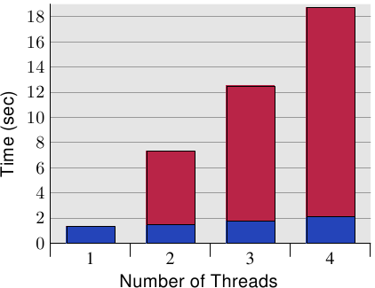

*图 6.10：并行缓存行访问的间接成本*

图 6.10 显示这种“假共享（false sharing）”的结果。测试程序（显示于 A.3 节）建立若干线程，其除递增一个内存位置（5 亿次）外什么也不做。测量的时间是从程序启动、直到程序等待最后一条线程结束之后。线程被钉在独立的处理器上。机器拥有四个 P4 处理器。蓝色值表示被指派到每条线程的内存分配位在个别缓存行上的执行时间。红色部分为线程的位置被移到仅一个缓存行时出现的损失。

蓝色的测量（使用独立的缓存行时所需的时间）与预期的相符。程序在无损失的情况下延展至多条线程。每个处理器都将它的缓存行保存在它拥有的 L1d 中，而且没有带宽问题，因为不必读取太多代码或数据（事实上，它们全都被缓存）。测量的些微提升其实是系统的杂讯、和可能的一些预取影响（线程使用连续的缓存行）。

使用唯一一个缓存行所需的时间、以及每条线程一个个别的缓存行所需的时间相除所计算出的测量的间接成本分别是 390%、734%、以及 1,147%。乍看之下，这些很大的数字可能很令人吃惊，但考虑到需要的缓存交互影响，这应该很显而易见。已经完成写入到缓存行之后，就从一个处理器的缓存拉出缓存行。[^3]在任何给定的时刻，除了拥有缓存行的处理器以外，所有处理器都会被延迟，无法做任何事。每个额外的处理器都会导致更多的延迟。

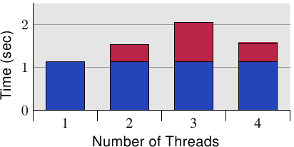

*图 6.11：四个处理器核的间接成本*

由于这些测量，清楚的是这种情况必须在程序中避免。考虑到巨大的损失，在许多情况下，这个问题是很显而易见的（至少，性能分析会显示程序位置），但有个使用现代硬件的陷阱。图 6.11 显示当程序执行在一台单一处理器节点具备四核的机器上（Intel Core 2 QX 6700）的等价测量。即使使用这个处理器的两个个别的 L2，测试案例也没有显示出任何可延展性的问题。当相同的缓存行被使用超过一次时有些许的间接成本，但它并没有随着处理器核的数量增加。[^4]若是用多于一个这种处理器，我们自然会看到类似于那些在图 6.10 中的结果。尽管越来越多多核处理器的使用，许多机器还是会继续使用多处理器。因此，正确的处理这种状况是很重要的，这可能意味着要在真实的 SMP 机器上测试程序。

有个针对这个问题的非常简单的“修正”：将每个变量摆在它们自己的缓存行。这是与先前提到的发挥作用的优化的冲突之处，具体来说就是应用程序的内存使用量会增加许多。这是不能忍受的；因此有必要想出一个更聪明的解法。

需要确定哪些变量一次只会被唯一一条线程使用到，始终只有一条线程使用的那些变量、也可能是那些不时会被争夺的变量。针对这些情况的每一个的不同解法是可能而且有用的。以变量的区分来说，最基本的标准是：它们是否曾被写入过、以及这有多常发生。

不曾被写入、以及那些仅会被初始化一次的变量基本上是常数（constant）。由于仅有写入操作需要 RFO 消息，因此能够被在缓存中共享常数（“S”状态）。所以，不必特别处理这些变量；将它们归在一起很好。若是程序员正确地以 `const` 标记这些变量，工具链将会把这些变量从普通的变量移出到 `.rodata`（唯读数据）或 `.data.rel.ro`（重定位〔relocation〕后唯读） 数据段（section）。[^5]不需其他特别的行为。若是出于某些理由，变量无法正确地以 `const` 标记，程序员能够借助将它们指派到一个特殊的数据段来影响它们的摆放。

当连接器构造出最后的二元档时，它首先会附加来自所有输入档、具有相同名称的数据段；那些数据段接着会以连接器脚本所决定的顺序排列。这表示，借助将所有基本上为常数、但没被这样标记的变量移到一个特殊的数据段，程序员便能够将那些变量全部群组在一起。它们之中不会有个经常被写入的变量。借助适当地对齐在这个数据段中的第一个变量，就可能保证不会发生假共享。假定这个小例子：

```c
int foo = 1;
int bar __attribute__((section(".data.ro"))) = 2;
int baz = 3;
int xyzzy __attribute__((section(".data.ro"))) = 4;
```

假如被编译的话，这个输入档定义四个变量。有趣的部分是，变量 `foo` 与 `baz`、以及 `bar` 与 `xyzzy` 被各自群组在一起。少了那个属性定义，编译器就会以源代码中定义的顺序将四个变量全都分配在一个叫做 `.data` 的数据段中。[^6]使用现有这段程序，变量 `bar` 与 `xyzzy` 会被放置在一个叫做 `.data.ro` 的数据段中。将这个数据段叫做 `.data.ro` 或多或少有些随意。一个 `.data.` 的前缀保证 GNU 连接器会将这个数据段与其他数据段摆在一起。

相同的技术能被用于分离出主要是读取、但偶尔也会被写入的变量。只要选择一个不同的数据段名称就可以。在某些像是 Linux 系统内核的情况中，这种分离看起来很合理。

若是一个变量永远仅会被一条线程用到的话，有另一个指定变量的方式。在这种情况下，使用线程区域变量（thread-local variable）是可能而且有用的（见 [8]）。gcc 中的 C 与 C++ 语言允许使用 `__thread` 关键字将变量定义为各条线程的。

```c
int foo = 1;
__thread int bar = 2;
int baz = 3;
__thread int xyzzy = 4;
```

变量 `bar` 与 `xyzzy` 并非被分配在普通的数据段中；而是每条线程拥有它自己的、存储这种变量的分离区域。这些变量能够拥有静态初始子（static initializer）。所有线程区域变量都能够被所有其他的线程寻址，但除非一条线程将线程区域变量的指针传递给那些其他的线程，其他线程也没法找到这个变量。由于变量为线程区域的，假共享就不是个问题——除非程序人为地造成问题。这个解法很容易设置（编译器与连接器做了所有的事），但它有它的成本。当建立线程时，它必须花上一些时间来设置线程区域变量，这需要时间与内存。此外，寻址线程区域变量通常比使用全域或自动变量更昂贵（如何自动地将成本最小化——如果可能的话——的解释见 [8]）。

另一个使用线程区域存储区（thread-local storage，TLS）的缺点是，假如变量的使用转移给另一条线程，在旧线程的目前值是无法被新线程取得的。每条线程的变量副本都是不同的。通常这根本不是问题，但假如是的话，转移到新的线程就需要协调，能够在这个时刻复制目前值。

一个更大的问题是可能浪费资源。假如在任何时候都仅有一条线程会使用这个变量，所有线程都必须付出内存的代价。若是一条线程不使用任何 TLS 变量的话，TLS 内存区域的惰性分配（lazy allocation）会防止它成为问题（除了在应用程序本身的 TLS）。若是一条线程仅在 DSO 中使用一个 TLS 变量，所有在这个对象中的其他 TLS 变量也都会被分配内存。假如大规模地使用 TLS，这可能会潜在地累加。

一般来说，可以给出的最好的建议是

1. 至少分离唯读（初始化之后）与读写变量。可能将这种分离扩展到，以主要是读取的变量作为第三种类别。
2. 将一起用到的读写变量一起群组在一个结构中。使用结构，是确保在某种程度上，被所有 gcc 版本一致翻译成，所有那些变量的内存区域都紧靠在一起的唯一方法。
3. 将经常被不同线程写入的读写变量移到它们自己的缓存行。这可能代表要在末端加上填充，以填满缓存行的剩余部分。若是结合步骤 2，这经常不是真的浪费。扩展上面的例子，我们可能会产生下列程序（假定 `bar` 与 `xyzzy` 要一起使用）：

    ```c
    int foo = 1;
    int baz = 3;
    struct {
      struct al1 {
        int bar;
        int xyzzy;
      };
      char pad[CLSIZE sizeof(struct al1)];
    } rwstruct __attribute__((aligned(CLSIZE))) =
      { { .bar = 2, .xyzzy = 4 } };
    ```

    某些程序的改变是必要的（`bar` 的参考必须被取代为 `rwstruct.bar`，`xyzzy` 亦同），但就这样。编译器与连接器会做完剩下的事情。[^7]
4. 若是一个变量被多条线程用到，但每次使用都是独立的，则将变量移入 TLS。

[^1]: 因为缓存的最小单位为缓存行。因此若是数据摆在一起，代表它们所占用的缓存行数量较少，因此一次能缓存的数据量就变多。

[^3]: 因为所有线程写入的数据都在同个缓存行内。因此刚写入的缓存行立刻就会因为其他线程也要对相同的缓存行进行写入，而变为“I（无效）”状态。

[^2]: 原子的英文 "atom" 源于希腊文 ἄτομος (拉丁转写为 atomos)，意思是“不可分割的单位”，十五世纪晚期 atomos 这词去除后缀转写为现代英语，成为 atom。计算机科学进一步借用 atomic 一词来表示“不可再拆分的”，于是 "atomic operation" 寓意为“不可再拆分的执行步骤”，也就是“最小操作”，即某个动作执行时，中间没有办法分割。倘若我们将 atomic operation 翻译为“原子操作”，可能会让人联想到高科技或者核能 (nuclear)，但事实根本不是这个意思，于是这里保留原文。

[^4]: 我无法解释在四颗处理器核全都用上时的较低的数字，但它是能够重现的。

[^5]: 数据段，由它们的名字所识别，为一个 ELF 文件中包含程序与数据的 atomic 单元。

[^6]: 这并不受 ISO C 标准保证，但 gcc 是这么做的。

[^7]: 到目前为止，这段程序都必须在命令列以 `-fms-extensions` 编译。

### 6.4.2 原子操作的优化

假如多条线程同时修改相同的内存位置，处理器并不保证任何具体的结果。这是个为了避免在所有情况的 99.999% 中的不必要成本而做出的慎重决定。举例来说，若有个在“S”状态的内存位置、并且有两条线程同时必须增加它的值的时候，在从缓存读出旧值以执行加法之前，执行流水线不必等待缓存行变为“E”状态。而是会读取目前缓存中的值，并且一旦缓存行变为“E”状态，新的值便会被写回去。若是在两条线程中的两次缓存读取同时发生，结果并不如预期；其中一个加法会没有效果。

对于可能发生并行操作的情况，处理器提供 atomic 操作。举例来说，这些 atomic 操作可能在直到能以像是 atomic 地对内存位置进行加法的方式执行加法之前，不会读取旧值。除了等待其他处理器核之外，某些处理器甚至会将特定地址的 atomic 操作发给在主板上的其他设备。这全都会令 atomic 操作变慢。

处理器厂商决定提供不同的一组 atomic 操作。早期的 RISC 处理器，与代表简化（reduced）的“R”相符，提供非常少的 atomic 操作，有时仅有一个 atomic 的位设置与测试。[^1]在光谱的另一端，我们有提供大量 atomic 操作的 x86 与 x86-64。普遍来说可用的 atomic 操作能够归纳成四类：

* 位测试
    - 这些操作 atomic 地设置或者清除一个位，并返回一个代表位先前是否被设置的状态。
* 加载锁定／条件存储（Load Lock/Store Conditional，LL/SC）[^2]
    - LL/SC 操作成对使用，其中特殊的加载指令用以开始一个事务（transaction），而最后的存储仅会在这个位置没有在这段期间内被修改的情况才会成功。存储操作指出成功或失败，所以程序能够在必要时重复它的工作。
* 比较并交换（Compare-and-Swap，CAS
    - 这是个三元（ternary）操作，仅在目前值与第三个参数值相同的时候，将一个以参数提供的值写入到一个地址中（第二个参数）；
* atomic 算术
    - 这些操作仅在 x86 与 x86-64 可用，其能够在内存位置上执行算术与逻辑操作。这些处理器拥有对这些操作的非 atomic 版本的支持，但 RISC 架构则否。所以，怪不得它们的可用性是有限的。

一个处理器架构可能会支持 LL/SC 指令或 CAS 指使其一，不会二者都支持。两种方法基本上相同；它们能提供一样好的 atomic 算术操作实现，但看起来 CAS 是近来偏好的方法。其他所有的操作都能够间接地以它来实现。例如，一个 atomic 加法：

```c
int curval;
int newval;
do {
  curval = var;
  newval = curval + addend;
} while (CAS(&var, curval, newval));
```

调用 `CAS` 的结果指出操作是否成功。若是它返回失败（非零的值），循环会再次执行、执行加法、并且再次尝试调用 `CAS`。这会重复到成功为止。这段程序值得注意的是，内存位置的地址必须以两个独立的指令来计算。[^3]对于 LL/SC，程序看起来大致相同：

```c
int curval;
int newval;
do {
  curval = LL(var);
  newval = curval + addend;
} while (SC(var, newval));
```

这里我们必须使用一个特殊的加载指令（`LL`），而且我们不必将内存位置的目前值传递给 `SC`，因为处理器知道内存位置是否曾在这期间被修改过。

<table>
    <tr>
      <td><pre><code>for (i = 0; i < N; ++i)
  __sync_add_and_fetch(&var,1);</code></pre></td>
      <td><pre><code>for (i = 0; i < N; ++i)
  __sync_fetch_and_add(&var,1);</code></pre></td>
      <td><pre><code>for (i = 0; i < N; ++i) {
  long v, n;
  do {
    v = var;
    n = v + 1;
  } while (!__sync_bool_compare_and_swap(&var, v,n));
}</code></pre></td>
    </tr>
    <tr>
      <th>1. 做加法并读取结果</th>
      <th>2. 做加法并返回旧值</th>
      <th>3.  atomic 地以新值替换</th>
    </tr>
  </table>

*图 6.12：在一个循环中 atomic 递增*

The big differentiators are x86 and x86-64, where we have the atomic operations and, here, it is important to select the proper atomic operation to achieve the best result.
图 6.12 显示实现一个 atomic 递增操作的三种方法。在 x86 与 x86-64 上，三种方法全都会产生不同的程序，而在其他的架构上，程序则可能完全相同。性能的差异很大。下面的表格显示由四条并行的线程进行 1 百万次递增的执行时间。程序使用 gcc 的内建函数（`__sync_*`）

<table>
  <tr>
    <th>1. Exchange Add</th>
    <th>2. Add Fetch</th>
    <th>3. CAS</th>
  </tr>
  <tr>
    <td>0.23s</td>
    <td>0.21s</td>
    <td style="background: yellow">0.73s</td>
  </tr>
</table>

前两个数字很相近；我们看到返回旧值稍微快一点。重要的信息在被强调的那一栏，使用 CAS 时的成本。毫不意外，它要昂贵许多。对此有诸多理由
1. 有两个内存操作;
2. CAS 操作本身比较复杂，甚至需要条件操作;
3. 整个操作必须在一个循环中完成，以防两个同时的访问造成一次 CAS 调用失败。

现在读者可能会问个问题：为什么有人会使用这种利用 CAS 的复杂、而且较长的程序？对此的回答是：复杂性通常会被隐藏。如同先前提过的，CAS 是横跨所有有趣架构的统一 atomic 操作。所以有些人认为，以 CAS 定义所有的 atomic 操作就足够。这令程序更为简单。但就如数字所显示的，这绝对不是最好的结果。CAS 解法的内存管理的间接成本很大。下面示意仅有两条线程的执行，每条在它们自己的处理器核上。

<table>
  <tr>
    <th>线程 #1</th>
    <th>线程 #2</th>
    <th>var 缓存状态</th>
  </tr>
  <tr>
    <td><code>v = var</code></td>
    <td></td>
    <td>在 Proc 1 上为“E”</td>
  </tr>
  <tr>
    <td><code>n = v + 1</code></td>
    <td><code>v = var</code></td>
    <td>在 Proc 1+2 上为“S”</td>
  </tr>
  <tr>
    <td>CAS(<code>var</code>)</td>
    <td><code>n = v + 1</code></td>
    <td>在 Proc 1 上为“E”</td>
  </tr>
  <tr>
    <td></td>
    <td>CAS(<code>var</code>)</td>
    <td>在 Proc 2 上为“E”</td>
  </tr>
</table>

我们看到，在这段很短的执行期间内，缓存行状态至少改变三次；两次改变为 RFO。再加上，因为第二个 CAS 会失败，所以这条线程必须重复整个操作。在这个操作的期间，相同的情况可能会再度发生。

相比之下，在使用 atomic 算术操作时，处理器能够将执行加法（或者其他什么的）所需的加载与存储操作保持在一起。能够确保同时发出的缓存行请求直到 atomic 操作完成前都会被阻挡。

因此，在示例中的每次循环迭代至多会产生一次 RFO 缓存请求，就没有别的。

这所有的一切都意味着，在一个能够使用 atomic 算术与逻辑操作的层级定义机器抽象是很重要的。CAS 不该被普遍地用作统一的机制。

对于大多数处理器而言， atomic 操作本身一直是 atomic。对于不需要 atomic 的情况，只有借助提供完全独立的程序路径时，才能够避免这点。
This means more code, a conditional, and further jumps to direct execution appropriately.

对于 x86 与 x86-64，情况就不同：相同的指令能够以 atomic 与非 atomic 的方式使用。为了使它们 atomic 化，便对指令用上一个特殊的前缀：`lock` 前缀。假如在一个给定的情况下， atomic 需求是不必要的，这为 atomic 操作提供避免高成本的机会。例如，在库中，在需要时必须一直是线程安全（thread-safe）的程序就能够受益于此。没有编写程序时所需的信息，决策能够在执行期进行。技巧是跳过 `lock` 前缀。这个技巧适用于 x86 与 x86-64 允许以 `lock` 前缀的所有指令。

```
    cmpl $0, multiple_threads
    je   1f
    lock
1:  add  $1, some_var
```

如果这段组合语言程序看起来很神秘，别担心，它很简单的。第一个指令检查一个变量是否为零。非零在这个情况中表示有多于一条执行中的线程。若是这个值为零，第二个指令就会跳到标记 `1`。否则，就执行下一个指令。这就是狡猾的部分。若是 `je` 没有跳跃，`add` 指令便会以 `lock` 前缀执行。否则，它会在没有 `lock` 前缀的情况下执行。

增加像是条件跳跃这样一个潜在昂贵的操作（在分支预测错误的情况下是很昂贵的）看似事与愿违。确实可能如此：若是大多时候都有多条线程在执行中，性能会进一步降低，尤其在分支预测不正确的情况。但若是有许多仅有一条线程在使用中的情况，程序是明显比较快的。使用一个 if-then-else 构造的替代方法在两种情况下都会引入额外的非条件跳跃，这可能更慢。假定一次 atomic 操作花费大约 200 个周期，使用这个技巧（或是 if-then-else 区块）的交叉点是相当低的。这肯定是个要记在心上的技术。不幸的是，这表示无法使用 gcc 的 `__sync_*` 内建函数。

[^1]: HP Parisc 仍然没有提供更多的操作...

[^2]: 有些人会使用“连接（linked）”而非“锁定”，这是一样的。

[^3]: x86 与 x86-64 上的 `CAS` 操作码（opcode）能够避免第两次与后续迭代中的值的加载，但在这个平台上，我们能够用一个单一的加法操作码、以一个较简单的方式来编写 atomic 加法。

### 6.4.3 带宽考量

当使用多条线程、并且它们不会因为在不同的处理器核上使用相同的缓存行而造成缓存争夺时，仍然会有潜在的问题。每个处理器拥有连接到与这个处理器上所有处理器核与 HT 共享的内存的最大带宽。取决于机器架构（如，图 2.1 中的那个），多核可能会共享连接到内存或北桥的相同的总线。

处理器核本身即便在完美的情况下全速运转，到内存的连接也无法在不等待的前提下满足所有加载与存储的请求。现在，将可用的带宽进一步以处理器核、HT、以及共享一条到北桥的连接的处理器的数量划分，并行突然变成一个大问题。有效率程序的性能可能会受限于可用的内存带宽。

图 3.32 显示增加处理器的 FSB 速度能帮上大忙。这就是为什么随着处理器核数量的成长，我们也会看到 FSB 速度上的提升。尽管如此，若是程序使用很大的工作集，并且被充分优化过，这也永远不会足够。程序员必须准备好识别由有限带宽所致的问题。

现代处理器的性能测量计数器能够观察到 FSB 的争夺。在 Core 2 处理器上，`NUS_BNR_DRV` 事件计算一颗处理器核因为总线尚未准备就绪而必须等待的周期数。这指出总线被重度使用，而且加载或存储至主存要花费比平常还要更长的时间。Core 2 处理器支持更多事件，能够计算像 RFO 或一般的 FSB 使用率等特定的总线行为。在开发期间研究一个应用程序的可延展性的可能性的时候，后者可能会派上用场。若是总线使用率已接近 1.0，可延展性的机会是最小的。

若是识别出一个带宽问题，有几件能够做到的事情。它们有时候是矛盾的，所以某些实验可能是必要的。一个解法是去买更快的计算机，假如有什么可买的话。取得更多的 FSB 速度、更快的 RAM 模块、或许还有处理器本地的内存，大概——而且很可能会——有帮助。不过，这可能成本高昂。若是程序仅在一台机器（或少数几台机器）上需要，硬件的一次性开销可能会比重写程序的成本还低。不过一般来说，最好是对程序下手。

在优化代码本身以避免缓存未命中之后，达到更好带宽使用率的唯一剩余选项是将线程更妥善地放在可用的处理器核上。默认情况下，系统内核中的调度器会根据它自己的策略，将一条线程指派给一个处理器。将一条线程从一颗处理器核移到另一颗是被尽可能避免的。不过，调度器并不真的知道关于工作负载的任何事情。它能够从缓存未命中等收集信息，但这在许多情况下并不是非常有帮助。

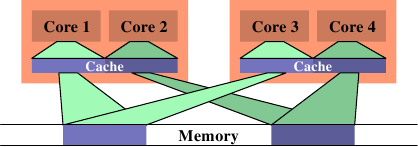

*图 6.13：没效率的调度*

一个可能导致很大的内存总线使用率的情况，是在两条线程被调度在不同的处理器（或是在不同缓存区域的核）上、而且它们使用相同的数据集的时候。图 6.13 显示这种状况。处理器核 1 与 3 访问相同的数据（以相同颜色的访问指示与内存区域表示）。同样地，处理器核 2 与 4 访问相同的数据。但线程被调度在不同的处理器上。这表示每次数据集都必须要从内存读取两次。这种状况能够被更好地处理。

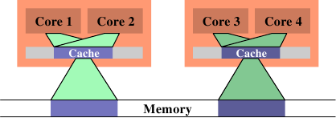

*图 6.14：有效率的调度*

在图 6.14 中，我们看到理想上来看应该要是怎么样。现在被使用的总缓存容量减少，因为现在处理器核 1 与 2 以及 3 与 4 都在相同的数据上运作。数据集只需从内存读取一次。

这是个简单的例子，但通过扩展，它适用于许多情况。如同先前提过的，操作系统内核中的调度器对数据的使用并没有深刻的理解，所以程序员必须确保调度是被有效率地完成的。没有很多操作系统内核的接口可用于传达这个需求。事实上，只有一个：定义线程亲和性。

线程亲和性表示，将一条线程指派给一颗或多颗处理器核。调度器接着将会在决定在哪执行这条线程的时候，（只）在那些处理器核中选择。即使有其他闲置的处理器核，它们也不会被考虑。这听来可能像是个缺陷，但这是必须偿付的代价。假如太多线程排外地执行在一组处理器核上，剩余的处理器核可能大多数都是闲置的，而除了改变亲和性之外就没什么能做的。默认情况下，线程能够执行在任一处理器核上。

有一些查询与改变一条线程的亲和性的接口：

```c
#define _GNU_SOURCE
#include <sched.h>
int sched_setaffinity(pid_t pid, size_t size,
                      const cpu_set_t *cpuset);
int sched_getaffinity(pid_t pid, size_t size,
                      cpu_set_t *cpuset);
```

这两个接口必须要被用在单线程的程序上。`pid` 引数指定哪个进程的亲和性应该要被改变或测定。调用者显然需要适当的权限来做这件事。第二与第三个参数指定处理器核的位掩码。第一个函数需要填入位掩码，使得它能够设定亲和性。第二个函数以选择的线程的调度信息来填充位掩码。这些接口都被宣告在 `<sched.h>` 中。

`cpu_set_t` 型别也和一些操作与使用这个型别对象的巨集一同被定义在这个头文件中。

```c
#define _GNU_SOURCE
#include <sched.h>
#define CPU_SETSIZE
#define CPU_SET(cpu, cpusetp)
#define CPU_CLR(cpu, cpusetp)
#define CPU_ZERO(cpusetp)
#define CPU_ISSET(cpu, cpusetp)
#define CPU_COUNT(cpusetp)
```

`CPU_SETSIZE` 指定有多少 CPU 能够以这个数据结构表示。其他三个巨集运用 `cpu_set_t` 对象。要初始化一个对象，应该使用 `CPU_ZERO`；其他两个巨集应该用以选择或取消选择个别的处理器核。`CPU_ISSET` 测试一个指定的处理器是否为集合的一部分。`CPU_COUNT` 返回集合中被选择的处理器核数量。`cpu_set_t` 型别为 CPU 数量的上限提供一个合理的默认值。随着时间推移，肯定会证实它太小；在这个时间点，这个型别将会被调整。这表示程序必须一直将这个容量放在心上。上述的便利巨集根据 `cpu_set_t` 的定义，隐式地处理这个容量。若是需要更动态的容量管理，应该使用一组扩展的巨集：

```c
#define _GNU_SOURCE
#include <sched.h>
#define CPU_SET_S(cpu, setsize, cpusetp)
#define CPU_CLR_S(cpu, setsize, cpusetp)
#define CPU_ZERO_S(setsize, cpusetp)
#define CPU_ISSET_S(cpu, setsize, cpusetp)
#define CPU_COUNT_S(setsize, cpusetp)
```

这些接口接收一个对应于这个容量的额外参数。为了能够分配动态容量的 CPU 集，提供三个巨集：

```c
#define _GNU_SOURCE
#include <sched.h>
#define CPU_ALLOC_SIZE(count)
#define CPU_ALLOC(count)
#define CPU_FREE(cpuset)
```

`CPU_ALLOC_SIZE` 巨集的返回值为，必须为一个能够处理 CPU 计数的 `cpu_set_t` 结构而分配的字节数量。为了分配这种区块，能够使用 `CPU_ALLOC` 巨集。以这种方式分配的内存必须使用一次 `CPU_FREE` 的调用来释放。这些巨集可能会在背后使用 `malloc` 与 `free`，但并不是非得要维持这种方式。

最后，定义了一些对 CPU 集对象的操作：

```c
#define _GNU_SOURCE
#include <sched.h>
#define CPU_EQUAL(cpuset1, cpuset2)
#define CPU_AND(destset, cpuset1, cpuset2)
#define CPU_OR(destset, cpuset1, cpuset2)
#define CPU_XOR(destset, cpuset1, cpuset2)
#define CPU_EQUAL_S(setsize, cpuset1, cpuset2)
#define CPU_AND_S(setsize, destset, cpuset1,
                  cpuset2)
#define CPU_OR_S(setsize, destset, cpuset1,
                 cpuset2)
#define CPU_XOR_S(setsize, destset, cpuset1,
                  cpuset2)
```

这二组四个巨集的集合能够检查两个集合的相等性，以及对集合执行逻辑 AND、OR、与 XOR 操作。这些操作在使用一些 libNUMA 函数（见附录 D）的时候会派上用场。

一个进程能够使用 `sched_getcpu` 接口来确定它目前跑在哪个处理器上：

```c
#define _GNU_SOURCE
#include <sched.h>
int sched_getcpu(void);
```

结果为 CPU 在 CPU 集中的索引。由于调度的本质，这个数字并不总是 100% 正确。在返回结果的时间、与线程回到用户层级的时间之间，线程可能已经被移到一个不同的 CPU 上。程序必须总是将这种不正确的可能性纳入考量。在任何情况下，更为重要的是被允许执行线程的那组 CPU。这个集合能够使用 `sched_getaffinity` 来查询。集合会被子线程与进程继承。线程不能指望集合在生命周期中是稳定的。亲和性掩码能够从外界设置（见上面原型中的 `pid` 参数）；Linux 也支持 CPU 热插拔（hot-plugging），这意味着 CPU 能够从系统中消失——因此，也能从亲和 CPU 集消失。

在多线程程序中，个别的线程并没有如 POSIX 定义的正式进程 ID，因此无法使用上面两个函数。作为替代，`<pthread.h>` 宣告四个不同的接口：

```c
#define _GNU_SOURCE
#include <pthread.h>
int pthread_setaffinity_np(pthread_t th,
                           size_t size,
                           const cpu_set_t *cpuset);
int pthread_getaffinity_np(pthread_t th,
                           size_t size,
                           cpu_set_t *cpuset);
int pthread_attr_setaffinity_np(
                           pthread_attr_t *at,
                           size_t size,
                           const cpu_set_t *cpuset);
int pthread_attr_getaffinity_np(
                           pthread_attr_t *at,
                           size_t size,
                           cpu_set_t *cpuset);
```

前两个接口基本上与我们已经看过的那两个相同，除了它们在第一个参数拿的是一个线程的控制柄（handle），而非一个进程 ID。这能够寻址在一个进程中的个别线程。这也代表这些接口无法在另一个进程使用，它们完全是为了进程内部使用的。第三与第四个接口使用一个线程属性。这些属性是在建立一条新的线程的时候使用的。借助设置属性，一条线程能够在开始时就被调度在一个特定的 CPU 集合上。这么早选择目标处理器——而非在线程已经启动之后——能够在许多不同层面上受益，包含（而且尤其是）内存分配（见 6.5 节的 NUMA）。

说到 NUMA，亲和性接口在 NUMA 程序设计中也扮演着一个重要的角色。我们不久后就会回到这个案例。

目前为止，我们已经谈过两条线程的工作集重叠、使得在相同处理器核上拥有两条线程是合理的情况。反之亦然。假如两条线程在个别的数据集上运作，将它们调度在相同的处理器核上可能是个问题。两条线程为相同的缓存斗争，因而相互减少缓存的有效使用。其次，两个数据集都得被加载到相同的缓存中；实际上，这增加必须加载的数据总量，因此可用的带宽被砍半。

在这种情况中的解法是，设置线程的亲和性，使得它们无法被调度在相同的处理器核上。这与先前的情况相反，所以在做出任何改变之前，理解试着要优化的情况是很重要的。

针对缓存共享优化以优化带宽，实际上是将会在下一节涵盖的 NUMA 程序设计的一个面相。只要将“内存”的概念扩展至缓存。一旦缓存的层级数增加，这会变得越来越重要。基于这个理由，NUMA 支持库中提供一个多核调度的解决方法。在不写死系统细节、或是钻入 `/sys` 文件系统的深度的前提下，决定亲和性掩码的方法请参阅附录 D 中的程序例子。

## 6.5 NUMA 程序设计

以 NUMA 程序设计而言，目前为止说过的有关缓存优化的所有东西也都适用。差异仅在这个层级以下才开始。NUMA 在访问地址空间的不同部分时引入不同的成本。使用均匀内存访问的话，我们能够优化以最小化缺页（见 7.5 节），但这是对它而言。所有建立的分页都是均等的。

NUMA 改变这点。访问成本可能取决于被访问的分页。访问成本的差异也增加针对内存分页的局部性进行优化的重要性。NUMA 对于大多 SMP 机器而言都是无可避免的，因为有着 CSI 的 Intel（for x86, x86-64, and IA-64）与 AMD（for Opteron）都会使用它。随着每个处理器核数量的增加，我们很可能会看到被使用的 SMP 系统急遽减少（至少除了数据中心与有着非常高 CPU 使用率需求的人们的办公室之外）。大多家用机器仅有一个处理器就很好，因此没有 NUMA 的问题。但这一来不是说程序员可忽略 NUMA，再者也不表示没有相关的问题。

假如理解 NUMA 的一般化的话，也能快速意识到拓展至处理器缓存的概念。在处理器核上使用相同缓存的两条线程，会合作得比在处理器核上不共享缓存的线程还快。这不是个杜撰的状况：

* 早期的双核处理器没有 L2 共享。
* 举例来说，Intel 的 Core 2 QX 6700 与 QX 6800 四核芯片拥有两个独立的 L2 缓存。
* 正如早先猜测的，由于一片芯片上的更多核、以及统一缓存的渴望，我们将会有更多层的缓存。

缓存形成它们自己的阶层结构；线程在核上的摆放，对于许多缓存的共享（或者没有）来说变得很重要。这与 NUMA 面对的问题并没有很大的不同，因此能够统一这两个概念。即使是只对非 SMP 机器感兴趣的人也该读一读本节。

在 5.3 节中，我们已经看到 Linux 系统内核提供许多在 NUMA 程序设计中有用——而且需要——的信息。不过，收集这些信息并没有这么简单。以这个目的而言，目前在 Linux 上可用的 NUMA 库是完全不足的。一个更为合适的版本正由本作者建造中。

现有的 NUMA 库，`libnuma`——numactl 软件包（package）的一部分——并不提供对系统架构信息的访问。它仅是一个对可用系统调用的包装（wrapper）、与针对常用操作的一些方便的接口。现今在 Linux 上可用的系统调用为：

<dl>
    <dt><code>mbind</code></dt>
    <dd>选择指定内存分页的连接（binding）。</dd>

    <dt><code>set_mempolicy</code></dt>
    <dd>设定默认的内存连接策略。</dd>

    <dt><code>get_mempolicy</code></dt>
    <dd>取得默认的内存连接策略。</dd>

    <dt><code>migrate_pages</code></dt>
    <dd>将一组给定节点上的一个进程的所有分页迁移到一组不同的节点上。</dd>

    <dt><code>move_pages</code></dt>
    <dd>将选择的分页移到给定的节点、或是请求关于分页的节点信息。</dd>
</dl>

这些接口被宣告在与 `libnuma` 库一起出现的 `<numaif.h>` 头文件中。在我们深入更多细节之前，我们必须理解内存策略的概念。

### 6.5.1 内存策略

定义一个内存策略背后的构想是，令现有的程序在不大幅度修改的情况下，能够在一个 NUMA 环境中适度良好地运作。策略由子进程继承，这使得我们能够使用 numactl 工具。这个工具的用途之一是能够用来以给定的策略来启动一个程序。

Linux 系统内核支持下列策略：

<dl>
    <dt><code>MPOL_BIND</code></dt>
    <dd>内存只会从一组给定的节点分配。假如不能做到，则分配失败。</dd>

    <dt><code>MPOL_PREFERRED</code></dt>
    <dd>内存最好是从一组给定的节点分配。若是这失败，才考虑来自其他节点的内存。</dd>

    <dt><code>MPOL_INTERLEAVE</code></dt>
    <dd>内存是平等地从指定的节点分配。节点要不是针对基于 VMA 的策略，以虚拟内存区域中的偏移量来选择、就是针对基于任务（task）的策略，通过自由执行的计数器来选择。</dd>

    <dt><code>MPOL_DEFAULT</code></dt>
    <dd>根据内存区域的默认值来选择分配方式。</dd>
</dl>


*图 6.15：内存策略阶层结构*

这份清单似乎递回地定义策略。这对了一半。事实上，内存策略形成一个阶层结构（见图 6.15）。若是一个地址被一个 VMA 策略所涵盖，就会使用这个策略。一种特殊的策略被用在共享的内存区段上。假如没有针对特定地址的策略，就会使用任务的策略。若是连这也没有，便使用系统的默认策略。

系统默认是分配请求内存的那条线程本地的内存。默认不会提供任务与 VMA 策略。对于一个有着多条线程的进程，本地节点为首先执行进程的“家”节点。上面提到的系统调用能够用来选择不同的策略。

### 6.5.2 指定策略

`set_mempolicy` 调用能够用以为目前的线程（对系统内核来说的任务）设定任务策略。仅有目前的线程会受影响，而非整个进程。

```c
#include <numaif.h>
long set_mempolicy(int mode,
                   unsigned long *nodemask,
                   unsigned long maxnode);
```

`mode` 参数必须为前一节介绍过的其中一个 `MPOL_*` 常数。`nodemask` 参数指定未来分配要使用的内存节点，而 `maxnode` 为 `nodemask` 中的节点（即位）数量。若是 `mode` 为 `MPOL_DEFAULT`，就不需要指定内存节点，并且会忽略 `nodemask` 参数。若是为 `MPOL_PREFERRED` 传递一个空指针作为 `nodemask`，则会选择本地节点。否则，`MPOL_PREFERRED` 会使用 `nodemask` 中设置的位所对应的最低的节点编号。

对于已经分配的内存，设定策略并没有任何影响。分页不会被自动迁移；只有未来的分配会受影响。注意到内存分配与预留地址空间之间的不同：一个使用 `mmap` 建立的地址空间区域通常不会被自动分配。在内存区域上首次的读取或写入操作会分配合适的分页。若是策略在访问相同地址空间区域的不同分页之间发生改变，或者策略允许内存的分配来自不同节点，那么一个看似均匀的地址空间区域可能会被分散在许多内存节点之中。

### 6.5.3 交换与策略

若是物理内存耗尽，系统就必须丢弃干净的分页，并将脏的分页存储到替换空间（swap）中。Linux 的替换实现会在将分页写入替换空间的时候丢弃节点信息。这表示当分页被重复使用并加载分页（page in）时，将会从头开始选择被使用的节点。线程的策略很可能会导致一个靠近执行中处理器的节点被选到，但这个节点可能跟先前使用的节点不同。

这种变换的关联（association）意味着节点关联无法借助一个程序被存储为分页的一个属性。关联可能会随着时间改变。对于与其他进程共享的分页，这也可能会因为一个进程的请求而发生（见下面 `mbind` 的讨论）。系统内核本身能够在一个节点耗尽空间、而其他节点仍有闲置空间的时候迁移分页。

任何用户层级程序得知的节点关联因而只能在一段很短的时间内为真。它比起纯粹的信息，更像是一个提示。每当需要精确的消息时，应该使用 `get_mempolicy` 接口（见 6.5.5 节）。

### 6.5.4 VMA 策略

要为一个地址范围设定 VMA 策略，必须使用一个不同的接口：

```c
#include <numaif.h>
long mbind(void *start, unsigned long len,
           int mode,
           unsigned long *nodemask,
           unsigned long maxnode,
           unsigned flags);
```

这个接口为地址范围 [`start`, `start` + `len`) 注册一个新的 VMA 策略。由于内存管理是在分页上操作，所以起始地址必须是对齐分页的。`len` 值会被无条件进位至下一个页大小。

`mode` 参数再次指定策略；这个值必须从 6.5.1 节的清单中挑选。与使用 `set_mempolicy` 相同，`nodemask` 参数只会用在某些策略上。它的处理是一样的。

`mbind` 接口的语义取决于 `flags` 参数的值。默认情况下，若是 `flags` 为零，系统调用会为这个地址范围设定 VMA 策略。现有的映射不受影响。假如这还不够，目前有三种修改这种行为的标志；它们能够被单独或者一起被选择：

<dl>
    <dt><code>MPOL_MF_STRICT</code></dt>
    <dd>假如并非所有分页都在由 <code>nodemask</code> 指定的节点上，对 <code>mbind</code> 的调用将会失败。在这个标志与 <code>MPOL_MF_MOVE</code> 和／或 <code>MPOL_MF_MOVEALL</code> 一起使用的情况下，调用会在任何分页无法被移动的时候失败。</dd>

    <dt><code>MPOL_MF_MOVE</code></dt>
    <dd>系统内核将会试着移动地址范围中、任何分配在一个不在由 <code>nodemask</code> 指定的集合中的节点上的分页。默认情况下，仅有被目前进程的页表专用的分页会被移动。</dd>

    <dt><code>MPOL_MF_MOVEALL</code></dt>
    <dd>如同 <code>MPOL_MF_MOVE</code>，但系统内核会试着移动所有分页，而非仅有那些独自被目前进程的页表使用的分页。这个操作具有系统层面的影响，因为它也影响其他——可能不是由相同用户所拥有的——进程的内存访问。因此 <code>MPOL_MF_MOVEALL</code> 是个特权操作（需要 <code>CAP_NICE</code> 的能力）。</dd>
</dl>

注意到针对 `MPOL_MF_MOVE` 与 `MPOL_MF_MOVEALL` 的支持仅在 2.6.16 Linux 系统内核中才被加入。

在没有任何标志的情况下调用 `mbind`，在任何分页真的被分配之前必须为一个新预留的地址范围指定策略的时候是最有用的。

```c
void *p = mmap(NULL, len,
               PROT_READ|PROT_WRITE,
               MAP_ANON, -1, 0);
if (p != MAP_FAILED)
  mbind(p, len, mode, nodemask, maxnode,
        0);
```

这段程序序列保留一段 `len` 字节的地址空间范围，并指定应该使用指涉 `nodemask` 中的内存节点的策略 `mode`。除非 `MAP_POPULATE` 标志与 `mmap` 一起使用，否则在 `mbind` 调用的时候并不会分配任何内存，因此新的策略会套用在这个地址空间区域中的所有分页。

单独的 `MPOL_MF_STRICT` 标志能用来确定，传给 `mbind` 的 `start` 与 `len` 参数所描述的地址范围中的任何分页，是否都被分配在那些由 `nodemask` 指定的那些节点以外的节点上。已分配的分页不会被改变。若是所有分页都被分配在指定的节点上，那么地址空间区域的 VMA 策略会根据 `mode` 改变。

有时候是需要内存的重新平衡的。在这种情况下，可能必须将一个节点上分配的分页移到另一个节点上。以设置 `MPOL_MF_MOVE` 调用的 `mbind` 会尽最大努力来达成这点。仅有单独被进程的页表树指涉到的分页会被考虑是否移动。可能有多个以线程或其他进程的形式共享部页表树的用户。不可能影响碰巧映射相同数据的其他进程。这些分页并不共享页表项目。

若是传递给 `mbind` 的 `flags` 参数中设置 `MPOL_MF_STRICT` 与 `MPOL_MF_MOVE` 位，系统内核会试着移动并非分配在指定节点上的所有分页。假如这无法做到，这个调用将会失败。这种调用可能有助于确定是否有个节点（或是一组节点）能够容纳所有的分页。可以连续尝试多种组合，直到找到一个合适的节点。

除非执行目前的进程是这台计算机的主要目的，否则 `MPOL_MF_MOVEALL` 的使用是较难以证明为正当的。理由是，即使是出现在多张页表的分页也会被移动。这会轻易地以负面的方式影响其他进程。因而应该要谨慎地使用这个操作。

### 6.5.5 查询节点信息

`get_mempolicy` 接口能用以查询关于一个给定地址的 NUMA 状态的各种事实。

```c
#include <numaif.h>
long get_mempolicy(int *policy,
             const unsigned long *nmask,
             unsigned long maxnode,
             void *addr, int flags);
```

当 `get_mempolicy` 以 `0` 作为 `flags` 参数调用时，关于地址 `addr` 的策略信息会被存储在由 `policy` 指到的字、以及由 `nmask` 指到的节点的位掩码中。若是 `addr` 落在一段已经被指定一个 VMA 策略的地址空间范围中，就返回关于这个策略的信息。否则，将会返回关于任务策略或者——必要的话——系统默认策略的信息。

若是 `flags` 中设定 `MPOL_F_NODE`、并且管理 `addr` 的策略为 `MPOL_INTERLEAVE`，那么 `policy` 所指到的字为要进行下一次分配的节点索引。这个信息能够潜在地用来设定打算要在新分配的内存上运作的一条线程的亲和性。这可能是实现逼近的一个比较不昂贵的方法，尤其是在线程仍未被建立的情况。

`MPOL_F_ADDR` 标志能用来检索另一个完全不同的数据项目。假如使用这个标志，`policy` 所指到的字为已经为包含 `addr` 的分页分配内存的内存节点索引。这个信息能用来决定可能的分页迁移、决定哪条线程能够最有效率地运作在内存位置上、还有更多更多的事情。

一条线程正在使用的 CPU——以及因此用到的内存节点——比起它的内存分配还要更加变化无常。在没有明确请求的情况下，内存分页只会在极端的情况下被移动。一条线程能被指派给另一个 CPU，作为重新平衡 CPU 负载的结果。关于目前 CPU 与节点的信息可能因而仅在短期内有效。调度器会试着将线程维持在同一个 CPU 上，甚至可能在相同的核上，以最小化由于冷缓存（cold cache）造成的性能损失。这表示，查看目前 CPU 与节点的信息是有用的；只要避免假设关联性不会改变。

libNUMA 提供两个接口，以查询一段给定虚拟地址空间范围的节点信息：

```c
#include <libNUMA.h>
int NUMA_mem_get_node_idx(void *addr);
int NUMA_mem_get_node_mask(void *addr,
                           size_t size,
                           size_t __destsize,
                           memnode_set_t *dest);
```

`NUMA_mem_get_node_mask` 根据管理策略，在 `dest` 中设置代表所有分配（或者可能分配）范围 [`addr`, `addr`+`size`) 中的分页的内存节点的位。`NUMA_mem_get_node` 只看地址 `addr`，并返回分配（或者可能分配）这个地址的内存节点的索引。这些接口比 `get_mempolicy` 还容易使用，而且应该是首选。

目前正由一条线程使用的 CPU 能够使用 `sched_getcpu` 来查询（见 6.4.3 节）。使用这个信息，一个程序能够使用来自 libNUMA 的 `NUMA_cpu_to_memnode` 接口来确定 CPU 本地的内存节点（们）：

```c
#include <libNUMA.h>
int NUMA_cpu_to_memnode(size_t cpusetsize,
                        const cpu_set_t *cpuset,
                        size_t memnodesize,
                        memnode_set_t *
                        memnodeset);
```

对这个函数的一次调用会设置所有对应于任何在第二个参数指到的集合中的 CPU 本地的内存节点的位。就如同 CPU 信息本身，这个信息直到机器的配置改变（例如，CPU 被移除或新增）时才会是正确的。

`memnode_set_t` 对象中的位能被用在像 `get_mempolicy` 这种低阶函数的调用上。使用 libNUMA 中的其他函数会更加方便。反向映射能通过下述函数取得：

```c
#include <libNUMA.h>
int NUMA_memnode_to_cpu(size_t memnodesize,
                        const memnode_set_t *
                        memnodeset,
                        size_t cpusetsize,
                        cpu_set_t *cpuset)
```

在产生的 `cpuset` 中设置的位为任何在 `memnodeset` 中设置的位所对应的内存节点本地的那些 CPU。对于这两个接口，程序员都必须意识到，信息可能随着时间改变（尤其是使用 CPU 热插拔的情况）。在许多情境中，在输入的位集中只会设置单一个位，但举例来说，将 `sched_getaffinity` 调用检索到的整个 CPU 集合传递到 `NUMA_cpu_to_memnode`，以确定哪些内存节点能够被线程直接访问到，也是有意义的。

### 6.5.6 CPU 与节点集合

借助将程序改变为使用目前为止所描述的接口来为 SMP 与 NUMA 环境调整程序，在来源[^1]无法取得的情况下可能会极为昂贵（或者不可能）。此外，系统管理员可能想要对用户和／或进程能够使用的资源施加限制。对于这些情境，Linux 系统内核支持所谓的 CPU 集。这个名称有一点误导，因为内存节点也被涵盖其中。它们也与 `cpu_set_t` 数据型别无关。

此刻，CPU 集的接口为一个特殊的文件系统。它通常没有被挂载（mount）（至少到目前为止）。这能够使用

`mount -t cpuset none /dev/cpuset`

改变。挂载点 `/dev/cpuset` 在这个时间点当然必须存在。这个目录的内容为默认（根）CPU 集的描述。它起初由所有的 CPU 与所有的内存节点所构成。这个目录中的 `cpus` 文件显示在 CPU 集中的 CPU、`mems` 文件显示内存节点、`tasks` 文件显示进程。

为了建立一个新的 CPU 集，只要在阶层结构中的某个地方建立一个新的目录。新的 CPU 集会继承来自父集合的所有设定。接着，新的 CPU 集的 CPU 与内存节点能够借助将新值写到在新目录中的 `cpus` 与 `mems` 虚拟文件来更改。

若是一个进程属于一个 CPU 集，CPU 与内存节点的设定会被用作亲和性与内存策略位掩码的掩码。这表示，程序无法在亲和性掩码里选择不在进程正在使用的 CPU 集（即，它在 `tasks` 文件中列出的位置）的 `cpus` 文件中的任何 CPU。对于内存策略的节点掩码与 `mems` 文件也是类似的。

除非位掩码在掩码后为空，否则程序不会经历任何错误，因此 CPU 集是一种控制程序执行的近乎无形的手段。这种方法在有着大量 CPU 与／或内存节点时是尤其有效率的。将一个进程移到一个新的 CPU 集，就跟将进程 ID 写到合适 CPU 集的 `tasks` 文件一样简单。

CPU 集的目录包含许多其他文件，能用来指定像是内存压力下、以及独占访问 CPU 与内存节点时的行为。感兴趣的读者请参阅系统内核源代码树中的文件 `Documentation/cpusets.txt`。

[^1]: 根据前后文猜测，这里的“来源”指的应该是程序使用的 CPU 与内存节点。

### 6.5.7 明确的 NUMA 优化

假如所有节点上的所有线程都需要访问相同的内存区域时，所有的本地内存与亲和性规则都无法帮上忙。当然，简单地将线程的数量限制为直接连接到内存节点的处理器所能支持的数量是可能的。不过，这并没有善用 SMP NUMA 机器，因此并不是个实际的选项。

若是所需的数据是唯读的，有个简单的解法：复制（replication）。每个节点能够得到它自己的数据副本，这样就不必进行节点之间的访问。这样做的代码看起来可能像这样：

```c
void *local_data(void) {
  static void *data[NNODES];
  int node =
    NUMA_memnode_self_current_idx();
  if (node == -1)
    /* Cannot get node, pick one. */
    node = 0;
  if (data[node] == NULL)
    data[node] = allocate_data();
  return data[node];
}
void worker(void) {
  void *data = local_data();
  for (...)
    compute using data
}
```

在这段程序中，函数 `worker` 借助一次 `local_data` 的调用来取得一个数据的本地副本的指针来进行准备。接着它继续执行使用这个指针的循环。`local_data` 函数保存一个已经被分配的数据副本的列表。每个系统拥有有限的内存节点，所以带有各节点内存副本的指针的数组容量是受限的。来自 libNUMA 的 `NUMA_memnode_system_count` 函数返回这个数字。若是给定节点的内存还没被分配给目前节点（由 `data` 在 `NUMA_memnode_self_current_idx` 调用所返回的索引位置的空指针来识别），就分配一个新的副本。

重要的是要意识到，如果在 `getcpu` 系统调用之后，线程被调度在另一个连接到不同内存节点的 CPU 上时，是不会发生什么可怕的事情的。[^1]它只代表在 `worker` 中使用 `data` 变量的访问，访问另一个内存节点上的内存。这直到 `data` 被重新计算为止会拖慢程序，但就这样。系统内核总是会避免不必要的、每颗 CPU 执行伫列的重新平衡。若是这种转移发生，通常是为了一个很好的理由，并且在不久的未来不会再次发生。

当处理中的内存区域是可写入的，事情会更为复杂。在这种情况下，单纯的复制是行不通的。根据具体情况，或许有一些可能的解法。

举例来说，若是可写入的内存区域是用来累积（accumulate）结果的，首先为结果被累积的每个内存节点建立一个分离的区域。接着，当这项工作完成时，所有的每节点的内存区域会被结合以得到全体的结果。即使运作从不真的停止，这项技术也能行得通，但中介结果是必要的。这个方法的必要条件是，结果的累积是无状态的（stateless）。即，它不会依赖先前收集起来的结果。

不过，拥有对可写入内存区域的直接访问总是比较好的。若是对内存区域的访问数量很可观，那么强迫系统内核将处理中的内存分页迁移到本地节点可能是个好点子。若是访问的数量非常高，并且在不同节点上的写入并未同时发生，这可能有帮助。但要留意，系统内核无法产生奇迹：分页迁移是一个复制操作，并且以此而论并不便宜。这个成本必须被分期偿还。

[^1]: 用户层级的 `sched_getcpu` 接口是使用 `getcpu` 系统调用来实现的。后者不该被直接使用，并且有一个不同的接口。

### 6.5.8 利用所有带宽

在图 5.4 中的数据显示，当缓存无效时，对远程内存的访问并不显著慢于对本地内存的访问。这表示，一个程序也许能借着将它不必再次读取的数据写入到附属于另一个处理器的内存中来节省带宽。到 DRAM 模块的连接带宽与交互连接的带宽大多数是独立的，所以并行使用能提升整体性能。

这是否真的可能，取决于许多因素。必须确保缓存无效，否则与远程访问相关的减慢是很显著的。另一个大问题是，远程节点是否有任何它所拥有的内存带宽的需求。在采用这个方法之前，必须详加检验这种可能性。理论上，使用一个处理器可用的所有带宽可能有正面影响。一个 10h Opteron 家族的处理器能够直接连接到高达四个其他的处理器。假如系统的其余部分合作的话，利用所有这种额外带宽，也许结合合适的预取（尤其是 `prefetchw`），可能致使改进。
