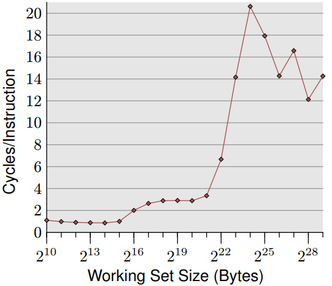
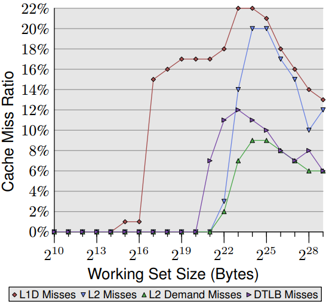
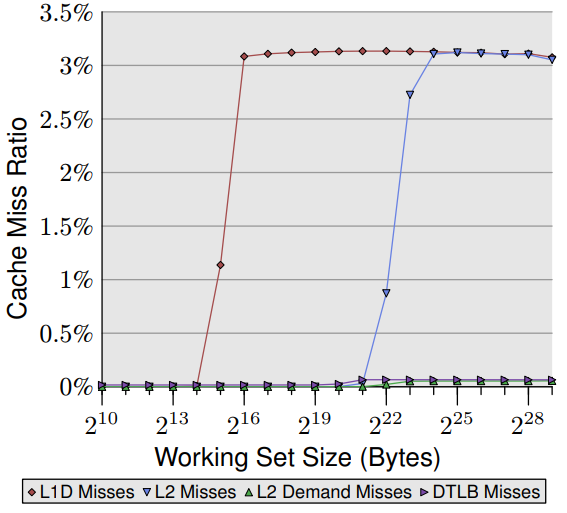
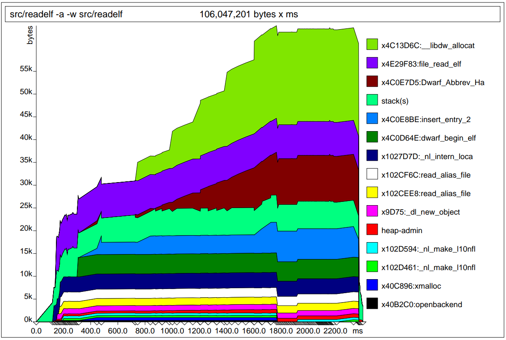
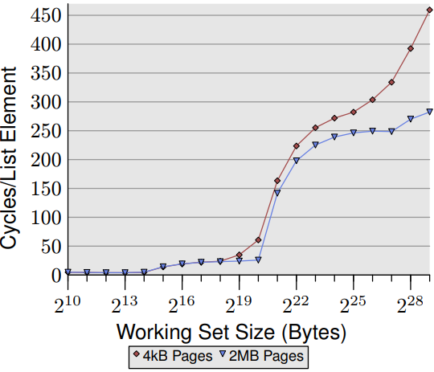

# 第 7 章 内存性能工具

许多工具可协助程序员理解程序性能、缓存和内存使用状况等信息。现代处理器具备可用的性能监控硬件。但有些事件(event)很难精确测量，因此需要模拟（simulation）的空间。当牵涉到较高层次的功能时，有一些特殊工具可监控进程的执行。我们将介绍一组常用的工具，这些工具在大多数 Linux 系统上都可用。

## 7.1 内存操作分析

进行内存操作分析需要与硬件的进行整合。当然也可只通过软件收集某些信息，但这些信息往往过于粗糙或属于模拟而非真实测量。第 7.2 和 7.5 节里我们会展示一些模拟的例子。在此章节，我们会专注在可测量的内存所带来的功效。

在 Linux 操作系统可通过 [OProfile](https://www.man7.org/linux/man-pages/man1/OProfile.1.html) 来监控性能。如参考书目[2](https://dl.acm.org/doi/10.1145/265924.265925)所写，OProfile 提供不间断的性能分析与友善的界面来提供测量功能并以统计数据方式呈现。OProfile 并非性能测量的唯一的方式，许多 Linux 开发者也正在开发 [pfmon](https://perfmon2.sourceforge.net/man/pfmon.html) 来适用于某些特殊情境。

OProfile 提供简单的界面，即便选择 GUI 仍可运行于设备底层。用户必须在处理器间发生的事件 (event) 中选择。尽管处理器的架构说明书记载了这些事件的细节，但若需对数据进行分析往往需要对处理器本身有深入了解。另一个问题是对收集的数据进行解释时。由于测量结果为绝对值且可任意增长。对于某个已知的计数器来说，数字要多高才算太高呢？

针对这个问题首先避免观测单一计数器的绝对值，可将多个计数器的数值一同纳入参考。处理器一次可监控不只一个事件；再来可计算所有收集数据的比值。可能可获得更好比较的结果。计算时通常以处理时间 (process time) 作除数，例如时钟周期数 (clock cycles) 或指令数。以程序性能的初步测试而言，这两个数字具有参考的价值。

图 7.1 为对一个简单随机“跟随”测试数据进行测量的结果，纵轴为 CPI（Cycles Per Instruction）数值，横轴则为工作集 (working set) 容量。在大多数 Intel 处理器上纪录这个事件的变量名称为 [`CPU_CLK_UNHALTED`](https://www.intel.com/content/dam/develop/external/us/en/documents/tuningguide-intelxeonprocessor-scalablefamily-2ndgen-181827.pdf) 和 [`INST_RETIRED`](https://www.intel.com/content/dam/develop/external/us/en/documents/tuningguide-intelxeonprocessor-scalablefamily-2ndgen-181827.pdf) 。从缩写大概可猜到，前者计算 cpu 的时钟周期，后者则计算指令数。我们看到类似于每个元素的周期测量的图片。对小工作集 (working set) ，比值为 1.0 有时甚至更低。这些计算结果皆在 Intel Core 2 处理器上进行，此处理器具有多纯量 (multi-scalar) 特性，可同时处理多个指令。对于不受内存带宽限制的程序，比率可显著低于 1.0 ，但以此案例来说，1.0 的结果已经非常好了。



*图 7.1：时钟指令数*

当 L1d 缓存无法存储所有计算数值时，CPI 会跳升到接近但低于 3.0 。需要注意 CPI 比率是将所有指令对 L2 的访问成本再取平均，而非只计算牵涉内存访问的指令。通过列表上的数据的周期，可计算出每个列表上项目所需的指令数量。即使 L2 缓存不足时，CPI 比率会跳跃至超过 20。但这些都是可预期的结果。

但性能测量计数器应该要让我们能更深入地了解处理器内部运作。因此我们需要思考处理器的实现细节。在这个章节我们非常在乎缓存处理的细节，因此必须查看与缓存相关的事件。但这些事件以及相关名称与计数方式都与处理器息息相关。这就是为什么 OProfile 有其不便，就算使用接口非常友善：程序员仍必须事先了解计数器相关详细数据。在附录 B 中会展示一些处理器的详细信息。

对于 [Intel Core 2](https://OProfile.sourceforge.io/docs/intel-core2-events.php) 处理器，所对应的事件分别为 `L1D_REPL` 、`DTLB_MISSES` 和 `L2_LINES_IN`。后者可测量所有未命中以及由指令所造成的未命中，而非硬件预取 (prefetch) 所造成 。随机“跟随”测试的结果如图 7.2 所示。

所有比值结果都是使用除役 (retired) 指令（`INST_RETIRED`）的数量计算。因此要计算缓存未命中率，还必须从 `INST_RETIRED` 中减去所有读取数据和存储数据的指令，使得内存操作的实际缓存未命中率比图中显示的数字更高。

其中 L1d 的缓存未命中占大多数，对 Intel 处理器而言由于使用包含缓存（inclusive caches），代表可能会出现 L1d 缓存未命中的情况。该处理器具有 32k 容量的 L1d 缓存，因此可看到，如同预期，L1d 未命中率从零开始上升到将近工作集的容量（除了列表数据集外，还可能有其他原因触发缓存，因此增加集中在 16k 和 32k 之间 。硬件预取可将 L1d 缓存未命中率保持在约 1％，直到工作集超过 64k 之后，L1d 未命中率急剧上升。



*图 7.2：缓存未命中率 (随机版本“跟随”)*

L2 缓存未命中率一直保持为零，直到 L2 缓存完全用尽为止。其他原因造成的 L2 缓存未命中可姑且忽略不计，一旦超过 L2 缓存容量（221位），未命中率就会上升。另一件值得注意的部份为 L2 缓存需求未命中率并非为零。表示硬件预取器没有加载后续指令所需的所有高速缓存内容。随机访问会影响指令预取的效果。可跟图 7.3 顺序非随机读取的测试版本一起比较。



*图 7.3：缓存未命中率 (顺序版本“跟随”)*

这张图中可看到 L2 的需求未命中率基本上为零（注意此图的度量衡与图 7.2 不同）。对于顺序访问硬件预取器运作得非常完美：几乎所有 L2 缓存未命中都由预取器所造成。从 L1d 和 L2 缓存未命中率相同来判断，几乎所有 L1d 缓存未命中都被 L2 缓存处理，没有造成进一步延迟。这样的情境对所有程序都是最理想却很难成真。

在这两个图中，第四条线是 DTLB 未命中率（ Intel 有专门为代码和数据所设置的 TLB ，DTLB 就是存储数据用的 TLB ）。对随机访问的情况，DTLB 的未命中率就非常高且会导致延迟。但有趣的地方在 DTLB 的代价早在 L2 缓存未命中之前就已确定。对顺序访问情况，DTLB 的未命中率基本上为零。

回到 6.2.1 节中的矩阵乘法示例以及 A.1 节中的示例代码，我们可利用另外三个计数器。`SSE_HIT_PRE` 、`SSE_PRE_MISS` 和 `LOAD_PRE_EXEC` 来查看软件预取 (prefetch) 的效果如何。如果执行 A.1 节中的代码，我们可得到以下结果：

描述 | 比值——- |——-
有用的 NTA 预取 | 2.84%
延迟的 NTA 预取 | 2.56%

[NTA](https://gcc.gnu.org/projects/prefetch.html)（非时间对齐）预取比率表示有多少的预取指令已被执行，因此不需要额外的功夫来处理。这表示处理器必须浪费额外的时间来解译预取的指令并到缓存寻找相关内容。因此软件的表现很大程度取决于所使用的处理器缓存容量；以及硬件预取器的性能。

若是只看 NTA 预取比值不太准确。因为比值表示所有预取指令中有 2.65％ 产生延迟无法发挥效益。这些预取指令在执行之前需要将相关的数据从缓存中取出。因此从数值来看只有 2.84％ + 2.65％ = 5.5％ 的预取指令有用。以所有有用的 NTA 预取指令来看 48％ 没有及时完成。由此得知代码还有改进的空间如下：

* 大多数的预取指令没有帮助
* 预取指令要依照硬件特性做调整

这个部份可留给读者去练习如何在硬件上调整出最佳解决方案。硬件规格扮演至关重要的角色，对 Intel Core 2 处理器而言，SSE 运算的延迟为 1 个时钟周期[^1]。若是较旧版本则为 2 个时钟周期，这表示硬件预取器和预取指令有更多的前置时间来读取数据。

- 1. OProfile 执行随机分析。但只记录某个事件的第 N 次（其中 N 是每个事件最小值的阈值），以避免造成系统的负担。某些情况可能会触发 100 次事件，但很有可能不会在报告中显示。

- 2. 并非所有事件都能被精准的记录。例如在记录特定事件时指令计数器(instruction pointer)[^2]的结果往往可能是错误。处理器的多纯量 (multi-scalar) 特性可使计算结果很难 100％ 正确。但在某些处理器上特定事件可精确纪录。

这些已标记的列表不仅有助于解读预取信息，每个事件都以程序计数器来记录，因此可精准定位程序中的其他热点。执行频繁的位置通常会是许多 `INST_RETIRED` 事件的来源，因此值得进行额外调整。如果观测结果有许多缓存未命中时，则需要通过预取指令来避免缓存未命中。

有一种事件可在没有硬件支持的情况下测量缺页 (page fault) 。操作系统在解决缺页时会将结果纪录。并分成以下两种类型的缺页：

- **次要缺页** 对于未使用的匿名页面（未被任何文件纪录使用）、写入时才复制 (copy-on-write) 页面以及内容已经在内存某处的其他页面。
- **主要缺页** 需要读取磁盘以获取文件支持（或替换页面出去 (swapped-out) ）的数据。

很明显，主要缺页比次要缺页要付出更多的代价。但次要缺页所造成的损失也不容忽视。在任何情况下缺页都需要进入操作系统内核来进行操作，无论是寻找新的页面，清除或写入需要的数据，都必须修改页表树 (page table tree) 。最后还需同步那些读取或修改页表树的其他任务并可能引发更多延迟。

最简单读取缺页的方法是通过 [time](https://man7.org/linux/man-pages/man1/time.1.html) 工具，而不是 shell 的内建命令。如下图 7.4 中所示。

```c
$ time ls /etc
[...]
0.00user 0.00system 0:00.02elapsed 17%CPU (0avgtext+0avgdata 0maxresident)k
0inputs+0outputs (1major+335minor)pagefaults 0swaps
```
*图 7.4：time 工具的相关内容*

注意图中最后一行。time 指出 1 个主要缺页的和 335 个次要的缺页。确切数字可能不同；特别是如果立刻重复运行可能会显示现在完全没有主要的缺页。如果程序执行相同操作，在系统环境没有任何变化情况下，总缺页的数字将保持稳定。

对缺页影响最大阶段在程序启动阶段。使用每个页面都会产生缺页；特别是 GUI 应用程序，使用的页面越多，程序运作所需的时间与准备时间就越长。在 7.5 节中，我们会介绍一个专门用于测量初始化时间的工具。

time 通过 [`rusage`](https://www.gnu.org/software/libc/manual/html_node/Resource-Usage.html) 来运作。[`wait4`](https://man7.org/linux/man-pages/man2/wait4.2.html) 系统调用在亲代进程等待子进程终止时会写入 `strcut rusage` ; 正好符合 time 的需求。但进程仍可获取自身资源使用信息（正是 `rusage` 命名由来）或已终止子进程的资源使用信息。

```c
#include <sys/resource.h>
int getrusage(__rusage_who_t who, struct rusage *usage)
```

[`getrusage`](https://man7.org/linux/man-pages/man2/getrusage.2.html)通过参数 `who` 明确表示哪个进程要求信息。目前只有 `RUSAGE_SELF` 和 
`RUSAGE_CHILDREN` 两个变量有定义。资源使用状况计算到当每个子进程截至终止的总和，而非个别使用情况。为了能够允许访问特定线程的数据，未来可能会新增 `RUSAGE_THREAD` 来处理单一个别线程计算。`rusage` 结构定义了包括执行时间、发送和使用进程间通信（IPC）数量及缺页数在内的各项计算值。缺页信息可在 `ru_minflt` 和`ru_majflt` 中获得。

对于想通过减少缺页来增加程序性能的程序员可查看这些信息，收集分析并做出比较。以系统面而言，如果用户拥有足够系统权限，也可通过 [`/proc/<PID>/stat`](https://www.kernel.org/doc/html/latest/filesystems/proc.html) 看到相关信息。其中 `<PID>` 是欲查看的进程 ID ，缺页的数值则位在第 10 到第 14 栏。分别是进程及其子程的累进次要和主要缺页数。

[^2]: 在 x86 家族的微处理器，称为 instruction pointer，或简称 IP，详细可见 [Program counter](https://en.wikipedia.org/wiki/Program_counter)。
[^1]: x86 家族微处理器的指令延迟可见: https://www.agner.org/optimize/instruction_tables.pdf。

## 7.2 模拟处理器缓存行为

就算缓存的运作原理相当容易理解，但实际程序究竟如何与缓存互动并不容易观察。其实程序员并不在乎数据所在的内存位置。内存地址产生是由连接器 (linker) 或运行当下由动态连接器与操作系统决定。产生的组合语言能够处理所有可能的内存寻址。因此代码中甚至看不到任何关于内存位置的线索。也因为如此要理解程序如何使用内存真的非常困难。

我们在 7.1 节所提到的 cpu 层面的分析工具像 OProfile 有助于我们了解缓存的使用情况。所有数据都直接由硬件收集，在不追求高精度的状况下十分好用。一旦牵涉高精度需求的数据时，OProfile 就不适用；因为线程可能会被中断非常多次。因此若要查看程序在不同处理器上的内存使用行为，实际上必须凑齐这些不同的机台并直接在上面做实验，但往往窒碍难行。像图 3.8 的数据。若是要使用 OProfile 收集这些数据，必须要有 24 台不同的机器，但其中许多机器根本不存在。

```c
==19645== I   refs:   152,653,497
==19645== I1  misses:      25,833
==19645== L2i misses:       2,475
==19645== I1  miss rate:     0.01%
==19645== L2i miss rate:     0.00%
==19645==
==19645== D   refs:    56,857,129  (35,838,721 rd + 21,018,408 wr)
==19645== D1  misses:      14,187  (    12,451 rd +      1,736 wr)
==19645== L2d misses:       7,701  (     6,325 rd +      1,376 wr)
==19645== D1  miss rate:      0.0% (       0.0%   +        0.0%  )
==19645== L2d miss rate:      0.0% (       0.0%   +        0.0%  )
==19645==
==19645== L2  refs:        40,020  (    38,284 rd +      1,736 wr)
==19645== L2  misses:      10,176  (     8,800 rd +      1,376 wr)
==19645== L2  miss rate:      0.0% (       0.0%   +        0.0%  )
```
*图 7.5：cachegrind 统计结果*

图中是使用缓存模拟器所得到的结果。[`cachegrind`](https://valgrind.org/docs/manual/cg-manual.html) 使用 `valgrind` 框架是为了检查程序中的内存运用相关问题所开发。`valgrind` 模拟程序执行过程并在执行期间可使用各种扩展功能，例如 `cachegrind` 可窜入执行框架。`cachegrind` 利用这个功能来拦截纪录所有内存地址的使用状况，然后模拟所有 `L1i` 、`L1d` 和 `L2` 缓存在任何指定数据容量的行为。若要使用这个功能，必须在使用 `valgrind` 时给定参数如下：

```c
valgrind --tool=cachegrind command arg
```

上图的示例同时模拟三个缓存以及对应的数据容量与处理器。当程序在运行时，部分结果会写入到标准错误（stderr），其中包含缓存总使用量的统计结果，如图 7.5 所示。图中显示指令和内存位置参考的总数以及 `L1i/L1d` 和 `L2` 缓存产生的未命中次数、未命中率等等。该工具甚至可将 `L2` 访问细分为指令访问和数据访问，所有数据缓存都区分为读取和写入两种不同行为。

有了基础的认知后我们可通过输入不同的参数来进行更复杂的操作。使用 `--I1` 、 `--D1` 和 `--L2` 参数， `cachegrind` 可忽略物理处理器的缓存结构，模拟参数所指定的结构。 如下面的命令：

```c
valgrind --tool=cachegrind \
--L2=8388608,8,64 command arg
```

模拟 8MB 的 L2 缓存容量并支持 8 路组 (8-way set)，每个缓存行的容量为 64 位。 注意 `--L2` 需要放在 `command arg` 的前面。

此外 `cachegrind` 还提供更多功能。在进程结束之前会产生一个 `cachegrind.out.XXXXX` 档，其中 `XXXXX` 是进程的 `PID` 。这个文件包含程序中每个函数和原始代码中缓存使用的摘要和详细内容。可使用 [`cg annotate`](https://man7.org/linux/man-pages/man1/cg_annotate.1.html) 来查看这些数据。

程序所产生的结果包含缓存使用摘要，以及每个函数对缓存使用的详细摘要。要获得数据需要 `cg annotate` 将内存位置与函数做配对，这表示最好要有调试相关的信息。虽然文件可提供一些帮助，但由于内部符号 (internal symbol) 没有列在动态符号表中，因此结果不够完整。图 7.6 显示了与图 7.5 相同的程序运行的部分结果。

```c
--------------------------------------------------------------------------------
        Ir  I1mr I2mr         Dr  D1mr D2mr        Dw D1mw D2mw  file:function
--------------------------------------------------------------------------------
53,684,905     9    8  9,589,531    13    3 5,820,373   14    0  ???:_IO_file_xsputn@@GLIBC_2.2.5
36,925,729 6,267  114 11,205,241    74   18 7,123,370   22    0  ???:vfprintf
11,845,373    22    2  3,126,914    46   22 1,563,457    0    0  ???:__find_specmb
 6,004,482    40   10    697,872 1,744  484         0    0    0  ???:strlen
 5,008,448     3    2  1,450,093   370  118         0    0    0  ???:strcmp
 3,316,589    24    4    757,523     0    0   540,952    0    0  ???:_IO_padn
 2,825,541     3    3    290,222     5    1   216,403    0    0  ???:_itoa_word
 2,628,466     9    6    730,059     0    0   358,215    0    0  ???:_IO_file_overflow@@GLIBC_2.2.5
 2,504,211     4    4    762,151     2    0   598,833    3    0  ???:_IO_do_write@@GLIBC_2.2.5
 2,296,142    32    7    616,490    88    0   321,848    0    0  dwarf_child.c:__libdw_find_attr
 2,184,153 2,876   20    503,805    67    0   435,562    0    0  ???:__dcigettext
 2,014,243     3    3    435,512     1    1   272,195    4    0  ???:_IO_file_write@@GLIBC_2.2.5
 1,988,697 2,804    4    656,112   380    0    47,847    1    1  ???:getenv
 1,973,463    27    6    597,768    15    0   420,805    0    0  dwarf_getattrs.c:dwarf_getattrs
```
*图 7.6：cg annotate 结果*

`Ir` 、`Dr` 和 `Dw` 这几个字段显示的是总缓存使用量，而非缓存未命中数，这些未命中次数会在后面二栏显示。这些数据可用于辨识出发生最多缓存未命中的代码。首先可先关注 `L2` 的缓存未命中，再延伸处理 `L1i/L1d` 缓存未命中。

`cg annotate` 可提供更详细的数据。如果有特别指定某一个文件，甚至可逐行显示出对应的缓存命中数和未命中数。这些信息可让程序员深入到确切行数，虽然使用接口粗糙。本文书写之际，cachegrind 数据文件和原始档必须在同一个目录中。

再次强调，`cachegrind` 是模拟器，不会使用来自处理器的测量数据。因此与处理器中实际的缓存实现方式很可能会非常不同。`cachegrind` 使用[最近最少使用 (LRU) 策略](https://en.wikipedia.org/wiki/Cache_replacement_policies)，但对具高关联性的高速缓存而言，这会造成额外的成本。除此之外，模拟器并没有考虑上下文交换 (context switch) 和系统调用 (system call)的成本。这二者都可能破坏大部分 L2 缓存且必须更新 L1i 和 L1d 的缓存内容。会导致模拟结果的总缓存未命中数低于实际的状况。尽管如此，`cachegrind` 仍是一个很好的工具，可了解程序的内存使用情况以及其相关的问题。

## 7.3 测量内存使用

了解程序使用了多少内存并更进一步知道实际发生位置，是增进内存使用率的第一步。目前已有一些非常好用的工具可参考，而且还不需要重新编译或特别修改程序。

第一个要介绍的工具叫 [`massif`](https://valgrind.org/docs/manual/ms-manual.html) ，提供以时间为单位计算内存使用情况的概览而且还可保留编译器自动产生的调试 (debug) 信息。图 7.7 为示例。`massif` 与 `cachegrind`（7.2）相同都使用 `valgrind` 为基础架构。使用方法如下：

```c
valgrind --tool=massif command arg
```


*图 7.7： massif 统计结果*

在进程终止前，massif 会新增两个文件分别为：`massif.XXXXX.txt` 与 `massif.XXXXX.ps` ，其中 `XXXXX` 是进程的 `PID`。`.txt` 文件是进程所有调用点的内存使用摘要，而 `.ps` 文件内容如图 7.7 。

massif 还可记录程序栈的使用情况，可用来确定应用程序的总内存使用量，但并不适用于所有状况。在某些情况下（线程的栈或使用 [signaltstack](https://man7.org/linux/man-pages/man2/sigaltstack.2.html) 时），`valgrind` 无法知道栈的使用限制，在这个例子就不会把这些栈数字加到总和中。还有一些情况，同样也无法准确纪录栈。如果程序属于这些情况，可在开始运行 massif 时将参数设定 `--stacks=no` 。要注意是这些 `valgrind` 的使用参数，必须加在观察程序之前。

有些程序内建客制化的内存配置器，或改写系统提供的内存配置器。第一种情况，配置器通常会直接忽略；第两种情况下，记录会因为系统的内存配置程序被多包一层导致一些信息隐匿，因为只有最外层的函数调用地址会记录下来。因此最好纪录这些内存配置程序。参数 `--alloc-fn=xmalloc` 指定的 xmalloc 也是一种内存配置函数，这在 GNU 程序中很常见。因此只能将 xmalloc 的调用次数记录下来，xmalloc 内部所做的调用不会被记录。

第二个工具名为 [`memusage`](https://www.man7.org/linux/man-pages/man1/memusage.1.html)，是 GNU C 库的一部分，可看作 massif 的简化版本 (但早于 massif 许久)。它只记录堆的总使用量（包括可能的 mmap 使用等等，如果使用 `-m`），也可选择纪录栈。结果图是随时间变化的总内存使用情况，或者是内存配置函数使用的线性变化图。这些图表是由 `memusage` 脚本单独新增，与使用 valgrind 相同，必须使用 memusage 脚本来启动应用程序如下：

```c
memusage command arg
```

必须使用 `-p IMGFILE` 参数来指定在 `PNG` 文件 `IMGFILE` 中产生图形。收集数据的代码会在程序中实际运行，而不像 valgrind 通过模拟机。因此 `memusage` 的速度比 `massif` 快得多，并且可适用于 `massif` 无法使用的情况。除了总内存消耗外，代码还记录内存的配置容量，程序结束时，会以直方图显示所有使用的内存配置容量。并把这些数据写进标准错误 (stderr) 。

有些情况不能够直接调用待观察程序。例如 gcc 的编译阶段是由 gcc 驱动程序启动。在这种情况下使用 memusage 命令可通过 `-n NAME` 提供被观察程序的名称。就算被观察的程序启动了其他程序，也可使用此参数。如果没有指定程序名称，所有启动的程序都会被记录。

massif 和 memusage 都有提供额外的选项。程序员应先查阅使用说明手册来确认这些额外功能是否有提供。

现在我们已知道如何捕获有关内存配置的数据，要解读这些数据有必要从主存和缓存的互动中著手。有效的动态线性内存配置往往与高效率预取和减少缓存未命中息息相关。

需要读取特定数量数据才能进行后续动作的程序可通过新增一个列表来改善性能，其中每个列表项目都包含一个新的数据。这种配置方法的开销可能是最小的（使用单向连接链表），但使用数据时的缓存效果可能会大大降低性能。

其中一个问题，按时序配置的内存区块在主存上并非按顺序排列。有许多可能的原因：

- 由内存配置器管理的大型内存块中的内存区块实际上是从后面往前算
- 原本的内存区块用尽，并在地址空间索取不同位置的新内存区块
- 配置请求的容量不同，从不同的内存池中提供服务
- 多线程程序的各个线程交错配置内存区块

如果程序必须事先配置内存才能进行后续动作，使用连接链表显然不适合。因为列表中连续项目在主存中的存储位置并不一定按顺序排列。如果要确保主存上的顺序，就不能以小内存区块进行配置。必须使用另一层内存处理程序。程序员可自己实现客制化内存配置器。另一个选择是使用 GNU C 库中的 [obstacks](https://www.gnu.org/software/libc/manual/html_node/Obstacks.html) 实现。这个配置器先从系统的内存配置器请求大块内存，再分成任意容量的小内存区块。但这些配置区块会呈连续排列，除非大内存区块已用尽，主要取决于要求的容量但非常罕见。obstacks 不能完全取代内存配置器，其释放内存的部份有限制。详细信息可参阅 GNU C 库的使用说明书。

那如何从图表中识别出何时该用 obstacks 呢？若不查看原始代码，就无法确定哪些部分适合修改并运用，但图表可提供搜索的进入点。如果看到同一位置进行许多内存配置，可能表示一次大块的内存配置可能有所帮助。在图 7.7 中，我们可在地址 `0x4c0e7d5` 的配置中看到这样的情况。从 800 毫秒到 1800 毫秒，他是唯一一个内存增长的区域（除了绿色区域）。此外斜率不陡，表示有大量的小块内存配置发生。确实是使用 obstacks 或类似技术的绝佳时机。

另一个问题是图中显示总配置次数很高的情况。如果图形不是按时间线性绘制而是按调用次数线性绘制（ memusage 的原始设定）就不容易看出来。在这种情况图中的缓坡表示有很多小块内存配置发生。memusage 不会显示内存配置发生的位置，但可通过与 massif 的输出来确定，或者用户可能会立即看出。许多小内存配置应该合并以实践线性内存配置。

这表示程序使用的内存与系统或内存配置器所使用的内存互相交错。因此我们可能会看到像以下的图：


图中每一个方块代表一个内存[字 (word)](https://en.wikipedia.org/wiki/Word_(computer_architecture)) 。在比较小的内存区域中，有四个已配置的内存方块。由于方块内的头部容量和对齐填充开销就占50％ 。因为头部的放置方式会让处理器的有效预取率降低 50％ 。如果按排列顺序处理这些方块（最适合预取），处理器会读取所有头部和对齐填充字到缓存中，即便应用程序不应该读取或写入它们这些内存区块。头部字只有在程序运行中与释放内存时才会使用。

要改善这样的情况其实可以改变实现方式，将维护内存操作所需的数据（administrative data）置于他处。在某些状况可能是个好主意。但是仍有许多事情需要考虑，其中安全性是不可忽视的因素。不论未来有任何状况，内存对齐所造成的填充问题永远不会消失（如果忽略头部则对齐填充占了 16％ 的数据）。只有当程序员直接控制内存配置器时，才能避免这种情况。就算有对齐造成的空洞，也在可控范围内。

## 7.4 改善分支预测

6.2.2 节中，我们提到了两个改善 L1i 使用的方法，分别是借助分支预测和重新排序执行区块：借助 [`__builtin_expect`](https://gcc.gnu.org/onlinedocs/gcc/Other-Builtins.html) 进行静态预测和状态检测的优化（PGO）。正确的分支预测对软件性能有巨大的影响，但在这里我们会著重在内存使用的改善状况。

使用 `__builtin_expect` （或 `likely` 和 `unlikely` 两个巨集）的方式非常简单。只要把相关的定义放在中央头文件里编译器即可发挥作用。但仍有可能在需要使用 `likely` 的状况却使用 `unlikely` ，反之亦然。即便可用类似 [OProfile](https://www.man7.org/linux/man-pages/man1/OProfile.1.html) 的工具来测量分支预测错误和 L1i 未命中，但这些问题仍不易排除。

虽然如此仍有一个简单的方法可使用。A.2 节的代码另外定义了 `likely` 和 `unlikely` 两个巨集，可在程序执行阶段主动测量静态预测是否正确。且用户或测试人员可就检查结果进行调整。但测量不会考量程序的性能，只会测试程序员所做的静态假设。详细内容以及代码可在先前的章节中找到。

[PGO](https://www.intel.com/content/www/us/en/docs/cpp-compiler/developer-guide-reference/2021-8/profile-guided-optimization-pgo.html) 对 [gcc](https://www.man7.org/linux/man-pages/man1/gcc.1.html) 而言相当容易使用。只需三个步骤，但须满足某些先决条件。首先所有来源文件都须使用额外 [`-fprofile-generate`](https://gcc.gnu.org/onlinedocs/gcc/Instrumentation-Options.html) 选项进行编译。这个选项必须被传递到所有编译器运行的程序或连接该程序的命令中。虽然可混合使用已启用和未启用此选项的文件，但对没有启用此选项的目标文件，PGO 不会被触发。

开启 PGO 后，除了编译时间大幅增加外，编译器产生的二进制文件与寻常文件无异，因为文件记录（和存储）有关分支是否被采用等等相关信息。编译器还为每个输入文件新增一个名为 `.gcno` 的扩增文件。这个文件包含与代码中分支相关的信息。这个文件须保留以便后续使用。

当程序的二进制档准备好时，应该用来执行某代表性工作集。不论哪种工作，二进制档都会针对这项任务进行优化。程序的连续执行是可能且必要；每次的执行都会对同一个输出档做出贡献。在程序结束之前，收集的数据会写入 `.gcda` 扩增文件中。这些文件会在包含来源 (source) 文件的目录中新增。程序可从任何目录执行，且二进制档也可任意复制，但是来源目录必须具备可使用且可写入的权限。同样地，为每个输入的来源文件新增一个输出文件。如果多次启动程序，须要在来源目录中找到之前执行所留下的 `.gcda` 文件，否则后续执行数据就无法累积在同一个文件中。

执行一组代表性测试后，就可重新编译应用程序。编译器必须能够在包含来源文件的同一目录中找到 `.gcda` 档。千万不能移动这些文件，否则编译器会找不到，嵌入的文件校验也无法匹配。重新编译时，要将 `-fprofile-generate` 参数替换为 `-fprofile-use` ，但源代码更改有些限制。更改空格和注释没问题，但加上更多分支或代码区块会使收集的数据无效，导致编译失败。

这些就是程序员该有的准备，不难吧？最重要是选择最适合的工具来进行测量。如果测试工作不适合程序实际使用方式，执行结果可能会更糟。也因为如此使用 PGO 来进行库优化非常困难。库可在许多情境下使用，除非使用案例相似，否则最好使用 `__builtin_expect` 的静态分支预测。

而对 `.gcno` 和 `.gcda` 两个文件而言，有几点需要注意。这些二进制文件不能直接用来检查。但可使用 gcc 软件包中的 [gcov](https://www.man7.org/linux/man-pages/man1/gcov.1.html) 工具来进行检视。这个工具主要用于覆盖分析（因此得名），使用文件格式与 PGO 相同。 gcov 工具为每个包含执行代码的来源文件（可能包括系统头文件）生成 `.gcov` 扩增文件。这些文件依据给定的 gcov 参数，对原始代码标注 (annotate) 分支计数器和代码执行的机率等信息。

## 7.5 缺页优化

在 Linux 这样具有随选分页 (demand paging) 的操作系统上，使用 [`mmap`](https://www.man7.org/linux/man-pages/man2/mmap.2.html) 只修改页面表内容，它确保对文件支持的页面可找到底层的数据。对于匿名的内存空间，则提供初始化的页面并将内容设定为 0。`mmap` 使用时并不会实际配置内存。第一次读取页面时不管是读写数据或执行代码时，才会真的配置内存空间。当出现缺页时，操作系统内核会根据页表树决定需要在页面上出现的数据，进行缺页处理。处理缺页的成本很高，但在进程使用每个内存页面都时常发生。

为了降低缺页的成本，减少使用的总页面数是个好方法。通过减少代码数量可帮助实现此目的。为了减少特定程序路径（例如程序启动）的成本，重新排列代码以便在该程序路径中减少接触到的页面数量也有帮助。但要正确排序并不容易。

图 7.8 的示例中，程序从地址 3000000B5016 开始执行，系统接着读取位于地址 300000000016 的页面。不久后，下一个页面也跟著被加载，被调用的函数 `_dl_start` 位于此页面上。最初的代码访问位于地址 7FF00000016 的变量。发生在第一次缺页后 3,320 个指令周期，很可能是程序的第二道指令（第一个指令后三个位处）。如果查看代码，注意这个内存访问有一些奇怪的地方。此指令仅是调用指令，并没有加载或存储任何数据，但是它会在栈上存储返回地址。但这并不是进程的栈，而是 valgrind 内部的栈 。这表示在解释页面替换的结果时，valgrind 也会造成影响。

```c
0 0x3000000000 C           0 0x3000000B50: (within /lib64/ld-2.5.so)
1 0x 7FF000000 D        3320 0x3000000B53: (within /lib64/ld-2.5.so)
2 0x3000001000 C       58270 0x3000001080: _dl_start (in /lib64/ld-2.5.so)
3 0x3000219000 D      128020 0x30000010AE: _dl_start (in /lib64/ld-2.5.so)
4 0x300021A000 D      132170 0x30000010B5: _dl_start (in /lib64/ld-2.5.so)
5 0x3000008000 C    10489930 0x3000008B20: _dl_setup_hash (in /lib64/ld-2.5.so)
6 0x3000012000 C    13880830 0x3000012CC0: _dl_sysdep_start (in /lib64/ld-2.5.so)
7 0x3000013000 C    18091130 0x3000013440: brk (in /lib64/ld-2.5.so)
8 0x3000014000 C    19123850 0x3000014020: strlen (in /lib64/ld-2.5.so)
9 0x3000002000 C    23772480 0x3000002450: dl_main (in /lib64/ld-2.5.so)
```
*图 7.8：pagein 输出结果*

[pagein](https://manpages.ubuntu.com/manpages/jammy/man1/pagein.1.html) 的输出可用来确定代码中最理想的相邻顺序。从 `/lib64/ld-2.5.so` 的代码可发现，最初的指令调用函数为 `_dl_start` ，但这两个函数位于不同的页面。重新排列代码会把代码移动到同一页面以避免或延迟缺页。但要确认最佳代码顺序是一个繁琐的过程。由于设计上 pagein 不会纪录第两次使用页面的纪录，因此要使用试错法来查看更改的影响。并使用调用图分析来猜测可能的调用序列，有助于加快对函数和变量排序的过程。

如果只想有粗略概念，可通过查看组成可可执行文件或动态库的目标档来查看调用序列。从单个或多个进入点（即函数名称）开始，可计算函数的互相关赖的关系。以目标文件 (object file) 上来说很容易。每一轮开始之前先确定目标文件是否包含所需函数和变量的。但种子 (seed) 集合必须明确指定。然后将这些目文件中所有未定义的引用 (undefined reference) 都加到所需符号集合 (needed symbols)。重复执行直到集合稳定。

第二步骤是决定顺序。各个目标文件希望能使用最少的页面数。更进一步达到没有任何一个函数横跨不同页面。此情况中的复杂之处是：为了最佳地安排目标文件，必须知道连接器 (linker) 之后的行为。在此例连接器将按照它们出现在输入档和命令行中的顺序将目标文件放入可可执行文件或 [DSO](https://en.wikipedia.org/wiki/Dynamic_linker) 中。对程序员来说相对可预期。

愿意投入更多时间的用户可使用自动跟踪调用的函数来重新排序，方法是通过 gcc 在 [`-finstrument-functions`](https://gcc.gnu.org/onlinedocs/gcc/Instrumentation-Options.html) 选项插入 `__cyg_profile_func_enter` 和 `__cyg_profile_func_exit` 。详细使用方式跟功能请参阅 gcc 使用手册以获取有关这些 `__cyg_*`[^1] 使用界面的更多信息。通过跟踪程序的执行，程序员可更准确地确定函数调用链。 [17] 的结果是通过重新排序函数来减少 5％ 的启动成本。主要好处在于减少了缺页数量，但 TLB 缓存也发挥了作用因为在虚拟化环境中，TLB 未命中的代价变得更加昂贵。

通过 pagein 工具的分析结果与调用顺序信息，可能对减少程序中某些阶段（例如启动阶段）缺页数量有所帮助。

Linux 系统内核提供了两个额外的机制可避免页错误。第一个机制是 `mmap` 系统调用的标志 (flag) ，可告诉操作系统内核先去修改页面表的数据，甚至映射射区域中的所有页面先标记缺页。只需在 `mmap` 的第四个参数中加入 `MAP_POPULATE` 标志即可。但这也导致 `mmap` 的使用成本显著增加。如果这些映射空间的所有页面都立即使用，好处十分显著。相较于一次处理多个缺页，每次处理一个缺页的成本可能更高，因为还需要处理同步化等等其他问题，与其如此不如让程序只有一个昂贵的 `mmap` 调用。但使用此标志也有一些缺点，当映射页面中大部分的页面在调用后没有使用会造成时间和内存的浪费。预先处理的页面如果没有在短时间内使用也会造成系统阻塞。由于内存在页面使用之前就已配置，这可能导致内存短缺。在最糟的情况下，同一个页面可能因其他用途被重新使用（因为尚未修改），虽然不造成严重系统负担，但仍会增加处理时间，加上内存配置成本。

但 `MAP_POPULATE` 的方式有些过于粗糙。而且还有第二个问题是实际上没有必要将所有页面都映射进来。如果系统太忙无法执行操作，已经预取的页面也可能会被丢弃。一旦真的使用了该页面，程序就会出现缺页。另一种方法是使用 [`posix_madvise`](https://man7.org/linux/man-pages/man3/posix_madvise.3.html) 函数的 `POSIX_MADV_WILLNEED` 。这会提示操作系统程序在不久后会需要目标页面。当然操作系统内核可能忽略此设定或预先取好目标页面。优点在于操作更细微，任何映射地址空间区域中的单个页面或多个页面范围都可被预先提取。对于许多在运行时不使用数据的内存映射文件，可能比使用 `MAP_POPULATE` 效果还好。

除了这些主动减少缺页的方法之外，还可采用一些硬件设计师喜欢的方法。一个 DSO 占据地址空间中的相邻页面。页面尺寸越小，需要的页面越多，缺页的次数也会增加。对于较大的页面容量，映射（或匿名内存）所需的页面数量减少，缺页的数量也随之减少。

大多数的架构都支持 4K 的页面容量。在 [IA-64](http://refspecs.linux-foundation.org/IA64-softdevman-vol2.pdf) 和 [PPC64](https://zh.wikipedia.org/zh-tw/Ppc64) 架构上，64K 的页面容量也十分常见。这表示配置内存的最小单位为 64K 。这个值必须在编译核心时就设定好，而且无法在执行时期更改（至少目前无法）。 [ABI](https://en.wikipedia.org/wiki/Application_binary_interface) 提供多种页面容量设定可让应用程序选择并在执行时做出调整。较大的页面空间可能会浪费更多空间，但在某些情况下还算可接受。

大多数架构还支持 1MB 或甚至更大的页面容量。这样的页面在某些情况下很有用，但这样的内存配置法对物理内存空间太过浪费。大页面的优点在巨大数据集的情况，以 x86-64 上的 2MB 页面比使用 4k 页面节省了 511 个缺页（每个大页面）。这可能会产生很大的差异。解决方法是有选择地请求内存配置，仅某些地址范围使用大型内存页面，但对同一进程中的所有其他映射使用正常的页面容量。

使用大页面的代价在物理内存空间必须连续，因此存在内存碎裂的问题，可能在一段时间后就无法配置新的页面空间。但要处理内存碎片化非常复杂。例如对 2MB 的大页面，要取得 512 个连续页面非常困难，除非在系统启动阶段。这就是为什么目前大页面的解决方案是使用特殊文件系统 [`hugetlbfs`](https://www.kernel.org/doc/html/latest/admin-guide/mm/hugetlbpage.html) 。可通过写入要保留的大页面数量来做配置，文件位置如下：

```c
/proc/sys/vm/nr_hugepages
```

如果无法找到足够连续的内存空间，操作可能会失败。在使用虚拟化技术时，情况会变得特别有趣。由于 [VMM](https://en.wikipedia.org/wiki/Virt-manager)[^2] 模型的虚拟系统并不能直接管理物理的内存空间，因此无法自行配置 `hugetlbfs` 。必须依赖 VMM 代为处理，但这个功能并不是所有虚拟机都有。对于 [KVM](https://www.kernel.org/doc/html/latest/virt/kvm/index.html) 模型，运行 KVM 模块的 Linux 操作系统内核可执行 `hugetlbfs` 配置，并可能将其中的一部分页面传递给其中一个客户空间。

当一个程序需要大页面时有多种可行的方法：

-  程序可使用 System V 共享内存界面并设定 [`SHM_HUGETLB`](https://man7.org/linux/man-pages/man2/shmget.2.html) 标志 (flag) 
-  实际挂载 `hugetlbfs` 类型的文件系统，程序可在挂载点新增一个文件，并使用 `mmap` 将一个或多个页面映射为内存空间。

第一种情况下，`hugetlbfs` 不需要挂载。

请求一个或多个大页面的代码可能如下：

```c
key_t k = ftok("/some/key/file", 42);
int id = shmget(k, LENGTH, SHM_HUGETLB|IPC_CREAT|SHM_R|SHM_W);
void *a = shmat(id, NULL, 0);
```

这段代码的关键实现通过 [`shmget`](https://man7.org/linux/man-pages/man2/shmget.2.html) 中使用 `SHM_HUGETLB` 标志和选择正确的 `LENGTH`。 `LENGTH` 必须是系统大页面的倍数。不同的架构会需要填入不同的值。使用 System V 共享内存接口有一个麻烦的问题，因为需要通过 key 参数以区分（或共享）映射区域而且很容易跟 [`ftok`](https://man7.org/linux/man-pages/man3/ftok.3.html) 接口产生冲突因此最好使用其他机制。

如果可挂载 `hugetlbfs` 文件系统，最好不要使用 System V 的共享内存。使用特殊文件系统的唯一问题是操作系统必须支持，但目前尚未有标准化的挂载点。一旦文件系统成功挂载，例如在 `/dev/hugetlb` ，程序就可轻松使用它：

```c
int fd = open("/dev/hugetlb/file1",O_RDWR|O_CREAT, 0700);
void *a = mmap(NULL, LENGTH,PROT_READ|PROT_WRITE,fd, 0);
```

通过在 `open` 调用中使用相同的档名，多个进程可共享相同的大页面并协作。也可将页面设置为可执行，只是在 `mmap` 调用中必须设定 `PROT_EXEC`  标志。与 System V 共享内存相同， `LENGTH` 的值必须是系统的大页面尺寸的倍数。

一个防写入的程序（所有程序都应该如此）可使用以下函数在运行时确定挂载点存在：

```c
char *hugetlbfs_mntpoint(void) {
    char *result = NULL;
    FILE *fp = setmntent(_PATH_MOUNTED, "r");
    if (fp != NULL) {
        struct mntent *m;
        while ((m = getmntent(fp)) != NULL) {
            if (strcmp(m->mnt_fsname, "hugetlbfs") == 0) {
                result = strdup(m->mnt_dir);
                break;
            }
        }
    endmntent(fp);
    }
    return result;
}
```

关于这两种情况的更多信息，可参见 Linux 核心原始代码内附文件 [hugetlbpage.txt](https://www.kernel.org/doc/Documentation/vm/hugetlbpage.txt)，该档还描述 IA-64 特有处理机制。为了说明大页面的优点，图 7.9 显示了对于 `NPAD=0` 的随机 “跟随” 测试结果。与图 3.15 相同，但这次也测量了使用大页面配置内存的数据。可看到性能优势非常大。对于 $2^{20}$ 字节，使用大页面的测试速度快了 57％ 。是由于这个容量完全适合一个 2MB 的页面，因此不会发生 DTLB 未命中。



*图 7.9：“跟随”在大页面的输出结果*

数字一开始比较小，但随着工作集容量增加而开始递增。使用大页面测试，在 512MB 的工作集快了 38％。大页面测试曲线在大约 250 个周期处形成一个高原。当工作集超过 $2^{27}$ 个字符时数字再次显著上升。高原形成的原因是 64 个 2MB 的 TLB 可涵盖 $2^{27}$ 个字符。

正如这些数字所显示，使用大工作集的成本中有很大一部分来自 TLB 未命中。也因此使用本节中描述的界面可能会带来不错的成果。图表中的数字很可能是理想值的上限，但在现实中的某些应用程序也可通过大页面有显著的加速效果。例如：数据库：因为使用案例多是大量数据访问，是今天使用大页面的应用程序之一。

目前还没有办法将大页面映射至文件支持 (file-backed) 的内存区块。但目前为止仍有一些实现提案，但无非都是明确使用大页面，并搭配 `hugetlbfs` 文件系统。但这种方式令人无法接受。大页面使用必须透明，这样操作系统内核才可轻松地确定哪些映射范围适合并自动使用大页面。问题在操作系统内核不会永远知道内存的配置模式。如果一个可使用大页面的内存空间要求 4k 页面精细度（例：因为使用 [mprotect](https://man7.org/linux/man-pages/man2/mprotect.2.html) 更改了部分内存的保护范围），在线性的物理内存空间则会浪费很多宝贵的资源。因此成功实现这种方法肯定需要更多时间。

[^1]: 这些函数之所以会用 __cyg_ 开头，是因收录来自 Cygnus Solutions 公司这间早期的 GCC 贡献者的代码，后来这间公司被 Red Hat 公司收购，其开发者持续投入 GCC 的维护，并维护前述函数的实现至今。
[^2]: VMM 是 virtual machine manager 或 virtual machine monitor 的简称，详见 Wikipedia [hypervisor](https://en.wikipedia.org/wiki/Hypervisor) 词目
