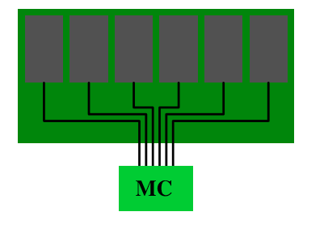
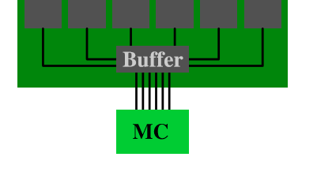

# 附录 C 内存类型

尽管这些并非高效编程所必需的知识，但描述一下现有内存类型更偏技术的一些细节或许仍有裨益。我们在此特别感兴趣的是“寄存式”（registered）与“非寄存式”（unregistered）、以及 ECC 与非 ECC DRAM 类型之间的差异。

“寄存式”与“带缓冲”这两个术语在描述一种在 DRAM 模组上多出一个元件的 DRAM 类型时是同义使用的：该元件就是一个缓冲器。所有 DDR 内存类型都可以有寄存式和非寄存式两种形式。对于非寄存式模组，内存控制器直接与模组上的所有芯片相连。图 C.1 展示了这种结构。

*图 C.1：无缓冲 DRAM 模组*

在电气上这要求很高。内存控制器必须能够应对所有内存芯片的容性负载（图中的芯片不止六个）。如果内存控制器（MC）的能力有限，或者要使用很多内存模组，这种结构就不理想了。

带缓冲（或寄存式）内存改变了这一局面：DRAM 模组上的 RAM 芯片不再直接连到内存，而是连到一个缓冲器，缓冲器再连到内存控制器。这大大降低了电气连接的复杂度。内存控制器驱动 DRAM 模组的能力，按所节省的连接数成比例地提升。

*图 C.2：寄存式 DRAM 模组*

既然有这些优势，问题就是：为什么不是所有的 DRAM 模组都带缓冲？原因有好几个。显然，带缓冲的模组要稍微复杂一些，因而也更贵。不过成本并不是唯一的因素。缓冲器会使来自 RAM 芯片的信号产生一点延迟；该延迟必须足够大，才能确保来自 RAM 芯片的所有信号都被缓冲。结果就是 DRAM 模组的延迟增加。这里值得一提的最后一个因素是，额外的电气元件会增加能耗。由于缓冲器必须以总线的频率工作，这个元件的能耗可能会相当可观。

再加上使用 DDR2 和 DDR3 模组的其他因素，通常不可能让每个 bank 上有多于两个 DRAM 模组。内存控制器的引脚数限制了 bank 的数量（在商用硬件上是两个）。大多数内存控制器能够驱动四个 DRAM 模组，因此非寄存式模组已经够用。在对内存需求很高的服务器环境中，情况可能有所不同。

某些服务器环境的另一个不同之处在于，它们不能容忍错误。由于 RAM 单元中的电容所保持的电荷极其微小，错误是可能发生的。人们常拿宇宙辐射开玩笑，但这确实是可能的。再加上 α 衰变和其他自然现象，它们会导致 RAM 单元的内容由 0 变为 1 或反之的错误。使用的内存越多，这类事件发生的概率就越高。

如果这类错误不可接受，就可以使用 ECC（Error Correction Code，纠错码）DRAM。纠错码使硬件能够识别不正确的单元内容，并在某些情况下纠正错误。早年间，奇偶校验只能识别错误，一旦检测到错误就必须停机。而有了 ECC，少量的出错比特可以被自动纠正。不过，如果错误数量太多，内存访问就无法正确完成，机器仍然会停机。但对于工作正常的 DRAM 模组来说，这是相当少见的情况，因为多个错误必须发生在同一个模组上。

当我们谈到 ECC 内存时，其实说得并不十分准确。执行错误检查的并不是内存，而是内存控制器。DRAM 模组只是提供了更多的存储空间，并把额外的非数据位与真正的数据一起传输。通常，ECC 内存每 8 个数据位多存一个位。为什么用 8 位，稍后会解释。

在向某个内存地址写入数据时，内存控制器会在把数据和 ECC 送上内存总线之前，即时计算新内容的 ECC。读取时，收到数据加 ECC，内存控制器计算数据的 ECC，并与 DRAM 模组传来的 ECC 比较。如果 ECC 相符，一切正常。如果不符，内存控制器会尝试纠正错误。如果无法纠正，错误会被记录，机器可能会停机。

<table>
  <thead>
    <tr>
      <th rowspan="2">数据位 W</th>
      <th colspan="2">SEC</th>
      <th colspan="2">SEC/DED</th>
    </tr>
    <tr>
      <th>纠错码位 E</th>
      <th>开销</th>
      <th>纠错码位 E</th>
      <th>开销</th>
    </tr>
  </thead>
  <tbody>
    <tr><td>4</td><td>3</td><td>75.0%</td><td>4</td><td>100.0%</td></tr>
    <tr><td>8</td><td>4</td><td>50.0%</td><td>5</td><td>62.5%</td></tr>
    <tr><td>16</td><td>5</td><td>31.3%</td><td>6</td><td>37.5%</td></tr>
    <tr><td>32</td><td>6</td><td>18.8%</td><td>7</td><td>21.9%</td></tr>
    <tr><td>64</td><td>7</td><td>10.9%</td><td>8</td><td>12.5%</td></tr>
  </tbody>
</table>

表 C.1：ECC 与数据位的关系

使用的纠错技术有好几种，但对于 DRAM ECC，通常采用汉明码。汉明码最初用于对四个数据位进行编码，能够识别并纠正一个翻转的比特（SEC，Single Error Correction，单比特纠错）。该机制可以很容易地扩展到更多数据位。数据位数 $W$ 与纠错码位数 $E$ 之间的关系由下式描述：

$$E = \left\lceil \log_2(W + E + 1) \right\rceil$$

迭代求解该方程，就得到表 C.1 第二列中的值。再加一个比特，我们就能用一个简单的奇偶校验位识别两个翻转的比特。这称为 SEC/DED，即 Single Error Correction/Double Error Detection（单比特纠错/双比特检错）。有了这个额外的比特，就得到表 C.1 第四列中的值。$W = 64$ 时的开销足够低，而且 (64, 8) 这两个数都是 8 的倍数，因此这是 ECC 的自然选择。在大多数模组上，每个 RAM 芯片产生 8 位，因此任何其他组合都会导致效率较低的方案。

| ECC 码字 | 7 | 6 | 5 | 4 | 3 | 2 | 1 |
|---|---|---|---|---|---|---|---|
| $P_1$ 奇偶校验 | D | – | D | – | D | – | P |
| $P_2$ 奇偶校验 | D | D | – | – | D | P | – |
| $P_4$ 奇偶校验 | D | D | D | P | – | – | – |

表 C.2：汉明生成矩阵的构造

汉明码的计算用一个 $W = 4$、$E = 3$ 的编码来演示很容易。我们在编码字中的一些关键位置上计算奇偶校验位。表 C.2 展示了这一原理。在对应于 2 的幂的比特位置上加入奇偶校验位。第一个奇偶校验位 $P_1$ 的校验和包含每隔一个的比特。第二个奇偶校验位 $P_2$ 的校验和包含数据位 1、3 和 4（此处编码为 3、6 和 7）。类似地可以计算 $P_4$。

奇偶校验位的计算可以用矩阵乘法更优雅地描述。我们构造矩阵 $G = [I|A]$，其中 $I$ 是单位矩阵，$A$ 是可以从表 C.2 确定的奇偶校验生成矩阵。

$$G = \left[\begin{array}{cccc|ccc}
1 & 0 & 0 & 0 & 1 & 1 & 1 \\
0 & 1 & 0 & 0 & 0 & 1 & 1 \\
0 & 0 & 1 & 0 & 1 & 0 & 1 \\
0 & 0 & 0 & 1 & 1 & 1 & 0
\end{array}\right]$$

$A$ 的各列由计算 $P_1$、$P_2$ 和 $P_4$ 时所用到的比特构成。如果现在把每个输入数据项表示为一个 4 维向量 $d$，就可以计算 $r = d \cdot G$，得到一个 7 维向量 $r$。在 ECC DDR 的情况下，存储的就是这些数据。

为了解码数据，我们构造一个新矩阵 $H = [A^{T}|I]$，其中 $A^{T}$ 是计算 $G$ 时所用的奇偶校验生成矩阵的转置。也就是说：

$$H = \left[\begin{array}{ccc|ccc}
1 & 0 & 1 & 1 & 0 & 0 \\
1 & 1 & 0 & 0 & 1 & 0 \\
1 & 1 & 1 & 0 & 0 & 1
\end{array}\right]$$

$H \cdot r$ 的结果表明所存储的数据是否有缺陷。如果不是，乘积就是 3 维向量 $\left(0\ \ 0\ \ 0\right)^{T}$。否则，该乘积的值按数字的二进制表示来解释时，就给出了发生翻转的比特所在的列号。

作为例子，假设 $d = \left(1\ \ 0\ \ 0\ \ 1\right)$。由此得到

$$r = \left(1\ \ 0\ \ 0\ \ 1\ \ 0\ \ 0\ \ 1\right)$$

用与 $H$ 的乘法进行检验，得到

$$s = \begin{pmatrix} 0 \\ 0 \\ 0 \end{pmatrix}$$

现在，假设存储的数据发生了损坏，从内存读回的是 $r' = \left(1\ \ 0\ \ 1\ \ 1\ \ 0\ \ 0\ \ 1\right)$。这种情况下我们得到

$$s' = \begin{pmatrix} 1 \\ 0 \\ 1 \end{pmatrix}$$

该向量不是零向量，按数字解释时 $s'$ 的值为 5。这就是我们在 $r'$ 中翻转的那个比特的编号（比特从 1 开始计数）。内存控制器可以纠正该比特，程序不会察觉到曾经出过问题。

处理 DED 部分那个额外的比特只是稍微复杂一点。付出更多努力，还可以构造出能纠正两个甚至更多翻转比特的码。是否需要这样做，取决于概率与风险。有些内存制造商说，在 256MB 的 RAM 中每 750 小时可能发生一个错误。把内存容量翻倍，这个时间就缩短 75%。当内存足够多时，短时间内遇到错误的概率就可能相当可观，ECC RAM 也就成了必需。这个时间尺度甚至可能小到 SEC/DED 的实现都不够用。

服务器主板不是去实现更强的纠错能力，而是能够在给定的时间跨度内自动读取全部内存。也就是说，无论处理器是否真的请求过这些内存，内存控制器都会读取数据，如果 ECC 校验失败，就把纠正后的数据写回内存。只要在读取并写回全部内存所需的时间段内发生少于两个内存错误的概率可以接受，SEC/DED 纠错就是一个完全合理的方案。

与寄存式 DRAM 一样，必须提出这个问题：为什么 ECC DRAM 不是常态？答案与关于寄存式 RAM 的同类问题相同：多出的 RAM 芯片增加了成本，奇偶校验计算增加了延迟。非寄存式、非 ECC 的内存可以显著更快。由于寄存式和 ECC DRAM 的问题相似，人们通常只能见到寄存式、ECC 的 DRAM，而见不到寄存式、非 ECC 的 DRAM。

还有另一种克服内存错误的方法。有些厂商提供常被错误地称为“内存 RAID”的方案，即把数据冗余地分布到多个 DRAM 模组、或至少多个 RAM 芯片上。具备这一特性的主板可以使用非寄存式 DRAM 模组，但内存总线上增加的流量很可能会抵消 ECC 与非 ECC DRAM 模组在访问时间上的差异。
